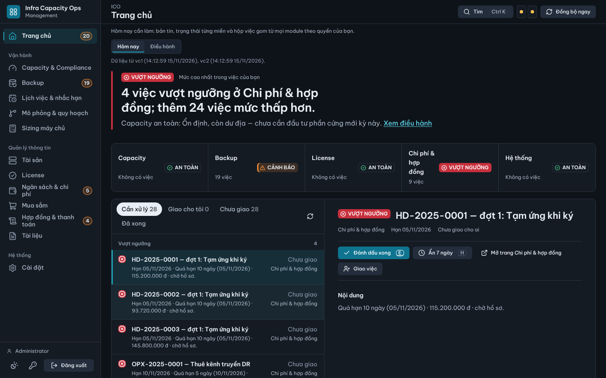
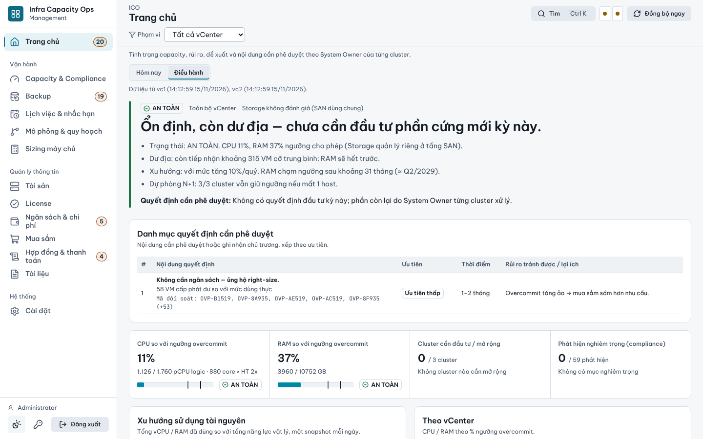
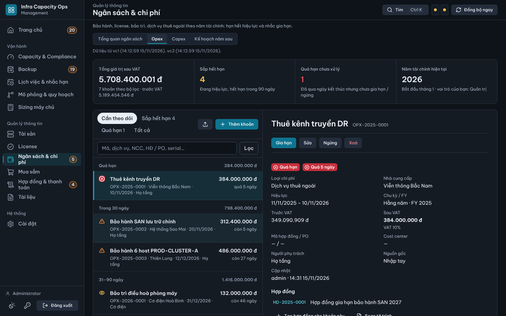
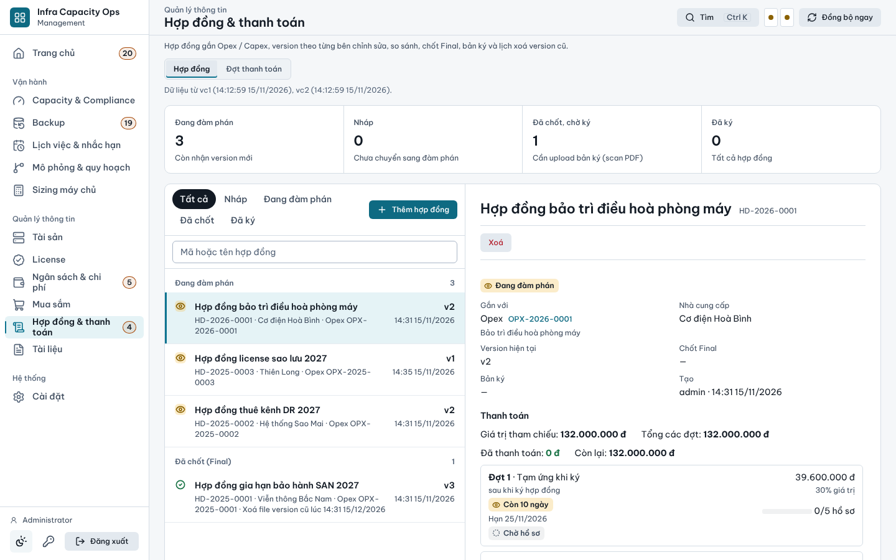

# Infra Capacity Ops Management (ICO)

ICO là ứng dụng nội bộ giúp nhóm hạ tầng theo dõi **capacity / compliance VMware** và **backup Veritas NetBackup**,
đồng thời quản lý **chi phí, mua sắm, hợp đồng IT**. Dữ liệu được đọc **chỉ đọc** từ tối đa 4 vCenter và 4 NetBackup
primary server, lưu lịch sử vào PostgreSQL. App có dashboard, báo cáo PDF / Excel và trợ lý AI tuỳ chọn.

> Hướng dẫn chi tiết từng tính năng và quy trình vận hành: [`docs/huong-dan-chi-tiet.md`](docs/huong-dan-chi-tiet.md).
> Thiết kế: [`docs/design/`](docs/design/). Quy ước code: [`CLAUDE.md`](CLAUDE.md).

## Thành phần chính

Menu chia hai miền, mỗi mục gồm các tab trong trang. Địa chỉ trang có dạng `#/<mục>/<tab>`.

| Miền | Mục | Nội dung |
|---|---|---|
| — | **Trang chủ** | Hộp việc chung của mọi module, lọc theo quyền; bản tin điều hành; tab Điều hành (KPI, xu hướng, quyết định) |
| Vận hành | **Capacity & Compliance** | CPU / RAM / storage theo overcommit, 4 mức AN TOÀN · THEO DÕI · CẢNH BÁO · VƯỢT NGƯỠNG, kiểm tra N+1, phát hiện có mã đối soát, xu hướng snapshot |
| | **Backup** | Job, client & RPO, lịch & tuân thủ, độ phủ VM so với vCenter, storage & policy, phân tích lỗi |
| | **Lịch việc & nhắc hạn** | Mọi mốc có ngày: Opex, license, đợt thanh toán, báo giá |
| | **Mô phỏng & quy hoạch** | What-if capacity (thêm / nâng cấp host, thêm / resize VM), quy hoạch tài nguyên theo kịch bản, what-if license |
| | **Sizing máy chủ** | Sizing từ danh sách VM, so sánh phương án, TCO, PDF / Excel tư vấn |
| Quản lý thông tin | **Tài sản / License** | Inventory host / VM, ESXi & phần cứng, hệ điều hành; đánh giá license và quyền sử dụng |
| | **Ngân sách & chi phí** | Opex có nhắc hạn (email / Discord), Capex, báo cáo ngân sách theo năm tài chính, **kế hoạch năm sau** (tự gợi ý gia hạn + % tăng giá, trần ngân sách, duyệt, theo dõi thực hiện), **nhập Opex / Capex từ file Excel** đang quản lý |
| | **Mua sắm** | Nhà cung cấp, so sánh báo giá (đọc Excel / Word / PDF), cải tạo văn phòng, **Chuẩn hoá BOM** (Dell / Cisco / HPE → một mẫu Excel) |
| | **Hợp đồng & thanh toán** | Hợp đồng có version và so sánh, đợt thanh toán, hồ sơ chứng từ |
| | **Tài liệu** | Tờ trình theo mẫu .docx, Trung tâm báo cáo, Kho báo cáo |
| Hệ thống | **Cài đặt** | Tiêu chí & ngưỡng, nguồn dữ liệu, tính năng bật / tắt, chi phí & nhắc hạn, AI & MCP, người dùng & quyền, đăng nhập & bảo mật, thương hiệu |

Giao diện: **kết luận trước** (một câu + trạng thái), trạng thái 4 mức luôn có biểu tượng + nhãn, và khung **danh sách →
chi tiết** (phím J / K / Enter). Sáng / tối, dùng được trên điện thoại. Cách đọc từng trang:
[hướng dẫn chi tiết — Cách đọc và thao tác](docs/huong-dan-chi-tiet.md#cách-đọc-và-thao-tác-trên-giao-diện).

| Trang chủ (tối) | Điều hành (sáng) |
|---|---|
|  |  |
| **Opex** | **Hợp đồng** |
|  |  |

Tính năng dùng chung trên mọi trang:
- Tìm kiếm **Ctrl + K** và thẻ Host / VM.
- Cảnh báo Discord khi chạm mức 90%.
- Tuỳ chọn người dùng lưu trên server.
- Mọi file xuất (PDF A4, Excel) dùng chung một giao diện.

**AI (tuỳ chọn, tắt mặc định).** Mọi tác vụ AI chạy qua `ai_platform` với hạn mức chi phí và nhật ký `ai_runs`.
Hostname / IP / tên VM được che trước khi gửi đi. Các tác vụ: bản tin, tổng kết báo cáo, phân tích lỗi backup, ánh xạ
cột khi nhập, nhận định sizing, tóm tắt thay đổi hợp đồng, đọc hoá đơn, "Hỏi ICO" (chỉ dùng công cụ đọc).
Riêng **MCP server** (chỉ đọc) cho AI phân tích log và hiệu suất của chính app.

## Kiến trúc

```
Trình duyệt ──HTTPS──▶ (Microsoft Entra App Proxy, tuỳ chọn) ──▶ ico-app :8000
                                                                  ├─ FastAPI: API + frontend tĩnh (cùng port)
                                                                  ├─ Lịch đồng bộ (thread pool) ──▶ vCenter (pyVmomi, chỉ đọc)
                                                                  │                              └▶ NetBackup REST :1556 (GET)
                                                                  ├─ Nhắc hạn hằng ngày ──▶ SMTP / Discord webhook
                                                                  └─ PostgreSQL 16 (lịch sử, cấu hình) + volume /data/files
```

| Thư mục | Nội dung |
|---|---|
| `backend/app/` | FastAPI, SQLAlchemy 2.0. `vcenter/`, `backup/` (thu thập + chế độ DEMO); `capacity.py`, `planning.py`, `sizing*.py`, `licensing/`; `spend/` (chi phí, hợp đồng, báo giá); `bom.py`; `shared/` (đọc xlsx an toàn, AI transport, webhook); `report_*.py` / `excel_*.py`; `routers/` |
| `frontend/` | HTML + vanilla JS, **không build step**. `js/routes.js` là bảng route duy nhất; `js/core.js` là mô hình capacity (khớp `capacity.py`); `js/ui.js` chứa helper dùng chung; `js/views/*.js` là các trang (Chi phí, BOM nạp khi mở trang); `vendor/` có Chart.js, lucide (ghim phiên bản, không dùng CDN) |
| `k8s/` | Manifest Rancher / RKE (ConfigMap, Secret mẫu, Postgres, app, PVC file) |
| `.github/workflows/` | `tests.yml` (pytest); `build-push.yml` (build image lên GHCR khi push `main`) |

Schema DB tự cập nhật khi app khởi động (`ensure_schema`, chỉ thêm cột), không có bước migrate riêng.

## Chạy thử nhanh (Docker Compose)

```bash
cp .env.example .env
```

Sửa `.env`: `POSTGRES_PASSWORD`, `JWT_SECRET`, `SECRETS_KEY` (`openssl rand -hex 32`), `ADMIN_PASSWORD`. Muốn chạy không cần
hạ tầng thật thì đặt `VCENTER_1_HOST=demo`, `VCENTER_1_DEMO=true`, `NETBACKUP_1_HOST=demo`, `NETBACKUP_1_DEMO=true`.

```bash
docker compose up -d --build
```

Mở `http://<máy>:8000`, đăng nhập `admin`, bấm **Đồng bộ ngay**. Tạo thêm user cục bộ có mật khẩu bằng lệnh sau
(tài khoản passkey tạo ở Cài đặt → Người dùng & quyền):

```bash
docker compose exec app python -m app.seed --username <user> --password '<pass>' --display-name "Tên"
```

Chạy test backend (dùng SQLite tạm và NetBackup DEMO):

```bash
cd backend && pip install -r requirements.txt pytest httpx && python -m pytest tests -q
```

## Nguồn dữ liệu (chỉ đọc)

Khai báo ở **Cài đặt → Nguồn dữ liệu** (admin) hoặc bằng biến `VCENTER_i_*` / `NETBACKUP_i_*` (i = 1…4).
- Mật khẩu / API key được mã hoá bằng `SECRETS_KEY`, không bao giờ trả về trình duyệt.
- Có nút **Kiểm tra kết nối**.
- Mọi nguồn đều có chế độ **DEMO**.

- **vCenter**: tạo một user dịch vụ (vd `infra.mon@vsphere.local`). Gán role **Read-Only** ở *Global Permissions*, tick
  *Propagate to children*, làm trên từng vCenter. App chỉ đọc host / cluster / VM / datastore theo lô bằng
  PropertyCollector. Có biến `VCENTER_i_VERIFY_SSL` để bật / tắt kiểm tra chứng chỉ.
- **NetBackup 9.x / 10.x**:
  - Tạo một user dịch vụ, gán RBAC role chỉ có quyền **View** cho *Jobs, Policies, Storage*.
  - Xác thực bằng API key (`NETBACKUP_i_API_KEY`) hoặc user / mật khẩu (`DOMAIN_TYPE`, `DOMAIN_NAME`).
  - Mở firewall từ app tới primary cổng **1556/TCP**.
  - TLS: đặt `NETBACKUP_i_VERIFY_SSL=true` và lấy CA bằng lệnh dưới. `NETBACKUP_i_HOST` phải là FQDN trùng tên trong
    chứng chỉ. Gặp lỗi 406 thì chỉnh `NETBACKUP_i_API_VERSION`.

    ```bash
    ./k8s/nbu-ca.sh <nbu-host> <namespace>
    ```

Lịch đồng bộ: `POLL_INTERVAL_MINUTES` (mặc định 60 phút). Mỗi lần đồng bộ tạo một snapshot, dùng cho xu hướng và dự báo.
Chỉ số idle / tắt máy của VM chính xác dần sau vài chu kỳ.

## Triển khai Kubernetes (Rancher / RKE)

Image `ghcr.io/luongminhphu/infra-capacity-ops-management-app:latest` được build khi merge vào `main`.
Namespace hiện tại: `cattle-monitoring-system`.

| File | Nội dung |
|---|---|
| `01-configmap.yaml` | `ico-config`: biến không nhạy cảm (polling, nguồn, Entra, `PUBLIC_URL`, `MCP_ENABLED`…) |
| `02-secret.example.yaml` | Mẫu `ico-secrets` (Postgres, JWT, `SECRETS_KEY`, admin, mật khẩu nguồn, Entra secret). Bản thật `02-secret.yaml` không commit |
| `03-postgres.yaml` | StatefulSet `ico-postgres`, PVC 20Gi, StorageClass `longhorn` |
| `04-app.yaml` | Deployment `ico-app` (**giữ `replicas: 1`**: lịch đồng bộ chạy trong tiến trình), Service NodePort `30080`, mount CA NetBackup |
| `05-files-pvc.yaml` | PVC `/data/files` cho file đính kèm (hợp đồng, báo giá, chứng từ) |

**Lần đầu:**

```bash
cp k8s/02-secret.example.yaml k8s/02-secret.yaml
```

Điền Secret. `DATABASE_URL` phải khớp với `POSTGRES_*`. Kiểm tra ConfigMap rồi áp dụng:

```bash
kubectl apply -k k8s/
```

**Cập nhật phiên bản**: merge vào `main` → đợi workflow *Build and push image* chạy xong → backup DB → restart.

```bash
NS=cattle-monitoring-system
```

```bash
kubectl -n $NS exec sts/ico-postgres -- sh -c 'pg_dumpall -U "$POSTGRES_USER"' > ~/ico-db-backup-$(date +%F).sql
```

```bash
kubectl -n $NS rollout restart deploy/ico-app && kubectl -n $NS rollout status deploy/ico-app
```

Lưu ý khi vận hành:
- Sửa ConfigMap / Secret xong phải `rollout restart`.
- Không gỡ Rancher Monitoring khi chưa backup DB, vì app đang nằm trong namespace của nó.

Rollback, khôi phục DB, chuyển namespace, pull secret GHCR, đổi mật khẩu NetBackup: xem
[hướng dẫn chi tiết](docs/huong-dan-chi-tiet.md#triển-khai-trên-kubernetes-rancher--rke).

## Đăng nhập: Entra ID SSO, Passkey, App Proxy

| Người dùng | Cách đăng nhập | Cấu hình |
|---|---|---|
| Nhân viên | **Microsoft Entra ID** (OIDC + PKCE, MFA bằng Conditional Access) | `AUTH_MODE=entra` hoặc `both`, `ENTRA_TENANT_ID`, `ENTRA_CLIENT_ID`, `ENTRA_CLIENT_SECRET` |
| Tài khoản cục bộ | **Passkey** (Face ID / Touch ID trên iPhone, Windows Hello), không mật khẩu, cấp bằng link mời một lần | `AUTH_LOCAL_METHOD=passkey`; tạo ở Cài đặt → Người dùng & quyền |
| Khẩn cấp | Mật khẩu (`AUTH_BREAKGLASS_USERS`) khi Entra / App Proxy gặp sự cố | luôn giữ |

**Chạy sau Microsoft Entra Application Proxy** (không mở app ra Internet; connector chỉ cần đi ra cổng 443):
1. Tạo *On-premises application*: Internal URL = `http://<node>:30080/`; *Backend timeout* = **Long**;
   *Translate URLs in body* = tắt.
2. Đặt `PUBLIC_URL` = External URL. Biến này quyết định redirect URI (`PUBLIC_URL/api/auth/oidc/callback`), tên miền
   passkey, link mời và cookie `Secure`. Đặt **trước** khi người dùng tạo passkey.
3. `FORWARDED_ALLOW_IPS` = IP connector / ingress.
4. Chọn *Pre-authentication*:
   - **Entra ID** nếu mọi người dùng là tài khoản công ty (thêm `ENTRA_AUTO_REDIRECT=true`);
   - **Passthrough** nếu còn tài khoản passkey cục bộ.

Quyền:
- Admin: `ADMIN_USERS` (tài khoản cục bộ) hoặc app role `ICO.Admin`.
- Vai trò Chi phí: app role `ICO.Spend.*`, hoặc gán ở Cài đặt → Người dùng & quyền.

Trang **Cài đặt → Đăng nhập & bảo mật** kiểm tra cấu hình và chỉ ra chỗ còn thiếu.

## Bảo mật

- vCenter / NetBackup **chỉ đọc**: quyền tối thiểu, app không gọi API thay đổi hạ tầng.
- Cookie phiên `httpOnly` (JWT). Thao tác nhạy cảm đòi xác thực lại (step-up). Mọi thay đổi số tiền, hợp đồng, file,
  tài khoản được ghi `audit_log`.
- Secret (mật khẩu nguồn, SMTP, webhook, API key AI) được mã hoá bằng `SECRETS_KEY` và không trả về API. Không commit
  `.env`, `k8s/02-secret.yaml`, chứng chỉ thật.
- File upload được kiểm tra theo nội dung; file .xlsx có chống zip-bomb. Mọi dữ liệu ngoài được escape khi đưa vào
  HTML / PDF / Discord.
- AI và MCP tắt mặc định. Khi bật, dữ liệu gửi đi được che tên và có hạn mức; MCP chỉ đọc, dùng token cá nhân có hạn.
