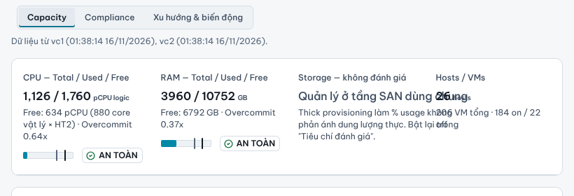

# Kiểm chứng design system web — vòng 2 (16/11/2026)

Vòng 1 chọn bảng màu “Phòng máy”, font, mật độ **theo quy tắc mặc định** của `ui-ux-pro-max` vì bản skill lúc đó thiếu
`scripts/search.py`. Tài liệu này kiểm chứng lại bằng dữ liệu tra cứu thật của skill (bản đầy đủ trong
`.claude/skills/ui-ux-pro-max/`, `validate_data.py`: *OK: validated 12 domain files, 22 stack files, and ui-reasoning.csv*)
và đo trên app chạy chế độ DEMO (nhánh `main` tại `0e3ee71`).

**Kết luận:** giữ hướng thiết kế. Dữ liệu tra cứu ủng hộ phong cách (Swiss + dày dữ liệu), nền tối trung tính, màu trạng
thái và font Be Vietnam Pro. Có **6 chỗ cần chỉnh**:
- 3 chỗ đo được dưới chuẩn: viền ô nhập < 3 : 1; chữ ô nhập 14 px trên điện thoại; vùng chạm < 44 px trên điện thoại.
- 1 lỗi bố cục: chữ KPI đè nhau ở Capacity, khổ 820 / 390 px.
- 2 quy tắc MASTER đã ghi nhưng chưa làm: biểu đồ thiếu “Xem bảng”; series phân biệt chỉ bằng màu.

Không đề xuất đổi màu nền, màu nhấn hay font.

## 1. Lệnh tra cứu đã chạy

Mỗi kết quả đã được kiểm độ phù hợp. Mẫu dành cho landing page (hero, testimonials, CTA “Start trial”, GSAP scroll reveal)
bị loại vì ICO là ứng dụng nội bộ.

| # | Lệnh | Kết quả chính | Dùng / loại |
|---|---|---|---|
| Q1 | `search.py "IT operations monitoring dashboard" --design-system --density 8 --motion 3 --variance 4 -f markdown` | Style **Glassmorphism**; màu nền `#0F172A`, chữ `#F8FAFC`, chữ mờ `#94A3B8`, nhấn **xanh lá `#22C55E`**; font Fira Code + Fira Sans; pattern “Real-Time / Operations **Landing**”; motion GSAP scroll reveal 300–400 ms | Dùng phần màu nền / chữ. **Loại**: pattern landing, Glassmorphism (skill: blur chỉ để báo lớp nền bị che, `blur-purpose`), GSAP (không có thư viện; MASTER chỉ cho chuyển động khi thao tác) |
| Q2 | `… "enterprise capacity planning analytics" --design-system --density 8 --motion 2 --variance 3` | Màu **hồng lãng mạn + vàng kim**, font Great Vibes / Cormorant | **Loại cả kết quả** (lệch bối cảnh). Viết lại một lần → Q2b |
| Q2b | `… "capacity planning admin dashboard" --design-system --density 8 --motion 2 --variance 3` | Style **Minimalism & Swiss**; màu như Q1; font Fira Code + Fira Sans | Dùng phong cách + màu nền |
| Q3 | `… "internal finance contract tracker" --design-system --density 8 --motion 2 --variance 3` | Swiss; nền `#0F172A`, primary xanh tin cậy `#1E40AF`, nhấn xanh lá `#059669`; font Lexend + Source Sans 3; pattern “Product Demo + Features” | Dùng màu nền. Loại pattern (marketing) |
| Q4 | `--persist -p ICO-r2-scratch --output-dir <thư mục nháp>` (không đụng `design-system/ico/`) | Thang khoảng cách mật độ 8: 2 · 4 · 8 · 12 · 16 · 24 · 32 px; bóng 4 mức; bo 8 / 12 / 16 | Tham chiếu mật độ |
| Q5 | `--domain product`: “internal admin dashboard”, “financial dashboard”, “devops monitoring dashboard” (“IT infrastructure monitoring” trống → viết lại) | Analytics: *Data-Dense Dashboard*, phụ *Swiss* + *Dark Mode*; Financial: *Dark Mode + Data-Dense*, “red/green alerts + trust blue”; Status page: “status green + incident red + maintenance amber + neutral dark” | Dùng |
| Q6 | `--domain style`: “data-dense dashboard”, “dark mode OLED” | Data-dense: padding 8–12 px, chữ 12–14 px, hàng bảng 36 px, sidebar 240 px, header 56 px, tiêu đề bảng dính. OLED: đen tuyền `#000`, glow neon, *light mode not-recommended* | Dùng Data-dense. **Loại OLED** (ICO cần cả light) |
| Q7 | `--domain color`: “dark operations dashboard”, “status page incident”, “enterprise analytics” | Nền `#020617`, chữ mờ `#94A3B8`, viền `#334155`, nhấn xanh lá; status page: xanh lá vận hành / đỏ sự cố / hổ phách bảo trì | Dùng |
| Q8 | `--domain typography`: “dashboard data technical”, “vietnamese readable” | *Dashboard Data* = Fira Code + Fira Sans; ***Vietnamese Friendly* = Be Vietnam Pro + Noto Sans** (“excellent Vietnamese support”) | Dùng Q8-b |
| Q9 | `--domain google-fonts`, lọc đúng tên họ (lần đầu trả nhầm họ như “Fira Mono”, “Lexend Exa” → tra lại `-n 12`) | subset `vietnamese`: **Be Vietnam Pro ✓, JetBrains Mono ✓, Inter ✓**, Fira Sans ✓, IBM Plex Sans ✓, Lexend ✓, Source Sans 3 ✓; **Fira Code ✗** (không có vietnamese); Noto Sans: không có kết quả đúng họ | Loại Fira Code cho chữ giao diện |
| Q10 | `--domain chart`: “time series forecast”, “KPI target progress”, “part to whole composition”, “compare categories bar”, “many series small multiples” | Forecast: đường thực tế liền + dự báo **nét đứt** + dải tin cậy; KPI: **bullet chart** khi ≥ 3 KPI; nhiều series: **khác màu + khác kiểu nét + nhãn trực tiếp**; mọi biểu đồ: **bảng dữ liệu thay thế** | Dùng |
| Q11 | `--domain ux` (18 truy vấn, 1 ý / truy vấn): duration timing, reduced motion, touch target, sticky header, empty state, skeleton, tabular numbers, line height, dark contrast, focus not obscured, dragging, error recovery, toast, destructive confirm, font scale, keyboard, chart table | Ví dụ: *Duration*: dùng token chung, “không coi 150–300 ms là chuẩn chung”; *Touch*: web theo WCAG 2.5.8 (24 px), 44 pt cho chạm iOS; *Line height* 1,5–1,75; *Focus not obscured (Enhanced)* là AAA | Dùng |

Tham chiếu thêm: `references/quick-reference.md` (120 quy tắc). `references/pro-rules.md` tự ghi là dành cho **app native / mobile**. Với web, chỉ dùng các dòng áp được: icon, tương phản, trạng thái, khoảng cách, focus.

## 2. Đối chiếu từng quyết định của MASTER.md

Tỉ lệ tương phản đo bằng công thức WCAG trên token thật trong `frontend/css/styles.css`. Ghi theo thứ tự nền app / bề mặt / bề mặt 2 / nổi.

| Quyết định (MASTER) | Hiện tại | Kết quả tra cứu | Đề xuất | Lý do | Tương phản dark | Tương phản light |
|---|---|---|---|---|---|---|
| Phong cách | Swiss tối giản, dày dữ liệu, khung danh sách → chi tiết | Q2b, Q3: Minimalism & Swiss; Q5, Q6: Data-Dense Dashboard | **Giữ** | Trùng khớp. Glassmorphism (Q1) bị loại: blur làm giảm tương phản chữ trên dữ liệu dày | — | — |
| Nền / bề mặt | dark `#0E1319` `#151B23` `#1B2330` `#232D3B`; light `#F5F7F9` `#FFFFFF` `#EEF2F5` `#E3E9EF` | Q1, Q7: slate `#0F172A` / `#020617`; Q6: không dùng OLED đen tuyền | **Giữ** | Cùng họ graphite lạnh, khác ΔE nhỏ. Đổi sang slate không thêm lợi ích đo được | — | — |
| Chữ chính | `#E8EEF5` / `#121A24` | Q1: `#F8FAFC` | **Giữ** | | 15,97 / 14,82 / 13,52 / 11,91 | 16,31 / 17,52 / 15,56 / 14,32 |
| Chữ phụ | `#A9B6C6` / `#3E4C5E` | — | **Giữ** | | 9,05 / 8,40 / 7,67 / 6,75 | 8,15 / 8,75 / 7,77 / 7,15 |
| Chữ mờ | `#8C9AAC` / `#566579` | Q1, Q7: `#94A3B8` (≈ 6,9 trên `#0F172A`) | **Giữ** | Đạt AA trên mọi bề mặt | 6,51 / 6,05 / 5,51 / **4,86** | 5,53 / 5,94 / 5,28 / **4,86** |
| Nhấn / link | cyan `#1FA3BA`; chữ link `#5CD0E4` / `#0E6A82`; nút `#0E7490` / `#0E6A82` | Q1, Q2b, Q7: nhấn **xanh lá `#22C55E`**; Q3: xanh tin cậy `#1E40AF` | **Giữ** | Xanh lá là màu **AN TOÀN**: dùng làm nhấn sẽ trùng nghĩa trạng thái (quy tắc `color-not-decorative-only`). Cyan không trùng màu trạng thái nào | link 10,30 / 9,56 / 8,72 / 7,68; chữ trắng trên nút 5,36 | link 5,75 / 6,17 / 5,48 / 5,05; chữ trắng trên nút 6,17 |
| Màu trạng thái | lục / hổ phách / cam / đỏ khối đặc + glyph + nhãn | Q5, Q7: “status green + incident red + maintenance amber”; Q11: không dùng màu một mình | **Giữ** | Trùng khớp; glyph + nhãn đã có | ok 8,42…6,28; warn 11,11…8,29; bad 7,62…5,68; chữ trắng trên khối đỏ 5,36 | ok 5,46…4,79; warn 5,16…4,53; bad 5,36…4,71; trắng trên đỏ 6,51 |
| Chữ màu đỏ `--crit` (dark) | `#EF4E5A` | Q11 *Contrast Readability*: chữ thường ≥ 4,5 | **Chỉnh** → `#F26B75` | Trên bề mặt nổi chỉ 3,91. Hiện chỉ dùng cho số ≥ 18 px (đạt 3 : 1), nhưng dễ bị dùng cho chữ nhỏ | 5,25 / 4,87 / 4,44 / **3,91** → 6,34 / 5,88 / 5,37 / 4,73 | đạt (6,07…5,33) |
| **Viền ô nhập** `--field-border` | dark `#3D4A5C`, light `#A9B6C6` | quick-reference `color-accessible-pairs`; pro-rules *Icon Contrast*: viền control ≥ 3 : 1 (WCAG 1.4.11) | **Chỉnh** → dark `#66768B`, light `#768396` | Đo trên app: **66 / 72** màn hình có ô nhập viền < 3 : 1 (1,75–2,07) | 2,07 / 1,92 / 1,75 / 1,54 → 4,02 / 3,73 / 3,41 / 3,00 | 1,92 / 2,06 / 1,83 / 1,68 → 3,58 / 3,85 / 3,42 / 3,15 |
| Font chữ | Be Vietnam Pro 400–700, tự host | Q8-b: *Vietnamese Friendly* = Be Vietnam Pro; Q9: có subset vietnamese. Q1/Q2b đề xuất Fira Code + Fira Sans, nhưng **Fira Code không có subset vietnamese** | **Giữ** | Chỉ có Be Vietnam Pro vừa được skill gợi ý cho tiếng Việt vừa có subset; đổi font gây giật chữ, không có lợi ích đo được | — | — |
| Font mã | JetBrains Mono | Q9: có subset vietnamese | **Giữ** | | — | — |
| Thang chữ | 12 · 13 · 14 (thân) · 16 · 18 · 20 · 22 · 28; thân 14 / 22 (1,57) | Q6: chữ 12–14 px cho dữ liệu dày; Q11: line-height 1,5–1,75, thang nhất quán; quick-reference `readable-font-size`: ô nhập ≥ 16 px trên mobile (tránh iOS tự phóng to) | **Giữ** desktop; **Chỉnh** ô nhập 16 px dưới 640 px | Đo: ô nhập 14 px ở 390 px trên **11 / 12** nhóm trang | — | — |
| Khoảng cách / mật độ | 4 · 8 · 12 · 16 · 24 · 32 · 48 · 64; hàng bảng 32 px, chữ bảng 12 px; sidebar 240, topbar 56 | Q4 mật độ 8: 2 · 4 · 8 · 12 · 16 · 24 · 32; Q6: padding 8–12, hàng bảng 36, sidebar 240, header 56 | **Giữ** | Sidebar, topbar khớp. Bảng 32 px dày hơn 36 px một chút nhưng chữ 12 px vẫn ≥ ngưỡng 12; khác biệt không đáng kể | — | — |
| Control / vùng chạm | 36 px; MASTER ghi 44 px cho mục chạm chính < 1024 px | Q11: web theo WCAG 2.5.8 (≥ 24 px, **đạt 100 %**); 44 pt là chuẩn chạm | **Chỉnh** (thực thi đúng MASTER) | Đo ở 390 px: phần lớn nút / dòng < 44 px (vd Trang chủ 32 / 66, Opex 33 / 40, Capacity 24 / 24) — quy tắc 44 px của MASTER chưa được áp | — | — |
| Bo góc, đổ bóng | 6 · 10 · 14; bóng nhẹ | Q4: 8 / 12 / 16, 4 mức bóng | **Giữ** | Khác biệt không đáng kể | — | — |
| Chuyển động | 120 / 160 / 220 ms, `cubic-bezier(.2,0,0,1)`, tôn trọng reduced-motion | Q11 *Duration*: token chung, không cứng 150–300 ms; Q1: GSAP scroll reveal | **Giữ**; loại GSAP | Đo: reduced-motion → transition tối đa 0,001 s | — | — |
| Icon | lucide (SVG) | Q11 / pro-rules: SVG, không emoji, **kích thước theo token** | **Chỉnh nhỏ** | Đo: 5 cỡ icon 12 / 14 / 16 / 20 / 28 px → gom về 3 token (14 trong pill, 16, 20) | — | — |
| Biểu đồ — màu series | cyan / tím / hồng + xám, không dùng màu trạng thái | Q10: nhiều series → khác màu **và khác kiểu nét**, nhãn trực tiếp | **Chỉnh nhỏ** | Hiện chỉ khác màu (đường ngưỡng đã có nét đứt) | s1 6,22…4,64; s2 4,88…3,64; s3 5,27…3,93 (≥ 3 : 1 cho đồ hoạ) | s1 3,81…3,35; s2 4,71…4,14; s3 4,29…3,76 |
| Biểu đồ — bảng thay thế | MASTER §8: “luôn có Xem bảng” | Q10: mọi loại biểu đồ có *A11y Fallback* = bảng dữ liệu | **Chỉnh** (thực thi) | Grep `frontend/js`: **0** nút “Xem bảng” | — | — |
| Biểu đồ — KPI | dải KPI có bullet (vạch 80 / 100 %) | Q10: KPI vs mục tiêu → **bullet chart** khi ≥ 3 KPI | **Giữ** | Trùng khớp | — | — |
| Biểu đồ — dự báo | đường xu hướng + ngưỡng nét đứt | Q10: thực tế liền, dự báo nét đứt, dải tin cậy, tầm dự báo ≤ 30 % trục X | **Giữ**; ghi chú khi vẽ dự báo dạng đường | Dự báo hiện là thẻ chữ + “còn bao lâu”, chưa vẽ đường dự báo | — | — |

Đề xuất thay đổi MASTER.md (§2, §4, §5, §7, §8) **chỉ ghi sau khi được duyệt**.

## 3. Chấm điểm lại (1 = kém, 5 = tốt)

Cột theo 10 nhóm ưu tiên của skill: 1 Truy cập · 2 Chạm & tương tác · 3 Hiệu năng · 4 Phong cách · 5 Bố cục & responsive ·
6 Chữ & màu · 7 Chuyển động · 8 Form & phản hồi · 9 Điều hướng · 10 Biểu đồ. Mỗi ô ghi **vòng 2** (vòng 1 trong ngoặc).
Điểm vòng 1 lấy từ `README.md` §2.

| Nhóm trang | 1 | 2 | 3 | 4 | 5 | 6 | 7 | 8 | 9 | 10 | Còn nghẽn |
|---|---|---|---|---|---|---|---|---|---|---|---|
| Trang chủ | 4 (2) | 4 (2) | 4 (3) | 4 (3) | 4 (3) | 4 (3) | 4 (3) | 4 (3) | 4 (4) | — | Chạm < 44 px trên điện thoại; tóm tắt 5 miền: “Chi phí & hợp đồng” xuống 3 dòng cạnh pill |
| Điều hành | 3 (2) | 3 (2) | 4 (3) | 4 (2) | 3 (3) | 4 (2) | 4 (3) | — | 4 (3) | 3 (2) | Biểu đồ thiếu “Xem bảng”; bảng quyết định cuộn ngang ở 390 px; phạm vi chiếm 1 hàng |
| Capacity | 3 (2) | 3 (2) | 4 (3) | 4 (2) | **2** (2) | 3 (2) | 4 (3) | 4 (3) | 4 (3) | 4 (2) | **Chữ KPI đè nhau ở 820 / 390 px**; 3 ô phạm vi xếp 3 hàng ở 390 px; nhãn Anh (“Total / Used / Free”, “Free:”, “Hosts / VMs”) |
| What-if | 3 (2) | 3 (2) | 4 (3) | 3 (3) | 3 (3) | 3 (3) | 4 (3) | 3 (2) | 4 (3) | 3 (3) | 8 thẻ kịch bản vẫn đứng trước form; nhãn Anh (“Peak season”, “DR drill”, “Resize VM”, “Decommission”) |
| Compliance | 4 (—) | 4 (—) | 3 (—) | 4 (—) | 3 (—) | 3 (—) | 4 (—) | 4 (—) | 4 (—) | — | Danh sách → chi tiết tốt; “Findings”, “over-provision” còn tiếng Anh (32 chỗ “Findings” trong frontend); 3 ô phạm vi ở 390 px |
| Backup | 3 (2) | 3 (2) | 4 (3) | 4 (2) | 4 (3) | 4 (2) | 4 (3) | 4 (3) | 4 (4) | 4 (1) | Một trục Y mỗi biểu đồ ✓; thiếu “Xem bảng”; tab trang bị cắt ở 390 px không có dấu cuộn |
| License | 3 (2) | 3 (2) | 4 (3) | 4 (3) | 3 (2) | 4 (3) | 4 (3) | 3 (3) | 4 (3) | — | Bảng nhu cầu nhiều cột cuộn ngang; form entitlement viền ô nhập mờ |
| Chi phí & Hợp đồng | 4 (2) | 4 (2) | 4 (3) | 4 (3) | 4 (3) | 4 (3) | 4 (3) | 4 (2) | 4 (3) | — | Capex, Nhà cung cấp, Tờ trình chưa theo khuôn danh sách → chi tiết; chưa thao tác hàng loạt |
| BOM | 4 (2) | 3 (2) | 4 (3) | 4 (3) | 4 (3) | 4 (3) | 4 (3) | 3 (2) | 4 (3) | — | Form viền mờ; ô nhập 14 px trên điện thoại |
| Cài đặt | 3 (2) | 3 (2) | 4 (3) | 4 (3) | 4 (2) | 4 (3) | 4 (3) | 3 (3) | 4 (2) | — | Nhiều form → ảnh hưởng nhất bởi viền ô nhập < 3 : 1; nút Lưu vẫn xa trường vừa sửa |
| Kho báo cáo | 3 (—) | 3 (—) | 4 (—) | 4 (—) | 3 (—) | 4 (—) | 4 (—) | 4 (—) | 4 (—) | — | Bảng 6 cột ở 390 px bị cắt (cuộn trong khung); trạng thái rỗng chỉ có câu, chưa có hành động |

Tiến bộ lớn nhất so với vòng 1:
- **Truy cập:** chữ mờ từ 2,57 lên ≥ 4,86; focus thấy được ở 100 % điểm dừng (đã thử 25 lần Tab trên 3 trang); `prefers-reduced-motion` có tác dụng; ô nhập có nhãn; tiêu đề không nhảy bậc.
- **Phong cách:** hết màu neon cho số và series.
- **Biểu đồ:** Backup từ 1 lên 4 nhờ bỏ hai trục Y.

Điểm thấp nhất còn lại:
- **Bố cục Capacity (2):** do lỗi đè chữ.
- **Truy cập (3):** ở các trang nhiều form, do viền ô nhập.

## 4. Kết quả checklist (`pro-rules.md` + `quick-reference.md`, phần áp dụng cho web)

Chạy bằng `r2/check.js` (Playwright) trên 12 trang × dark / light × 1440 / 820 / 390 px. Tổng 72 lần đo.

| Hạng mục | Kết quả | Bằng chứng |
|---|---|---|
| Không cuộn ngang trang | **Đạt** 72 / 72 | `hscroll = []` |
| Lỗi JavaScript | **Đạt**: 0 lỗi ở cả 6 tổ hợp theme × khổ | `errors\|…` rỗng |
| Focus thấy được (Tab) | **Đạt**: 25 / 25 Trang chủ, 24 / 24 Opex, 25 / 25 Compliance | outline hoặc box-shadow trên phần tử đang focus |
| Ctrl + K | **Đạt**: focus vào ô tìm trong hộp thoại | `INPUT in dialog=true` |
| `prefers-reduced-motion` | **Đạt**: transition tối đa 0,001 s | |
| Vùng chạm ≥ 24 px (WCAG 2.5.8) | **Đạt** 72 / 72 | |
| Vùng chạm ≥ 44 px ở 390 px (MASTER §5) | **Chưa đạt** | vd Trang chủ 32 / 66, Compliance 24 / 83, Opex 33 / 40, License 44 / 44, Capacity 24 / 24 nút dưới 44 px |
| Viền control ≥ 3 : 1 (WCAG 1.4.11) | **Chưa đạt** 66 / 72 | 1,75–2,07 : 1 |
| Ô nhập ≥ 16 px trên mobile | **Chưa đạt** 11 / 12 nhóm trang | 14 px |
| Icon theo token kích thước | **Chưa đạt** | 5 cỡ: 12 / 14 / 16 / 20 / 28 |
| Bố cục không đè chữ | **Chưa đạt**: Capacity ở 820 / 390 | `bug-capacity-kpi-820.png` |
| Tương phản chữ ≥ 4,5 : 1 | **Đạt** (trừ `--crit` dark trên bề mặt nổi 3,91, chỉ dùng cho số lớn) | bảng §2 |
| Biểu đồ có bảng thay thế | **Chưa đạt** | 0 nút “Xem bảng” |
| Không emoji làm icon | **Đạt** | lucide SVG |

Ảnh bằng chứng (thư mục `validation-2026-11-16/`):
- `sheet-dark-1440.jpg`, `sheet-light-1440.jpg`, `sheet-light-820.jpg`, `sheet-dark-390.jpg`: 12 trang mỗi tổ hợp.
- `bug-capacity-kpi-820.png`: lỗi chữ KPI đè nhau.
- `capacity-dark-390.png`: phạm vi chiếm 3 hàng trên điện thoại.

## 5. Viết chữ trên giao diện (`ux-writing`)

- **Còn trộn Anh – Việt** ở nhãn (vi phạm MASTER §10), đếm trong `frontend/`:
  - “Findings” 32 chỗ; “over-provision” 5; “Overcommit ratio” 5; “Decommission” 4;
  - “Total / Used / Free”, “Free:”, “Hosts / VMs”;
  - tên kịch bản What-if: “Peak season”, “DR drill”, “Cost optimization”, “Expansion plan”, “Upgrade host”, “Resize VM”.

  Đề xuất dịch, giữ thuật ngữ kỹ thuật quen dùng (vCPU, overcommit, VM, host) khi chúng là tên chỉ số.
- **Dòng “Dữ liệu từ vc1 (…), vc2 (…)”** lặp ở mọi trang và xuống 2 dòng trên điện thoại. Nên thu thành một dòng meta ngắn (“Cập nhật 01:38”), chi tiết hiện khi rê / bấm.

## 6. Ngoài phạm vi (không đổi)

- Báo cáo PDF / Excel giữ HSC Design System. Chỉ áp quy tắc biểu đồ (bảng thay thế đã có sẵn trong PDF dưới dạng bảng số).
- Không chạy `--persist` / `--force` lên `design-system/ico/MASTER.md`.
