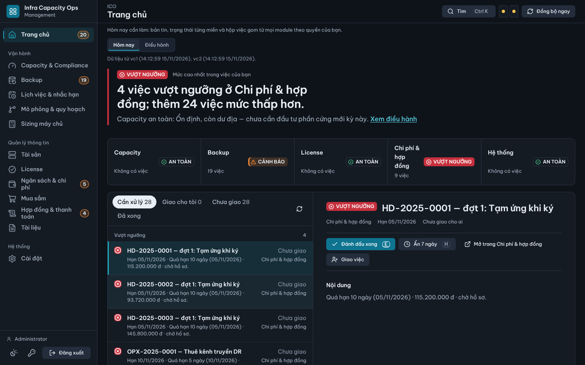
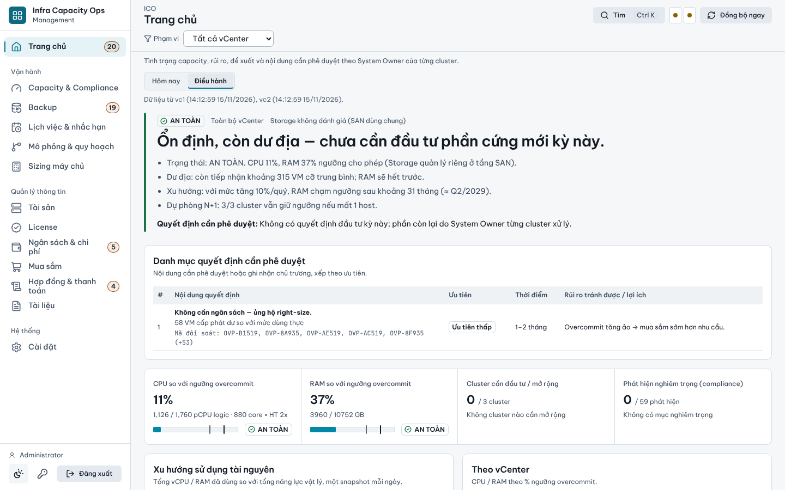
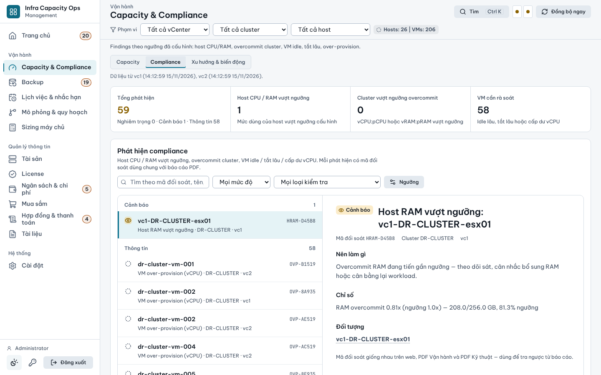
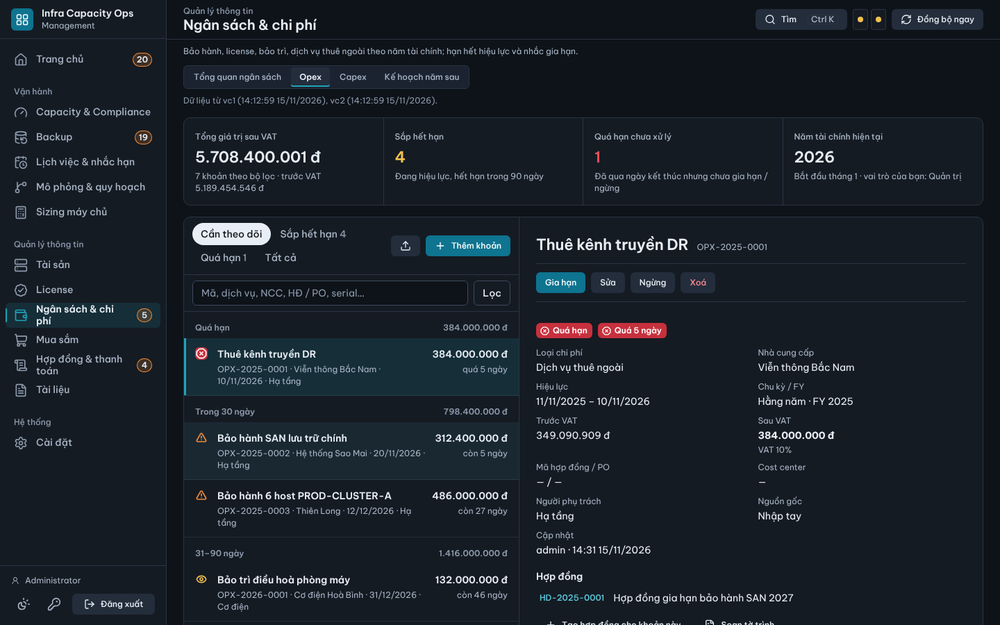
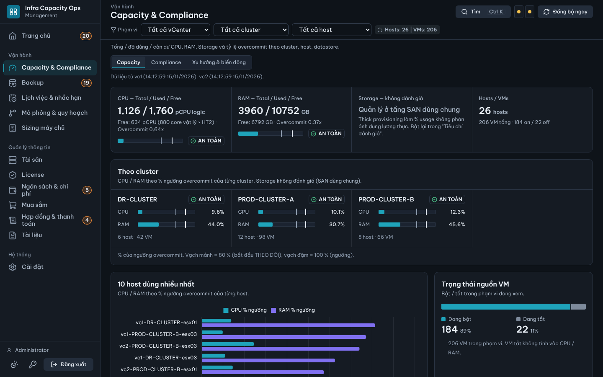
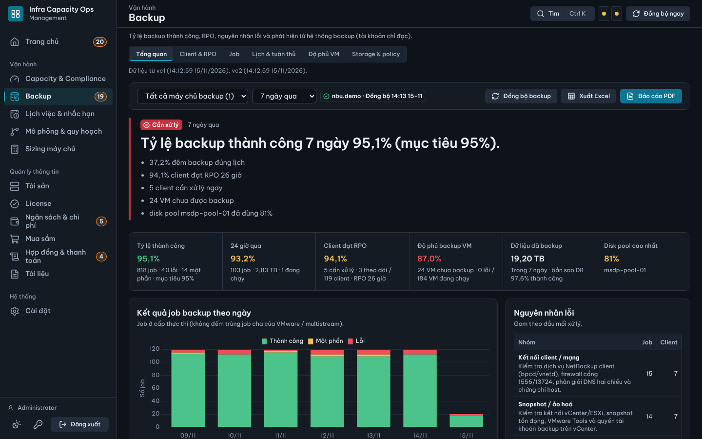
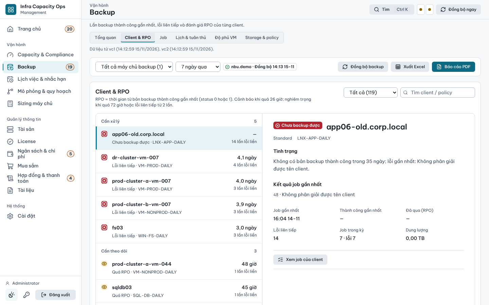
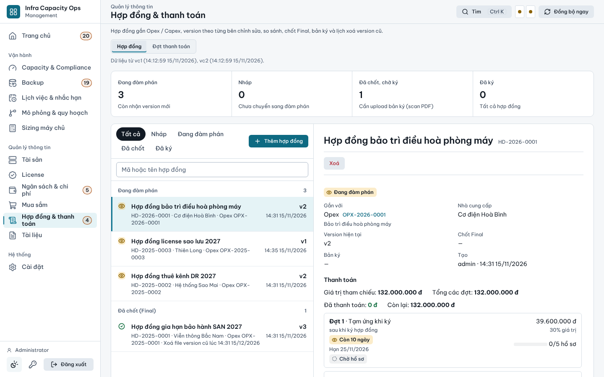
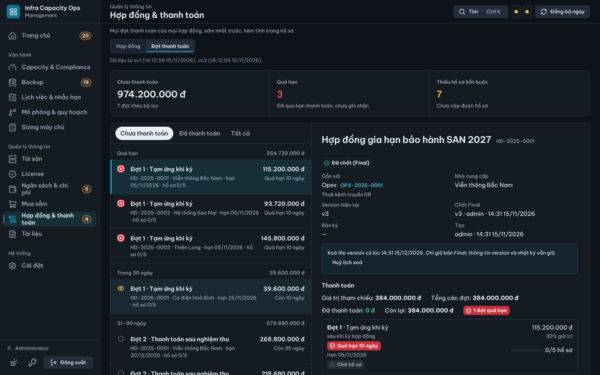
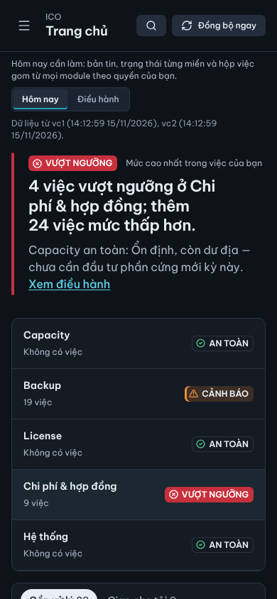

# ICO — Hướng dẫn chi tiết

> Tài liệu tham khảo đầy đủ từng tính năng và quy trình vận hành. Tổng quan và triển khai nhanh: [`README.md`](../README.md).

Ứng dụng theo dõi capacity, compliance, mô phỏng what-if cho hạ tầng ảo hoá và **giám sát backup
Veritas NetBackup**, hỗ trợ **truy vấn live tới 4 vCenter và 4 NetBackup primary server (tài khoản chỉ đọc)** song song với import CSV/JSON thủ công, lưu lịch sử theo thời
gian bằng PostgreSQL, và giao diện **điều hướng theo luồng công việc** (sidebar trái). App web dùng bảng màu
“Phòng máy” + font Be Vietnam Pro; báo cáo PDF / Excel giữ HSC Design System (`design-system/ico/MASTER.md`).

### Cấu trúc giao diện (super app — `docs/design/super-app.md`)

Menu chia theo **công việc**, không theo nguồn dữ liệu: **Vận hành** (theo dõi sống, cảnh báo, mô phỏng) và
**Quản lý thông tin** (danh mục, hồ sơ, hợp đồng, tài liệu), cùng nhóm **Hệ thống**.
- Mỗi mục menu gom nhiều trang thành **tab trong trang**.
- Địa chỉ có dạng `#/<mục>/<tab>`, vd `#/backup/jobs`, `#/procure/quotes`, `#/settings/sources`. Địa chỉ giữ được khi
  F5 / chia sẻ link. **Link cũ** (`#/bk-jobs`, `#/spend-opex?code=…` trong email nhắc hạn) vẫn mở đúng trang và tự
  đổi sang địa chỉ mới.
- Thanh **Phạm vi** trên cùng chỉ hiện các bộ lọc mà trang đó dùng.

| Miền | Mục menu | Tab |
|---|---|---|
| — | **Trang chủ** | Hôm nay (hộp việc chung) · Điều hành (tóm tắt, KPI, xu hướng, nhận định & danh mục quyết định) |
| Vận hành | **Capacity & Compliance** | Capacity · Compliance · Xu hướng & biến động |
| | **Backup** | Tổng quan · Client & RPO · Job · Lịch & tuân thủ · Độ phủ VM · Dung lượng · Storage & policy |
| | **Lịch việc & nhắc hạn** | Mọi mốc có ngày của các module |
| | **Mô phỏng & quy hoạch** | What-if capacity · Quy hoạch tài nguyên · What-if license |
| | **Sizing máy chủ** | Bàn làm việc tài liệu sizing |
| Quản lý thông tin | **Tài sản** | Host & VM · ESXi & phần cứng · Hệ điều hành |
| | **License** | Đánh giá & quyền sử dụng · Snapshot |
| | **Ngân sách & chi phí** | Tổng quan ngân sách · Opex · Capex |
| | **Mua sắm** | Nhà cung cấp · So sánh báo giá · Cải tạo văn phòng |
| | **Chuẩn hoá BOM** | Tải BOM thô → Excel chuyên nghiệp theo đầu mục |
| | **Hợp đồng & thanh toán** | Hợp đồng · Đợt thanh toán |
| | **Tài liệu** | Tờ trình · Báo cáo (Trung tâm báo cáo) |
| Hệ thống | **Cài đặt** | Tiêu chí & ngưỡng · Nguồn dữ liệu · Backup (nguồn & ngưỡng) · Tính năng · Chi phí & nhắc hạn · AI & MCP · Người dùng & quyền · Đăng nhập & bảo mật · Thương hiệu |

### Cách đọc và thao tác trên giao diện

Mọi trang theo cùng ba quy ước (chi tiết thiết kế: `design-system/ico/MASTER.md`, bối cảnh `docs/design/redesign/`).

**1. Kết luận trước, bằng chứng sau.** Trang chủ và Điều hành mở bằng **khối kết luận**: vạch màu trạng thái, nhãn
trạng thái, một câu kết luận và câu dẫn. Câu ở tab Điều hành trùng với hộp “Tổng kết — vấn đề & quyết định” của PDF Vận hành.
Dưới đó là dải KPI có **bullet bar** (vạch mảnh 80 % = bắt đầu THEO DÕI, vạch đậm 100 % = ngưỡng).





**2. Trạng thái đọc được không cần màu.** 4 mức luôn có **biểu tượng + nhãn chữ**:

| Nhãn | Biểu tượng | Hình thức |
|---|---|---|
| AN TOÀN | vòng tròn có dấu ✓ | viền mảnh |
| THEO DÕI | con mắt | nền hổ phách nhạt |
| CẢNH BÁO | tam giác ! | nền cam nhạt + vạch trái |
| VƯỢT NGƯỠNG | bát giác ✕ | **khối đỏ đặc**, chữ trắng |

Ở danh sách, biểu tượng nằm đầu dòng. Trình đọc màn hình đọc kèm nhãn. Thẻ xám (vd “Đang bật”, “Từ policy”) là
**loại / thuộc tính**, không phải trạng thái.

**3. Danh sách → chi tiết, không rời trang.** Hộp việc, Compliance, Client & RPO, Opex, Hợp đồng, Đợt thanh toán dùng cùng
một khung: danh sách bên trái (nhóm theo mức hoặc theo hạn, mỗi nhóm có tổng), chi tiết bên phải.
- **Chế độ xem** (nút tròn trên đầu danh sách) thay cho ô chọn trạng thái, vd Opex: *Cần theo dõi · Sắp hết hạn · Quá hạn · Tất cả*.
- **Bàn phím**: `J` / `K` (hoặc ↓ / ↑) chuyển dòng, `Enter` mở; Trang chủ có thêm `E` (Đánh dấu xong), `H` (Ẩn 7 ngày).
  `Ctrl + K` tìm host / VM / mã ở mọi trang.
- Màn hình **dưới 1024 px**: danh sách chiếm toàn màn; bấm một dòng thì chi tiết mở bên dưới (Compliance, Client & RPO,
  Trang chủ) hoặc trong hộp thoại (Opex, Hợp đồng).





Các trang tổng quan khác:











**Sáng / tối và điện thoại.** Nút mặt trời / mặt trăng ở chân sidebar đổi giao diện (lưu theo máy). Dưới 1024 px sidebar thu
thành ngăn kéo (nút ☰).



**Trang chủ "Hôm nay cần làm"** (chung cho mọi người, lọc theo quyền):
- **Bản tin capacity** và **thẻ trạng thái từng miền** (Capacity, Backup, License, Chi phí & hợp đồng).
- **Hộp việc** gom từ mọi module:
  - cluster vượt ngưỡng / ≥ 90%;
  - phát hiện backup, tỷ lệ thành công / độ phủ / RPO dưới 90%;
  - license và Opex sắp hết hạn;
  - đợt thanh toán đến hạn;
  - báo giá chờ kiểm tra (Biên tập) / chờ chọn NCC (Duyệt);
  - tờ trình chờ duyệt (Duyệt).
- Mỗi mục mở chi tiết ngay bên phải: **Nên làm gì**, số liệu, nút **Mở trang nguồn** (tới đúng trang, kể cả mở chi tiết
  khoản Opex). Đánh dấu **Xong** hoặc **Ẩn 7 ngày** theo từng người.
- **Đi sâu tới nguyên nhân** (alarm vCenter, sức khoẻ host, snapshot, datastore, storage, phần cứng Dell OME, backup,
  capacity): khung chi tiết có thêm
  - **Chi tiết**: thông tin chính của đối tượng (vCenter, cluster, thời điểm kích hoạt, model, service tag, overcommit…);
  - **Sự kiện liên quan**: sự kiện cụ thể đứng sau mục, bấm để mở đúng đối tượng — mọi alarm đang kích hoạt trên cùng
    host / VM / datastore kèm cảm biến phần cứng của host; alert đang mở của mảng storage; linh kiện lỗi và alert OME 7 ngày
    (mã MessageId); job backup lỗi (job ID, mã status, policy); snapshot của VM; host tải cao nhất của cluster;
  - **Đi tới**: thẻ host / VM / máy chủ vật lý, trang sức khoẻ host.
- Nút mở trang nguồn đưa tới **đúng đối tượng**, không chỉ trang chung: `#/health/alarms?alarm=<vCenter>|<mã alarm>` mở
  hộp thoại alarm (alarm khác cùng đối tượng + cảm biến), `?ds=` mở biểu đồ datastore, `?host=` / `?vm=` / `?q=` lọc bảng,
  `?array=` cuộn tới mảng storage và mở danh sách alert, `#/backup/clients?client=` chọn client, `#/backup/jobs?q=` tìm job,
  `#/hardware?s=&d=` mở máy chủ OME. Trên trang Alarm vCenter, bấm một dòng cũng mở hộp thoại này.
- **Mở trên vSphere Client**: alarm của vCenter thật (không phải demo, không phải Proxmox / Nutanix) có thêm nút mở đúng
  host / VM / datastore / cluster trên vSphere Client (tab mới, cần đăng nhập vCenter). Link dựng từ mã đối tượng (moId), loại
  đối tượng và `about.instanceUuid` đọc cùng phiên vCenter (cột `entity_moid` / `vim_type` / `vc_uuid` của `vc_alarm_states`,
  có sau lần đồng bộ kế tiếp) và host khai báo ở Kết nối nguồn dữ liệu; phần nào không hợp lệ thì không hiện nút
  (`vcenter/links.py`). Xác nhận / xoá alarm vẫn làm trên vSphere Client — ICO chỉ đọc.
- **Giao việc / Ai xử lý**: bấm **Giao việc** để giao mục cho một người (ghi nhật ký). Người được giao phải có quyền xem
  module của mục đó. Chế độ xem: *Cần xử lý · Giao cho tôi · Chưa giao · Đã xong*.
  Mục xấu đi (lên mức cao hơn) sẽ hiện lại.
- Bộ lọc được nhớ phía máy chủ (`/api/me/prefs`).

**Lịch việc & nhắc hạn**: mọi mốc có ngày, gồm cả mốc đã quá hạn trong 90 ngày, nhóm theo *Đã quá hạn / 7 ngày tới /
Trong 30 ngày / theo tháng*:
- Opex hết hạn
- Đợt thanh toán
- License hết hạn
- Báo giá hết hiệu lực

**Hợp đồng & thanh toán → Đợt thanh toán**: mọi đợt của mọi hợp đồng, nhóm theo hạn (Quá hạn · Trong 30 ngày · 31–90 ngày ·
Sau 90 ngày · Chưa có hạn · Đã thanh toán) kèm tổng tiền từng nhóm, tình trạng hồ sơ và tổng chưa thanh toán. Chọn một đợt là mở
hợp đồng của đợt đó ở bên phải để tick hồ sơ, nộp hồ sơ, ghi nhận thanh toán.
**Mô phỏng & quy hoạch → Quy hoạch tài nguyên**: nút **Xem kết quả** hiện ngay trên màn hình đề xuất, bảng theo kịch bản
và theo cluster (cùng engine với PDF).

**Cảnh báo vận hành qua Discord** (mức 90%):
- Ngưỡng: cluster có CPU hoặc RAM ≥ 90% ngưỡng overcommit, hoặc tỷ lệ backup thành công 7 ngày / độ phủ VM / client đạt
  RPO dưới 90%.
- Kiểm tra sau mỗi chu kỳ đồng bộ. Mỗi cảnh báo gửi **một lần**, báo "Đã hết" khi trở lại bình thường, rồi gửi lại nếu
  tái phát.
- Gửi tới các kênh Discord (Cài đặt → Chi phí & nhắc hạn) có tick *Nhận cả cảnh báo vận hành*.
- Admin chạy thử bằng `POST /api/admin/ops-alerts/run`.

**Tìm kiếm chung (Ctrl + K hoặc nút *Tìm* trên thanh trên cùng)**:
- Tìm được: host, VM (theo tên, IP, hostname guest), client backup, mọi mã nghiệp vụ (OPX / CPX / HD / BG / CTVP / TT,
  theo mã hoặc tên), nhà cung cấp (tên, tên viết tắt, tên gọi khác), mọi trang.
- Có sẵn thao tác nhanh: tạo Opex, tạo gói báo giá, tạo dự án cải tạo, xem kết quả quy hoạch, đồng bộ.
- Kết quả lọc theo quyền: người không có vai trò Chi phí không thấy mã chi phí.
- Mở mã nào là vào đúng chi tiết của mã đó.

**Trang đối tượng (một đối tượng — một trang)**, mở từ bảng Host & VM, Compliance, Độ phủ backup và từ tìm kiếm:
- **Host**: capacity, phần cứng & ESXi, trạng thái cluster (HA / DRS), phát hiện compliance, VM trên host, và
  bảo hành / hợp đồng Opex có khai báo thiết bị này (nếu có vai trò Chi phí).
- **VM**: cấu hình, host, hệ điều hành (gồm ghi đè), backup (độ phủ, client, policy, lần thành công gần nhất, RPO),
  phát hiện compliance.

**Quy hoạch → Capex nháp**: ở bảng kết quả theo cluster, nút **Tạo Capex nháp** tạo dự án Capex gồm n node theo kịch bản
cơ sở (năm tài chính = năm đặt hàng, đơn giá tuỳ chọn), rồi mở dự án vừa tạo.

**AI dùng chung (Cài đặt → AI & MCP, admin)** — một cấu hình cho mọi tính năng AI:
- **Kết nối**: nhà cung cấp (Anthropic), model (mặc định `claude-opus-5-5`), effort, API key (mã hoá, không trả về),
  *Cho phép gửi dữ liệu ra ngoài*.
- **Công tắc từng tác vụ**: soạn tờ trình, đọc báo giá PDF scan, tóm tắt khác biệt báo giá, **bản tin trang chủ**,
  **tổng kết báo cáo PDF**, **phân tích lỗi backup**, **ánh xạ cột file nhập**, **phân loại hệ điều hành**,
  **tóm tắt biến động VM**, **nhận định sizing**, **tóm tắt thay đổi hợp đồng**, **đọc hoá đơn**, **Hỏi ICO**.
- **Che tên** trước khi gửi (bật mặc định), thay bằng mã `<host:…>` / `<ip:…>` / `<email:…>`, rồi khôi phục trong
  kết quả. Phạm vi che:
  - host, IP, VM, client backup;
  - datastore, mảng / volume storage, thiết bị Dell OME, hostname IPAM;
  - **mọi địa chỉ email** (owner / backup / support là dữ liệu cá nhân).
- **Hạn mức được giữ chỗ trong DB**: mỗi lượt gọi giữ trước chi phí tối đa của nó trong một lệnh UPDATE có điều kiện, nên
  nhiều pod cùng gọi cũng không vượt hạn mức. Phần giữ chỗ được trả lại sau lượt gọi; phần còn sót do pod chết tự hết
  sau 15 phút.
- **Hạn mức 100 USD / tháng**: chạm hạn mức thì AI tạm dừng, các chức năng quay về văn bản theo luật.
  **Cảnh báo ở 50 USD**: gửi Discord (kênh có tick *Nhận cả cảnh báo vận hành*) và hiện trong hộp việc của admin,
  mỗi tháng một lần. Có giới hạn số lượt gọi mỗi người mỗi giờ.
- **Nhật ký và thống kê**: mỗi lượt (tác vụ, người, model, token, chi phí, thời gian, mã request, phiên bản prompt,
  phản hồi 👍 / 👎; không lưu nội dung) vào `ai_runs`. Admin xem qua MCP `ico_ai_usage`.
  Thống kê theo tác vụ và 30 lượt gần nhất.
  - Chi phí tính theo giá niêm yết của model đã trả lời; model lạ tính theo giá cao nhất.
  - Cùng dữ kiện thì dùng lại kết quả trong 6 giờ, không tính phí lần sau.
- **Trang chủ → AI tóm tắt hôm nay**: tóm tắt hộp việc của chính người bấm (theo quyền) cùng bản tin capacity.
- **Trung tâm báo cáo → Tổng kết bằng AI**: thêm hộp "Tổng kết (AI soạn)" vào PDF Vận hành / Kỹ thuật, Backup và Kế hoạch
  ngân sách. AI chỉ viết từ số liệu đã tính. Phần tổng kết theo luật vẫn giữ nguyên bên dưới để đối chiếu; AI lỗi
  hoặc tắt thì PDF ghi một dòng lý do.

**AI cho dữ liệu nhiều biến số** — chỉ là đề xuất; nút AI chỉ hiện khi tác vụ đang bật:
- **Backup → Tổng quan → AI phân tích lỗi**: gom job lỗi theo nguyên nhân gốc, giải thích mã lỗi chưa có trong bảng
  mã, đề xuất thứ tự xử lý. Chỉ gửi số job đã gom theo mã × policy × loại job (không gửi từng job). Mức độ ở các bảng
  vẫn theo luật; mã lỗi AI nêu mà không có trong kỳ bị bỏ. Tên policy được gửi nguyên văn (tên client trùng với
  danh mục được che).
- **Nhập file host / VM bố cục lạ** (không nhận ra cột tên / CPU): hộp **Chọn cột** hiện ra; bấm **AI đề xuất** để AI
  điền sẵn. AI chỉ nhận tiêu đề cột và tối đa 5 dòng mẫu đã che (chữ → `a`, số → `9`; số đo và từ trạng thái giữ
  nguyên; tiêu đề trông như dữ liệu — file không có dòng tiêu đề — cũng bị che). Cách ánh xạ đã xác nhận được **nhớ**
  theo bộ tiêu đề cột (bảng `import_mappings`); lần sau tự áp dụng. Chỉ người lưu hoặc admin sửa được một cách ánh xạ;
  admin xem / xoá qua `GET` / `DELETE /api/import-mappings`.
- **Tài sản → Hệ điều hành → AI gợi ý VM chưa rõ**: đề xuất họ / phiên bản / edition cho tối đa 60 VM *Other / Unknown*
  chưa ghi đè, kèm độ tin cậy và lý do. Chỉ đề xuất tin cậy cao được tick sẵn. Tick chọn rồi **Ghi đè các VM đã chọn** (dùng ghi đè thủ công sẵn có, ghi chú
  "AI đề xuất").
- **Capacity → Xu hướng & biến động → AI tóm tắt biến động**: tóm tắt VM thêm / bỏ / đổi cấu hình trong kỳ theo cluster.

**AI nâng cao và Kho báo cáo:**
- **Sizing → AI nhận định**: diễn giải phương án, rủi ro, câu hỏi cần làm rõ với khách hàng và một đoạn gửi khách
  (số liệu giữ nguyên từ bộ tính sizing).
- **Hợp đồng → So sánh version → AI tóm tắt thay đổi**: từng thay đổi gắn chủ đề (thanh toán, giá, phạt, bảo hành,
  SLA…) và mức rủi ro với bên mua; tối đa 60 thay đổi gửi AI. Quyền như xem so sánh (Chi phí — Xem).
- **Đợt thanh toán → AI đọc hoá đơn** (hồ sơ có file PDF, vai trò Biên tập): AI chép số hoá đơn, MST, số tiền; **hệ
  thống** đối chiếu với số tiền đợt, MST nhà cung cấp, mã / tên hợp đồng và kiểm tra tiền trước thuế + VAT = tổng.
  Không tự tick hồ sơ; có nhật ký. Cùng file thì dùng lại kết quả.
- **Hỏi ICO** (nút trên thanh trên cùng): hỏi bằng tiếng Việt. AI chỉ dùng công cụ **chỉ đọc**, chạy với quyền của người
  hỏi.
  - Công cụ có sẵn:
    - tìm kiếm, thẻ host / VM, capacity cluster;
    - client backup, VM chưa backup;
    - hộp việc (đủ mọi nguồn, kể cả Phần cứng và Rà soát owner);
    - sổ CI và tác động;
    - **phần cứng Dell OME**: trạng thái, ổ dự báo hỏng, firmware, bảo hành;
    - **hệ thống & owner**: tìm hệ thống, hoặc VM thuộc hệ thống nào;
    - **trạng thái nguồn dữ liệu**;
    - **tra IP**: IPAM và đối tượng mang IP.
  - Module tắt hoặc dữ liệu chi phí không đủ quyền thì công cụ không trả.
  - Tối đa 5 vòng tra cứu mỗi câu; câu trả lời kèm link tới thẻ host / VM.
  - Mỗi câu trả lời có nút **👍 / 👎**: chỉ người hỏi bấm được, bấm lại để bỏ. Tỷ lệ hài lòng theo tác vụ hiện trong
    `ico_ai_usage`, dùng để so trước / sau khi đổi model hay prompt.
- **Tài liệu → Kho báo cáo**: tick *Lưu vào kho* ở Trung tâm báo cáo, mỗi PDF xuất ra (Capacity, Sức khoẻ hạ tầng, Phần cứng,
  VM theo hệ thống, Rà soát owner, Backup, License, Sizing, Ngân sách, Cải tạo) được lưu một bản trong DB kèm người xuất, thời điểm, tham số. Mỗi người giữ tối đa 100 bản (bản cũ nhất của chính
  người đó bị thay), 400 ngày, 25 MB mỗi bản; cùng nội dung không lưu hai lần. Chỉ các route báo cáo trong danh sách được lưu. Báo cáo chi phí chỉ người có vai trò Chi phí xem được; người lưu hoặc admin xoá được.

**Chuẩn hoá BOM (Quản lý thông tin)** — tải file Excel BOM thô, xuất một file Excel trình bày chuẩn, giống nhau cho mọi hãng:
- Nhận ra **Dell Solutions Configurator** (dòng sản phẩm + option, giá option tính cho 1 máy), **Cisco CCW estimate**
  (danh sách phẳng — thiết bị chính bắt đầu cấu hình mới — hoặc có số dòng 1.0 / 1.1; giá net, thời hạn dịch vụ),
  **HPE Aruba IRIS** (Line# 1.0 / 1.1, dòng "INCLUDED" giá incl. được ẩn), HPE One Config và bảng kê thông thường.
  Số lượng linh kiện của Cisco / HPE là tổng cho mọi thiết bị; hộp thông số quy về 1 thiết bị. Thiết bị giống hệt nhau
  ở nhiều dòng được gộp (cộng số lượng); cùng model khác option được đánh số "(cấu hình 1)", "(cấu hình 2)".
- Gom theo đầu mục: Máy chủ, Thiết bị mạng, Tường lửa, Lưu trữ, SAN Switch, Cân bằng tải, Sao lưu, Phụ kiện (module quang,
  cáp), Phần mềm & License, Dịch vụ.
  Sửa được tên, đầu mục, số lượng và từng thông số trước khi xuất.
- Mỗi cấu hình có **hộp thông số cho 1 thiết bị**: máy chủ (model, CPU, RAM tổng, ổ đĩa, cổng mạng, cổng HBA, module quang,
  nguồn, bảo hành); switch (cổng, tốc độ, module quang, license Basic / Advanced / DNA…); firewall (throughput, cổng,
  subscription, HA); storage (bộ điều khiển, ổ đĩa, dung lượng thô, cổng host); SAN switch; load balancer — kèm **giá 1 thiết bị,
  thành tiền theo số lượng và giá niêm yết trên file gốc** để đối chiếu.
- File xuất: sheet **BOM** (mục La Mã, bảng hàng có công thức Thành tiền, cộng từng cấu hình / đầu mục, tổng, VAT tuỳ chọn),
  **Tổng hợp** (theo đầu mục và cấu hình, tỷ trọng) và **Dữ liệu gốc**. Dòng "No …" / "NONE" / Factory Integrated giá 0 được ẩn.
- Không lưu file trên máy chủ. Tính năng bật / tắt ở Cài đặt → Tính năng (`bom`).

Mục và tab của module đang tắt (Cài đặt → Tính năng) hoặc không đủ quyền (vai trò Chi phí) sẽ tự ẩn.
Các thành phần dùng chung (`frontend/js/ui.js`) giúp mọi trang thống nhất: pill 4 trạng thái, dòng trạng thái, hộp xác
nhận theo design system (thay `confirm()` của trình duyệt), trạng thái rỗng.

Giao diện web dùng bảng màu “Phòng máy” (graphite ánh xanh, tín hiệu cyan; tối mặc định, sáng chuyển bằng nút ở chân
sidebar), font Be Vietnam Pro và JetBrains Mono cho mã máy, tự host trong `frontend/vendor/`; số dùng tabular-nums.
Báo cáo PDF / Excel giữ màu và font Inter của HSC Design System. Nhãn AN TOÀN / THEO DÕI / CẢNH BÁO / VƯỢT NGƯỠNG
và ngưỡng giống nhau giữa web, PDF, Excel. Dưới 1024px sidebar thu thành ngăn kéo (drawer). Xem mục
“Cách đọc và thao tác trên giao diện” ở trên.

### VM luôn kèm IP

Tên VM trên VMware thường khác hostname mà system owner quản lý, nên **mọi danh sách VM đều có cột IP** (IP khách do
VMware Tools báo, lấy theo lần đồng bộ mới nhất):

| Nơi hiển thị | Danh sách VM có IP |
|---|---|
| Hệ thống & Owner | VM chưa có owner (ô lọc tìm được theo IP), VM của hệ thống; báo cáo VM theo hệ thống; email rà soát (thêm Cluster, IP và hostname trong máy ảo khi khác tên VM) |
| Rà soát owner | VM chưa có owner, VM chờ team hạ tầng quyết, hàng gán lại; cổng Owner (VM của hệ thống, phiếu rà soát); PDF / Excel kết quả rà soát |
| Sức khoẻ hạ tầng | Snapshot VM, alarm của VM; PDF / Excel Sức khoẻ hạ tầng |
| Compliance (VM idle / tắt lâu / over-provision) | Tab Compliance, CSV, PDF Kỹ thuật (cột IP), PDF Vận hành (IP dưới tên VM) |
| Biến động VM | Thêm mới / loại bỏ / di chuyển / đổi tên / đổi cấu hình, trên trang và trong PDF (IP của snapshot) |
| Backup | Client cần xử lý, Client & RPO (lọc theo IP), job backup; PDF (client, job lỗi), Excel (Client & RPO). IP lấy từ VM khớp client theo tên, hostname khách hoặc IP |
| Thẻ đối tượng | Datastore, máy chủ vật lý (Dell OME), host (có sẵn) |
| AI | Phân loại hệ điều hành |
| File CSV | `/api/export/csv` (VM, phát hiện) |

### Trung tâm báo cáo (Tài liệu → Báo cáo)

Mọi file xuất của app ở một chỗ, chia theo nhóm:

| Nhóm | Báo cáo |
|---|---|
| Capacity & vận hành | Báo cáo Vận hành / Kỹ thuật (PDF), danh sách host & VM (Excel), dữ liệu tổng hợp (CSV) |
| **Hạ tầng & phần cứng** | **Sức khoẻ hạ tầng** (PDF + Excel, mới), **Phần cứng máy chủ Dell OME** (PDF + Excel; lọc mức, hạn bảo hành), **Sổ CI** (Excel, mới; lọc loại / trạng thái) |
| **Hệ thống & Owner** | **VM theo hệ thống** (PDF + Excel), **Hệ thống & Owner** (Excel nhập lại được), **Kết quả rà soát owner** theo kỳ (PDF + Excel; chỉ admin / quản trị Hệ thống & Owner) |
| Quy hoạch & Sizing | Quy hoạch tài nguyên (PDF), Sizing (PDF đầy đủ / rút gọn, Excel, mẫu nhập) |
| License & Inventory | Tổng quan license (PDF), đánh giá license, ESXi & phần cứng, HĐH guest (Excel) |
| Backup | Hiện trạng Backup (PDF), thống kê backup (Excel) |
| Chi phí & ngân sách | Kế hoạch ngân sách IT (PDF + Excel); **Báo cáo theo hồ sơ**: lối tắt tới Kế hoạch năm sau, Cải tạo, Báo giá, BOM — mỗi hồ sơ xuất từ trang của nó |

- **Quy tắc:** tính năng nào có báo cáo (PDF / Excel / CSV) thì báo cáo đó cũng có ở đây. Báo cáo của một hồ sơ (kế hoạch, cải tạo,
  báo giá, BOM) được dẫn tới trang của hồ sơ qua thẻ *Báo cáo theo hồ sơ*. Test tự động chặn file xuất mới chưa gom về trang này.
- Nhóm của module đang tắt (hoặc thiếu vai trò Chi phí) bị ẩn; nút *Mở trang* chỉ hiện khi người dùng mở được trang đó.
- Mọi báo cáo theo **bộ lọc Owner** trên thanh trên.
- Sức khoẻ hạ tầng theo thêm vCenter / cluster / host ở khung *Phạm vi báo cáo Capacity*.
- Danh mục mọi file xuất (`GET /api/exports`, `backend/app/exports.py`) có thêm `infra-pdf` / `infra-xlsx` / `ci-xlsx` và so
  sánh / đánh giá báo giá.

**Sức khoẻ hạ tầng** (`GET /api/infra/report.pdf|xlsx?vcenter=&clusters=&hosts=` + bộ lọc owner) dùng cùng số liệu với các
trang Sức khoẻ hạ tầng.

PDF gồm:
- tổng kết việc cần làm;
- 1 Datastore: mức, % dùng, % cấp phát, tăng GB/ngày, đầy sau bao nhiêu ngày theo xu hướng 30 ngày;
- 2 Mảng lưu trữ: dung lượng, giảm dữ liệu, độ trễ, alert; số volume đã ghép datastore;
- 3 Snapshot VM, đánh dấu snapshot của phần mềm backup;
- 4 Alarm vCenter;
- 5 Host có vấn đề.

Mỗi bảng in tối đa 60 dòng. Excel có đủ mọi dòng, mỗi phần một sheet, thêm sheet Volume / LUN.

Bộ lọc owner chỉ giữ snapshot và alarm của VM thuộc các hệ thống đã chọn. Datastore, mảng và host dùng chung nên giữ nguyên.

**Sổ CI** (`GET /api/ci/export.xlsx?type=&status=active|retired|all`) gồm 3 sheet:
- Tổng hợp: CI theo loại × trạng thái, liên kết mạnh / yếu;
- CI: khoá chuẩn, số liên kết ra / vào, thuộc tính chính;
- Liên kết: quan hệ, độ tin cậy, ghép theo tên / IP.

Theo quyền như trang Sổ CI: client backup ẩn khi tắt Backup; dòng Opex chỉ hiện với vai trò Chi phí.

### Xuất báo cáo PDF (khổ A4)

Hai nút **Xuất PDF · Vận hành** và **Xuất PDF · Kỹ thuật** ở header tải báo cáo PDF khổ
A4 (in được trực tiếp) từ `GET /api/reports/pdf?view=executive|technical&vcenter=<key|all>`
(yêu cầu đăng nhập), theo scope vCenter đang chọn trên thanh lọc:

- **Báo cáo Vận hành** (`view=executive`) — **2 trang** (tối đa 3), dành cho góc nhìn quản trị:
  ít chữ, nhiều biểu đồ, đủ ý để ra quyết định; phần giải thích chi tiết để ở Báo cáo Kỹ thuật.
  Trách nhiệm xử lý quy về System Owner của từng cluster:
  - *Trang 1*: tiêu đề gọn (dòng eyebrow ghi phạm vi + ngày; không có đoạn mô tả hay dòng meta
    Phạm vi/Ngày/Trạng thái/Đồng bộ), ngay dưới là hộp **Tổng kết — vấn đề & quyết định đề nghị**
    (trạng thái + 1 câu kết luận + danh sách đánh số, mỗi dòng là *pain point* → quyết định đề
    nghị · thời điểm, ví dụ "1/3 cluster không chịu được mất 1 host (DR-CLUSTER) → Duyệt host dự
    phòng N+1 cho 1 cluster · Trong 1 quý"; + 5 ô số liệu: dư địa, số tháng tới ngưỡng, dự phòng
    N+1, VM thu hồi được, số điểm nghiêm trọng), gauge CPU/RAM (và Storage nếu bật) cạnh 4 KPI,
    biểu đồ **Bao lâu nữa chạm ngưỡng** (3 kịch bản +5/+10/+20 %/quý, mốc 1–2–3 năm) cạnh biểu đồ
    **Mức dùng theo cluster**, và bảng **Vấn đề cần quyết định** (tiêu đề = vấn đề/pain point,
    1 dòng *Rủi ro*, 1 dòng *Đề xuất* → ưu tiên → thời điểm → đề nghị phê duyệt → ô ký; tối đa 6
    dòng). Toàn bộ câu chữ viết ngắn, nêu thẳng vấn đề và quyết định cần lấy, không mô tả kỹ thuật.
  - *Trang 2*: biểu đồ **Xu hướng** CPU/RAM theo cluster + 4 ô biến động (CPU, RAM, số VM, số
    host), bảng cluster cần quan tâm (có cột N+1), **Điểm cần System Owner xử lý** gồm donut
    finding theo mức độ, biểu đồ nghiêm trọng theo cluster và theo loại, top-6 điểm nghiêm trọng có
    Mã, và một dòng tham chiếu sang Báo cáo Kỹ thuật.
  - Các biểu đồ so sánh/rủi ro theo cluster, donut VM/finding, bảng lịch sử theo cluster và danh
    sách cảnh báo/thông tin không nằm trong Báo cáo Vận hành — xem Báo cáo Kỹ thuật.
- **Báo cáo Kỹ thuật** — cùng bố cục mở đầu với Báo cáo Vận hành: tiêu đề gọn (eyebrow ghi
  phạm vi + ngày, không có đoạn mô tả hay dòng meta/chính sách), rồi hộp **Tổng kết khuyến nghị**
  giống hệt (cùng kết luận, cùng danh sách khuyến nghị và 5 ô số liệu) cộng thêm một hàng 5 ô
  kỹ thuật: Hosts/VMs, CPU overcommit và RAM overcommit thực tế so với ngưỡng (kèm hệ số HT),
  số findings critical/warning/info, chính sách idle + Storage. Phần còn lại là bảng overcommit
  theo cluster, chi tiết từng host, từng datastore, và toàn bộ compliance findings (sắp xếp theo
  severity). Dài hơn, dành cho đội kỹ thuật.

### Báo cáo Quy hoạch tài nguyên (Resource Planning)

Nút **Xuất PDF · Quy hoạch** mở bảng giả định rồi tạo `view=planning` (3–4 trang) để làm căn cứ
đề xuất mở rộng hạ tầng. Tham số (đều là query param của `GET /api/reports/pdf`):
`horizon` (12–60 tháng, mặc định 36), `growth` (các kịch bản %/quý, mặc định `5,10,20` =
Thấp/Cơ sở/Cao), `node_cores` + `node_ram` (spec node mới; để trống = host lớn nhất của từng
cluster), `lead` (tháng mua sắm + triển khai, mặc định 3), `target` (% ngưỡng overcommit coi là
đủ năng lực, mặc định 80). Theo phạm vi vCenter/cluster đang chọn như các báo cáo khác.

- Logic (`backend/app/planning.py`): dự phóng vCPU/RAM **đã cấp phát** cho VM đang bật theo lãi
  kép quý; với mỗi cluster × kịch bản × tháng, tìm số node nhỏ nhất sao cho mức dùng ≤ `target`
  % ngưỡng **và** vẫn ≤ 100% khi mất 1 host lớn nhất (N+1: CPU so với host nhiều core nhất, RAM so với host nhiều RAM nhất). Nếu có lịch sử snapshot ≥ 30 ngày,
  thêm kịch bản "Xu hướng N tháng" từ tăng trưởng thực tế (toàn phạm vi và từng cluster).
  Khi chỉ RAM là ràng buộc, báo cáo nêu thêm phương án B nâng RAM (bội số 64 GB/host).
- Bố cục (`backend/app/report_planning.py`): cùng mở đầu với hai báo cáo kia — hộp **Tổng kết đề
  xuất** (số node theo kịch bản cơ sở, thời điểm cần/đặt hàng, ràng buộc CPU hay RAM, danh sách
  đề nghị phê duyệt theo cluster), rồi Hiện trạng & giả định, Dự phóng nhu cầu so với năng lực
  (toàn phạm vi + từng cluster, trục chặn ở 200%), Lộ trình bổ sung node theo mốc 6/12/…
  tháng kèm biểu đồ, Đề xuất theo cluster (phương án A thêm node / B nâng RAM).

### What-if Simulation — Upgrade Host (nâng cấp host hiện hữu)

Ngoài Add Host / Add VM / Resize VM / Decommission, kịch bản **Upgrade Host** mô phỏng nâng cấp tại
chỗ (thêm DIMM, đổi CPU) cho các host đang tick trong cluster mục tiêu. Quy tắc riêng cho CPU
cores và RAM: *Giữ nguyên / Đặt thành / Cộng thêm / Tăng theo %*; bảng host xem trước cấu hình
sau nâng cấp. Kết quả gồm before/after như các kịch bản khác, bảng Δ từng host, tổng cores/GB thêm
quy đổi ra "tương đương bao nhiêu host trung bình" để so với phương án mua host mới, và kiểm tra
N+1 sau nâng cấp (mất host lớn nhất mới) — vì nâng cấp tại chỗ không tăng số host nên không cải
thiện dự phòng N+1. Template nhanh **Host upgrade** (RAM ×2 toàn bộ host) cũng dùng logic này
(`getEffectiveData({ upgradeHosts })`).

Kịch bản **Upgrade + Add Host** gộp hai bước trong một kịch bản: (1) quy tắc nâng cấp cho host đang
tick, (2) danh sách host mới (nhiều dòng), chạy một lần ra một kết quả before/after chung. Bảng
chi tiết liệt kê cả host nâng cấp (Δ cores/RAM) lẫn host mới (nhãn "mới"), dòng tổng hợp tách
riêng phần năng lực đến từ nâng cấp và từ host mới, số host trước → sau, và N+1 tính trên cụm
sau thay đổi (mất host lớn nhất, kể cả host mới). Template **Upgrade + expansion** = RAM ×2 host
hiện hữu + 1 host mới bằng host lớn nhất sau nâng cấp.

### Sizing máy chủ (HW sizing từ danh sách VM của dự án)

Bài toán: team Dev gửi danh sách VM cho một ứng dụng/hệ thống mới (tên, số lượng, vCPU, RAM, Disk);
team Infra cần đề xuất số lượng và cấu hình máy chủ vật lý. Trang **Sizing máy chủ** (nhóm Quy hoạch):

- **Nhập liệu**: bảng sửa trực tiếp (Enter ở dòng cuối tạo dòng mới), hoặc **Import Excel/CSV**
  (`POST /api/sizing/import`, đọc `.xlsx`/`.csv`, nhận tiêu đề tiếng Việt lẫn tiếng Anh: Tên VM / VM name,
  Số lượng / Qty, vCPU / CPU, RAM / Memory, Disk / Storage, Ghi chú / Note; tự quy đổi "2 TB", "512 GB").
  Nút **Tải file mẫu** (`GET /api/sizing/template`) và **Nạp ví dụ** để thử nhanh. Danh sách, giả định và
  cấu hình ứng viên lưu trong trình duyệt (localStorage) nên không mất khi tải lại trang.
- **Giả định sizing** (cột trái): overcommit CPU mục tiêu (vCPU : pCPU logic, mặc định 3x), hệ số HT,
  overcommit RAM (mặc định 1.0), mức dùng tối đa mỗi host (80 %), dự phòng tăng trưởng (20 %), dự phòng
  hỏng hóc N+x, số host tối thiểu, phần ESXi chiếm (cores/RAM mỗi host), lưu trữ SAN dùng chung hoặc
  đĩa cục bộ/vSAN (có hệ số bảo vệ FTT/RAID) và overhead lưu trữ.
- **Cấu hình host ứng viên**: nhiều dòng (sockets × cores/socket, RAM, đĩa cục bộ nếu vSAN, đơn giá
  tuỳ chọn). Mặc định 2×16C/512 GB, 2×24C/768 GB, 2×32C/1 TB.
- **Kết quả** (`POST /api/sizing/calc`, logic trong `backend/app/sizing.py`): với mỗi cấu hình — số host
  theo CPU, theo RAM, +dự phòng → tổng host; ràng buộc chính; tổng cores/RAM; overcommit CPU/RAM sau khi
  lắp; % năng lực khi mất đúng số host dự phòng (đạt N+x hay chưa); số VM cỡ trung bình của dự án còn
  thêm được; ngân sách ước tính nếu có đơn giá. Phương án **Đề xuất** = ít host nhất → ngân sách thấp nhất
  → hiệu suất dùng cao nhất. Ô số liệu nêu nhu cầu trước/sau tăng trưởng và **dung lượng SAN cần cấp**
  (đã gồm overhead). Khối **Hạ tầng hiện hữu có hấp thụ được không?** đưa toàn bộ nhu cầu vào từng
  cluster đang có (dữ liệu vCenter hiện tại), tính % ngưỡng trước → sau và N+1, kết luận có thể chưa
  cần mua host hay bắt buộc bổ sung.
- **Phân tích tư vấn** (`backend/app/sizing_advisory.py`, trả về trong khối `analysis` của `/api/sizing/calc`):
  - *Workload*: phân bố VM theo T-shirt size (S/M/L/XL/XXL), tỷ lệ GB RAM / vCPU → đặc tính compute /
    cân bằng / memory-intensive, nhóm VM chiếm tài nguyên lớn nhất (Pareto 80% RAM), VM lớn nhất, nhận diện
    workload CSDL/middleware nhạy độ trễ.
  - *Thác nước nhu cầu*: yêu cầu → +tăng trưởng → headroom → năng lực lắp đặt (CPU và RAM).
  - *Mỗi cấu hình*: kiểm tra NUMA (VM vượt cores/RAM của một socket, VM không vừa host), cân bằng CPU/RAM
    (% tài nguyên bị "kẹt" và RAM/cores cân bằng nên chọn), license theo core (tối thiểu 16 core/socket),
    TCO = phần cứng + license × số năm, chi phí / VM / tháng, / vCPU, dư địa tăng trưởng thêm, **bảng điểm
    0–100** trên 7 trục (số host, chi phí, hiệu suất, cân bằng, chịu lỗi, mở rộng, NUMA).
  - *Độ nhạy*: số host của từng cấu hình khi đổi dự phòng tăng trưởng / overcommit CPU / mức dùng tối đa.
  - *Dự báo nhiều năm*: số host cần theo năm với tăng trưởng hằng năm, năm cần mở rộng.
  - *Rủi ro & khuyến nghị* (mức Nghiêm trọng / Cảnh báo / Lưu ý / Đạt kèm hành động), mức sẵn sàng triển khai
    và *lộ trình triển khai* 6 giai đoạn.
  - **Ngưỡng tư vấn cấu hình được** (cột trái, mục **Ngưỡng tư vấn (nâng cao)**; API: `params.advisory`,
    model `AdvisoryThresholds` trong `sizing_advisory.py`): ngưỡng GB RAM/vCPU phân loại workload, % tài nguyên
    thừa, độ chênh coi là cân bằng, tải tối thiểu để xét cân bằng, overcommit CPU tối đa cho CSDL, overcommit
    CPU/RAM bị cảnh báo, dư địa tăng trưởng thấp, mức tải khi mất host đạt điểm tối đa, % TCO để gợi ý phương
    án rẻ hơn, số host gợi ý chia / cảnh báo cluster lớn, và danh sách từ khoá nhận diện VM CSDL. Mỗi đối tác /
    khách hàng có thể gửi bộ ngưỡng riêng theo từng yêu cầu; trường bỏ trống dùng mặc định
    (`GET /api/sizing/defaults` trả về giá trị mặc định + nhãn `advisoryMeta`). Giá trị lưu trên trình duyệt,
    có nút **Khôi phục mặc định**; PDF liệt kê ngưỡng đã áp dụng ở mục Giả định & phương pháp (đánh dấu * giá
    trị đã đổi), Excel ghi ở sheet Tóm tắt.
  - Tham số mới (cột trái, nhóm **Tư vấn & chi phí**): `optimize_for` (`hosts` = ít host nhất, `cost` = TCO
    thấp nhất), `annual_growth_pct`, `horizon_years`, `license_price_per_core`, `license_min_cores_per_socket`.
  Trên web, kết quả có thêm 9 biểu đồ Chart.js (phân bố VM, top nhóm VM, thác nước RAM, số host theo ràng
  buộc, radar đa tiêu chí, phân bổ năng lực cluster, dự báo theo năm, độ nhạy chọn được, TCO), danh sách rủi ro
  và lộ trình.
- **Xuất Excel dạng dashboard** (`POST /api/sizing/export`, `backend/app/excel_sizing.py`): sheet **Dashboard**
  (dải tiêu đề kèm logo, mức sẵn sàng, 6 ô KPI, kết luận chính, 7 biểu đồ Excel gốc — số máy chủ theo phương án,
  phân bố kích thước VM, phân bổ năng lực, dự báo theo năm, nhóm VM lớn nhất, độ nhạy, TCO — và rủi ro chính), tiếp
  theo là các sheet chi tiết dạng Excel Table có lọc, tô màu điều kiện và data bar: So sánh phương án (+ bảng điểm),
  Rủi ro & khuyến nghị (+ lộ trình), Phân tích workload, Độ nhạy & dự báo, Giả định & ngưỡng, Danh sách VM (cột tổng
  là công thức); dữ liệu nguồn của biểu đồ ở sheet cuối "Dữ liệu biểu đồ". Đã thiết lập in A4 vừa khổ ngang.
- **Logo riêng cho báo cáo Sizing**: trong hộp Xuất PDF, mục **Logo trên báo cáo** → *Chọn logo…* (PNG/JPEG/SVG/WEBP,
  ≤ 2MB) để dùng logo khác cho PDF và Excel (`logoDataUrl`); không chọn hoặc bấm *Dùng logo mặc định* → dùng logo trong
  Cài đặt báo cáo. Logo đã chọn được nhớ trên trình duyệt. Excel không nhúng được SVG.
- **Giọng văn báo cáo đầy đủ**: viết theo góc nhìn đơn vị tư vấn tích hợp giải pháp (SI) gửi khách hàng — "chúng tôi
  khuyến nghị / triển khai", "Quý khách phê duyệt", hạn chế thuật ngữ và giải thích ngắn khi cần. Báo cáo tư vấn
  rút gọn (`detail=brief`) dùng cùng văn phong.
- **Báo cáo đầy đủ** (mặc định, `detail=full`, `backend/app/report_sizing_full.py`): trang bìa (thông tin tài liệu — khách hàng,
  đầu mối, dự án, mã tài liệu, phiên bản, ngày lập, người lập, người duyệt — mục lục có số trang, lịch sử phiên bản, ký duyệt), rồi
  1 Tóm tắt (một bộ KPI duy nhất, lý do chọn phương án) · 2 Phạm vi & dữ liệu đầu vào (nguồn, ngày nhận, trong/ngoài phạm vi, quy ước) ·
  3 Nhu cầu tài nguyên · 4 So sánh phương án (bảng điểm, không dùng radar) · 5 Cấu hình đề xuất (thông số cụm, BOM sơ bộ, kiến trúc
  logic, phân bổ năng lực) · 6 Khả năng mở rộng · 7 Rủi ro & khuyến nghị · 8 Kế hoạch triển khai · 9 Giả định & cách tính (bảng giả
  định + bảng tính từng bước) · Phụ lục A Danh sách máy ảo · B Thuật ngữ. Đầu trang:
  "<đơn vị tư vấn> · Đề xuất cấu hình máy chủ – <khách hàng>"; một lề duy nhất khai báo trong `@page`; số theo định dạng Việt Nam;
  dung lượng theo TiB (1 TiB = 1.024 GB). Trường mới của payload: `customerContact`, `version`, `versionNote`, `approvedBy`,
  `inputSource`, `inputDate`, `outOfScope`; tham số `license_edition`, `suggest_variants`.
- **Nền tảng ảo hoá** (`params.platform`: `vmware` · `nutanix` · `hyperv` · `proxmox` · `generic`, danh mục trong
  `backend/app/platforms.py`): phép tính sizing không đổi; tên gọi trong báo cáo (hypervisor, quản trị tập trung, HA, cân bằng tải,
  di chuyển VM, lưu trữ HCI), sơ đồ kiến trúc logic, BOM, kế hoạch triển khai và nhận định lấy theo nền tảng. License tính theo
  đơn vị của từng nền tảng (VMware: core, tối thiểu 16 core/CPU; Windows Server: tối thiểu 8 core/CPU và 16 core/host; Proxmox:
  CPU socket). Chọn nền tảng trên giao diện tự điền loại license, số core tối thiểu và phần tài nguyên dành cho nền tảng (Nutanix
  CVM, Ceph). `generic` dùng khái niệm chung khi chưa chốt nền tảng; Phụ lục B có bảng tên gọi tương ứng giữa các nền tảng.
- **TCO nhiều năm** (mặc định 5 năm, nhóm *Tư vấn & chi phí*): năm 1 mua phần cứng (đơn giá / host của từng cấu hình), bảo hành
  kèm theo phần cứng `warranty_included_years` năm (mặc định 3, đã gồm trong giá); các năm còn lại nhập **chi phí gia hạn bảo hành
  từng năm** — theo số tiền / host / năm hoặc % giá host / năm (`warranty_ext_mode`, `warranty_ext_values`); license tính theo từng
  năm. Kết quả `advisory.costs.yearly` (phần cứng, bảo hành, license, tổng năm, lũy kế); năm chưa nhập giá gia hạn được ghi chú.
  Bảng TCO trình bày dạng ma trận: cột = Năm 1 … Năm N + Tổng N năm; hàng = Phần cứng, License, Dịch vụ bảo hành HW, Tổng theo
  năm, Lũy kế (web, PDF và sheet Excel — Excel dùng công thức cho tổng và lũy kế).
  Hiển thị: bảng + biểu đồ theo năm trên web, mục **Chi phí & TCO** trong PDF (bật/tắt được), sheet **Chi phí TCO** trong Excel.
  Phương án tham khảo chưa có giá phần cứng không đưa vào so sánh TCO.
- **Tuỳ chỉnh báo cáo sau khi tính** (khung "Tuỳ chỉnh báo cáo" hiện sau nút *Tính sizing*, lưu trên trình duyệt):
  - *Chỉnh nhanh giả định*: thanh trượt tỷ lệ chia sẻ CPU/RAM, mức dùng tối đa, dự phòng / tăng trưởng hằng năm, N+x — tính lại khi
    thả tay, đồng bộ với cột Giả định.
  - *Phương án & số host*: chọn tay phương án đề xuất (kể cả phương án tham khảo), tăng số host so với tính toán, ghi lý do
    (`params.pick_profile` = "<socket>x<core/CPU>x<RAM GB>", `params.host_override`). Áp dụng cho màn hình, PDF và Excel; báo cáo ghi
    "Người lập điều chỉnh: …" và tính lại mọi số liệu (mất host, dư địa, dự báo, BOM, license).
  - *Mục in*: bật/tắt từng mục và mục con (Bảng điểm, TCO, BOM, Kiến trúc logic, Phân bổ năng lực, phụ lục…); số mục, mục lục và
    chữ cái phụ lục tự đánh lại.
  - *Nội dung*: sửa câu kết luận, thêm ghi chú của người lập, ẩn nhận định, thêm khuyến nghị riêng (số đếm và mức sẵn sàng tính
    theo nội dung thực in). Gửi trong `reportOptions` của `/api/sizing/pdf` (chỉ áp dụng cho báo cáo đầy đủ).
- **Quy tắc chọn phương án**: ít host nhất → không sát ngưỡng (mất host vẫn dưới mức tối đa, còn dư địa) → chi phí thấp nhất (TCO nếu mọi
  phương án có giá, nếu không thì ngân sách phần cứng, nếu không thì số core license) → điểm tổng hợp cao nhất. Phương án đạt
  N+1 nhưng tải khi mất host chạm mức tối đa được đánh dấu "Sát ngưỡng". Hệ thống tự thêm **phương án tham khảo** (không tham gia
  xếp hạng): ít core hơn khi CPU dư nhiều (giảm license), thêm RAM khi phương án được chọn sát ngưỡng.
- **Nhận định theo đặc thù workload**: nhận diện CSDL (gồm PI Data Archive / historian), Domain Controller (quy tắc tách host),
  máy chủ backup chạy chung cụm, rủi ro vSAN 3 host / dự trữ thấp / HA cần lưu trữ dùng chung; tỷ lệ chia sẻ CPU trình bày theo
  vCPU : core vật lý; ngưỡng CPU tính theo vCPU/core (`db_cpu_per_core_max`, `high_cpu_per_core_warn`).
- **Hướng tới dịch vụ độc lập**: `sizing.py` + `sizing_advisory.py` là Python thuần (không DB, không I/O),
  `report_sizing*.py` chỉ cần WeasyPrint — có thể tách thành micro-service/CLI riêng cho đối tác, khách hàng
  mà giữ nguyên API (`/calc`, `/pdf`, `/export`). Test: `cd backend && python -m pytest tests`.
- **Báo cáo tư vấn rút gọn** (`POST /api/sizing/pdf` với `detail=brief`, cùng template `report_sizing_full.py` ở chế độ
  `compact`): cùng định dạng trang với báo cáo đầy đủ (header / footer, lề, số kiểu Việt Nam, thuật ngữ theo nền tảng), trang 1 là khối
  tiêu đề + thông tin tài liệu thay cho trang bìa; gồm Tóm tắt, So sánh phương án (bảng), **Cấu hình đề xuất & BOM cơ bản** (thông số
  chính, BOM sơ bộ và **Kết luận BOM**: tổng CPU / core / RAM, ổ dữ liệu, cổng mạng, license, bảo hành, mức đáp ứng khi mất host,
  TCO ước tính), Chi phí & TCO (bảng), Rủi ro & khuyến nghị chính (nghiêm trọng / cảnh báo), Giả định chính và Phụ lục danh sách VM.
  Bật/tắt mục trong khung Tuỳ chỉnh báo cáo áp dụng cho cả hai bản. Tên file kết thúc bằng `_rut_gon`. Kết luận BOM cũng có trong
  báo cáo đầy đủ.

### License & Inventory — Inventory & License Assessment

Nhóm trang **Inventory / License** (ESXi & phần cứng, Hệ điều hành guest, Đánh giá license, What-if license, Snapshot license) dùng lại kết nối vCenter read-only, collector theo lịch/thủ công
(mỗi vCenter đồng bộ và báo lỗi độc lập, credential chỉ nằm trong env/Secret), database, đăng nhập và bộ lọc
vCenter / cluster hiện có. Gồm 5 phần:

- **ESXi & phần cứng** — vendor/model, ESXi version/build, CPU model, **CPU socket**, **physical core**,
  **logical thread**, RAM, số VM, HA/DRS theo vCenter → cluster → host (drill-down), phân bố model/ESXi,
  xuất Excel. Collector lấy thêm `hardware.systemInfo`, `hardware.cpuInfo`, `config.product` của host và
  `configurationEx.dasConfig/drsConfig` của cluster; chỉ **physical core** được dùng để tính license
  (không phải vCPU, không phải thread).
- **Phân loại OS** — mỗi VM được xếp vào Windows Server / Windows Client / Linux / Appliance / Other-Unknown
  từ bằng chứng theo thứ tự ưu tiên *override thủ công → VMware Tools (`guest.guestFullName`) → cấu hình VM
  (`config.guestId`) → tên VM*, kèm **nguồn**, **độ tin cậy** (confirmed/high/medium/low) và OS version khi
  nhận diện được. Edition (Standard/Datacenter) không có trong vCenter API nên chỉ ghi khi người dùng
  **override** (có ghi chú bằng chứng, người và thời điểm). Bộ lọc theo phân loại/độ tin cậy/nguồn/cluster/tìm kiếm.
- **License assessment** — engine `backend/app/licensing/assess.py` tính theo **cluster** (HA/DRS/vMotion cho
  phép VM chạy trên mọi host):
  - Windows Server: core licensable mỗi host = max(physical core, 8 × socket, 16). **Standard**: số bộ
    license/host = ceil(số VM Windows Server trong cluster / 2), nhân với core licensable của từng host;
    **Datacenter**: core licensable mỗi host một lần, không giới hạn OSE. Đóng gói pack 2/16 core. VM
    Other/Unknown tạo **khoảng** nhu cầu [min; max] thay vì đoán. Windows Client không thuộc phạm vi.
  - VMware per-core (VCF/VVF/vSphere): max(physical core, 16 × socket) mỗi host, cộng mọi host trong
    phạm vi; tuỳ chọn rule per-CPU legacy (≤32 core/CPU). Tham số "core tối thiểu mỗi đơn hàng" mặc định 0
    vì không có trong tài liệu Broadcom hiện hành.
  - Kết quả: nhu cầu, entitlement, thiếu hụt, công thức, giả định, **danh sách thiếu dữ liệu** và so sánh
    chi phí Standard/Datacenter khi có đủ đơn giá. Trạng thái `ok / shortfall / insufficient_data /
    no_entitlement` — không kết luận compliance khi thiếu entitlement hoặc rule chưa active.
  - **Entitlement & đơn giá** do người dùng nhập (sản phẩm, đơn vị core/pack2/pack16/CPU, số lượng, đơn
    giá, SA, phạm vi vCenter/cluster, hạn). Không có giá mặc định. Tình trạng **Đang sở hữu** hoặc
    **Chưa có (chưa mua)**: dòng "Chưa có" xác nhận sản phẩm đó chưa có license — toàn bộ nhu cầu được tính
    là thiếu hụt phải mua, có thể nhập kèm đơn giá báo giá để ước chi phí.
  - **Phạm vi cluster cho đợt mua** — thanh chip *Phạm vi cluster* (theo `vcenterKey::cluster`) giới hạn
    đánh giá cho một số hệ thống (ví dụ production trước); các cluster còn lại được liệt kê rõ là "chưa
    tính". Lựa chọn lưu theo trình duyệt (`localStorage`); bộ lọc cluster toàn cục (nếu đang chọn) được ưu
    tiên. Snapshot, what-if, Excel và PDF đều ghi phạm vi (`scope.clusterKeys`, `excludedClusterKeys`,
    `partial`).
  - **Xuất PDF · Executive summary** — `backend/app/report_license.py` dùng cùng kết quả engine để xuất
    2–3 trang: kết luận & quyết định đề nghị, phạm vi, **tổng quan license theo cluster**, nhu cầu ·
    entitlement · thiếu hụt · chi phí, cơ sở tính toán (rule/version/nguồn, công thức, thiếu dữ liệu).
    Xuất từ phạm vi hiện tại (trang Đánh giá license, hoặc trực tiếp từ Trung tâm báo cáo) hoặc từ một snapshot đã lưu (nút PDF ở bảng Snapshot).
  - **Rule licensing** có version, URL nguồn, ghi chú, trạng thái `needs_verification / verified`, người
    và ngày xác minh. Rule không sửa đè: mỗi thay đổi tạo version mới; seed từ tài liệu công khai của
    Microsoft (core-based licensing, Product Terms, virtualization guidance) và Broadcom (KB 313548, VCF
    licensing model, vSphere Standard SPD) và luôn ở trạng thái "Chưa xác minh" cho tới khi được đối chiếu.
- **What-if license** — Thêm host / Giảm host / Nâng cấp host / Thêm VM / Chuyển workload: tính lại license
  (before → after → Δ, kèm chi phí nếu có đơn giá) **và** capacity (overcommit CPU/RAM theo chính sách, khả
  năng chịu lỗi N+1 qua `capacity.evaluate_ha_headroom`). Kịch bản vượt ngưỡng hoặc làm mất N+1 bị gắn
  **Không đề xuất** dù tiết kiệm license.
- **Snapshot** — lưu toàn bộ đầu vào (inventory đã phân loại, override, version rule + tham số,
  entitlement) cùng kết quả và hash; nút **Tái lập** chạy lại engine trên đầu vào đã lưu và so hash.

API: `/api/licensing/clusters`, `/inventory`, `/overrides`, `/rules` (+`/versions`, `/activate`, `/verify`),
`/entitlements`, `/assess`, `/assessments` (+`/{id}/recompute`), `/whatif`, `/report/pdf`
(`?clusters=vc::cluster,...` hoặc `?snapshot=<id>`). Tất cả yêu cầu đăng nhập. Tạo version / kích hoạt /
tắt rule và thêm / sửa / xoá entitlement chỉ dành cho **quản trị viên**; link nguồn của rule phải là
`http://` hoặc `https://`.

### Thiết bị Data Center — tuổi thiết bị, bảo hành và license theo số serial

**Tài sản → Thiết bị Data Center** (tab đầu tiên của mục Tài sản) quản lý máy chủ, lưu trữ, thiết bị mạng của Data Center:

- **Nhập Excel** (quản trị viên): mỗi sheet một nhóm (tên sheet có *Server* / *Storage* / *Network* → Máy chủ / Lưu trữ / Mạng).
  - Dòng tiêu đề cần cột **SN** và vài cột trong số: No., BUSINESS FUNCTION, QTY, Type, Env, ID, BRAND, MODEL, ASSET TAG,
    ACQUISITION DATE, LOCATION (có tên tiếng Việt tương đương). Bảng phụ bên phải (Green Policy) không bị đọc.
  - Ô chức năng / Type / Env gộp (trống ở các dòng dưới) được điền xuống. Nhóm **REMOVED** = đã thanh lý (dòng đó và các dòng bên dưới).
  - Cột tuổi trong file không dùng: tuổi tính lại từ ngày đưa vào dùng.
  - **Kiểm tra** trước khi nhập: số dòng mới / cập nhật / không đổi, dòng lỗi (thiếu SN và asset tag, ngày sai), asset tag
    trùng giữa hai thiết bị (khi đó hai thiết bị được nhận diện theo SN + ID, không mất dòng nào), SN trùng giữa các dòng.
  - Nhập lại cùng file không tạo trùng (nhận diện theo asset tag). Tuỳ chọn *Đánh dấu đã thanh lý các thiết bị không có trong file*.
- **Thêm thiết bị / Sửa** (quản trị viên): nhập tay từng thiết bị cùng các trường như file Excel. Cần tên (ID) và SN hoặc
  asset tag. Thiết bị nhập tay không bị lần nhập Excel đánh dấu thanh lý.
- **Mức trạng thái** (ngưỡng `ASSET_AGE_LIMIT_MONTHS` = 60, `ASSET_AGE_WARN_MONTHS` = 48):
  - dùng từ 5 năm → CẢNH BÁO; từ 5 năm mà không còn bảo hành phần cứng (hết hạn hoặc chưa ghép) → VƯỢT NGƯỠNG;
  - từ 4 năm → THEO DÕI (kèm tháng đủ 5 năm); hết bảo hành phần cứng (dưới 5 năm) hoặc hết license / firmware → THEO DÕI.
- **Ghép với Opex theo số serial**: SN của thiết bị so với SN trong mục *Thiết bị* của Opex (bỏ khoảng trắng, dấu gạch,
  không phân biệt hoa thường). Opex loại *Bảo hành* → cột Bảo hành HW; loại *License* → cột License / FW. Hiện trạng thái
  (còn hiệu lực / chưa bắt đầu / hết hạn / chưa ghép), ngày hết hạn, mã Opex, số hợp đồng. Chi tiết Opex chỉ hiện với
  người có quyền xem Chi phí.
- Mức CẢNH BÁO trở lên vào hộp việc Trang chủ (gộp theo mức) và cảnh báo Discord (nguồn "Thiết bị Data Center",
  mặc định chỉ VƯỢT NGƯỠNG).
- **Kế hoạch thay thế**: thiết bị đủ 5 năm trong năm kế hoạch được gợi ý ở Kế hoạch năm sau, nhóm *Thay thế thiết bị* (Capex).
- **Quyết định vòng đời — Thay thế / Dùng tiếp** (quản trị viên hoặc Biên tập Chi phí; ở thẻ thiết bị hoặc nút
  *Không thay — dùng tiếp* trên dòng *Thay thế thiết bị* của kế hoạch). Dùng khi không thay được (vượt ngân sách, thiết
  bị còn tốt, hãng còn hỗ trợ, chờ dự án khác):
  - chọn lý do, ghi chú và *Dùng tiếp đến* (để trống = tới khi đổi quyết định);
  - thiết bị rời dòng Capex; bảo hành được gia hạn ở Opex: Opex bảo hành đang có của SN đó ra dòng *Gia hạn* như thường,
    thiết bị chưa có Opex bảo hành gom thành dòng *Dùng tiếp thiết bị* (Opex, nhập giá dự toán). Khi kế hoạch được duyệt,
    dòng này tạo Opex *Dự kiến* kèm danh sách SN, nên thiết bị tự ghép bảo hành;
  - *Dùng tiếp đến* rơi vào giữa năm kế hoạch → thiết bị quay lại dòng *Thay thế* từ ngày hôm sau;
  - thiết bị dùng tiếp còn bảo hành phần cứng hạ xuống THEO DÕI; không có bảo hành vẫn VƯỢT NGƯỠNG. Mọi quyết định ghi nhật ký.
  - **Dùng tiếp, không mua bảo hành**: thiết bị dùng tiếp có chủ đích, không gia hạn bảo hành / license (vd chỉ chạy dữ
    liệu lạnh, chờ thanh lý). Tới *Dùng tiếp đến*: mức AN TOÀN, không vào hộp việc / Discord, không có dòng Capex hay Opex
    trong kế hoạch. Qua ngày đó thiết bị được đánh giá lại như thường (quay lại cảnh báo và dòng *Thay thế*).
  - **Thanh lý**: thiết bị chuyển sang *Đã thanh lý* từ *Ngày thanh lý* (mặc định hôm nay), rời cảnh báo, hộp việc và
    kế hoạch. Lần nhập Excel sau (file cũ vẫn còn thiết bị đó) không đưa nó trở lại; chọn quyết định khác (hoặc *Chưa
    quyết định*) để đưa lại vào dùng.
  - **Luân chuyển cho HN**: như Thanh lý (rời DC từ *Ngày luân chuyển*, rời cảnh báo và kế hoạch, giữ qua lần nhập Excel)
    nhưng ghi là *Đã luân chuyển HN*; thẻ số liệu tách riêng số thiết bị đã thanh lý và đã luân chuyển.
- **Chọn nhiều thiết bị**: đánh dấu ô đầu dòng (hoặc ô tiêu đề = mọi thiết bị đang hiện theo bộ lọc), rồi **Cập nhật
  quyết định** để áp một quyết định (thay thế, dùng tiếp, không mua bảo hành, thanh lý) cho tất cả trong một lần,
  ghi một dòng nhật ký.

### Định danh phần cứng host (Service Tag) và khoá chuẩn — ICO v2 G1a

Nền cho sổ CI (`docs/design/ico-v2-plan.md`): mỗi lượt đồng bộ ghi thêm **số serial** và **UUID phần cứng** của host.

- **vCenter**: đọc từ `summary.hardware` (đã có trong lượt đọc host, không thêm lệnh gọi):
  - serial = giá trị `otherIdentifyingInfo` loại **ServiceTag** (Dell); không có thì **SerialNumberTag**, rồi
    **EnclosureSerialNumberTag** (HPE, Lenovo…);
  - UUID = `summary.hardware.uuid` (SMBIOS / BIOS UUID).
- **Nutanix**: serial của node (`serial` trong Prism v2.0 `/hosts`; trên Dell XC / HPE DX là service tag của hãng).
  Không dùng `block_serial` (một chassis nhiều node). UUID để trống (uuid của Nutanix không phải BIOS UUID).
- **Proxmox VE**: API không cung cấp serial → để trống.
- Lưu ở `host_snapshots.serial`, `host_snapshots.hw_uuid`; dữ liệu cũ (trước bản này) để trống, không lỗi.
  Thẻ Host (Ctrl + K → host) hiện dòng **Service Tag**.
- **Khoá chuẩn** dùng chung (`backend/app/shared/identity.py`), mọi module so khớp qua đây:

  | Khoá | Chuẩn hoá | Ví dụ |
  |---|---|---|
  | Serial | chữ hoa, chỉ chữ + số (giống ghép SN của Thiết bị Data Center ↔ Opex) | `71fhkz3 ` → `71FHKZ3` |
  | FQDN / tên ngắn | chữ thường, bỏ dấu chấm cuối; tên ngắn = nhãn đầu, IP giữ nguyên | `ESX01.Corp.Local.` → `esx01` |
  | MAC | `aa:bb:cc:dd:ee:ff`, nhận cả `AA-BB-…`, `aabb.ccdd.eeff` | |
  | NAA | chữ thường, bỏ tiền tố `naa.` | `naa.624A93…` → `624a93…` |
  | IP | dạng chuẩn của IPv4 / IPv6; giá trị sai → bỏ | `FE80:0:…:1` → `fe80::1` |
  | Client NetBackup | tên ngắn chữ thường, IPv4 giữ nguyên | `SQL01.corp.local` → `sql01` |
- **DEMO**: host demo có service tag 7 ký tự kiểu Dell (HPE: 10 ký tự `CZJ…`), cố định theo tên host
  (`vcenter/demo_generator.demo_service_tag`), Nutanix demo `NX…`, Proxmox demo để trống.

### Sổ CI — một định danh cho mỗi đối tượng hạ tầng (ICO v2 G1b)

Sau mỗi vòng đồng bộ, pod leader dựng lại **sổ CI** từ dữ liệu ICO đã lưu (không gọi thêm nguồn nào):

| Loại CI | Nhận diện | Khoá |
|---|---|---|
| VM | instanceUuid (thiếu → `<vCenter>:<tên>`) | instance_uuid, tên ngắn, FQDN (hostname trong guest), IP |
| Host ảo hoá | `<vCenter>:<host>` | FQDN, tên ngắn, serial, UUID phần cứng |
| Cluster | `<vCenter>:<cluster>` | — |
| Máy chủ vật lý | serial chuẩn hoá (từ host, Thiết bị DC loại máy chủ, Opex bảo hành phần cứng) | serial |
| Datastore | `<vCenter>:<moId>` | NAA |
| Mảng / volume lưu trữ | nguồn Pure / NetApp; `<mảng>:<SVM>:<volume>` | NAA |
| Client backup | `<NetBackup>:<client>` (job 35 ngày gần nhất + client của policy đang bật) | client NetBackup |
| Thiết bị DC | asset key | serial, asset tag |
| Khoản Opex | mã Opex | mã Opex |

- **Liên kết** và độ tin cậy: VM *chạy trên* host, host *thuộc* cluster, host *là* máy chủ vật lý (cùng serial),
  Thiết bị DC *ghi nhận* máy chủ vật lý, Opex *bảo hành* máy chủ vật lý (cùng serial) — **chắc chắn**; VM *lưu trên*
  datastore, datastore *nằm trên* volume (NAA: chắc chắn; đường dẫn NFS: **ghép theo tên**), volume *thuộc* mảng.
  Opex chỉ khai tên host → *bảo hành* host, **ghép theo tên**. VM *được backup bởi* client: luôn **ghép theo tên**
  (tên VM, hostname trong guest hoặc IP — ghi trong `matchedBy`). Liên kết ghép theo tên không dùng để gom sự cố.
- Dựng lại không tạo trùng (chạy hai lần liên tiếp không đổi dữ liệu). Liên kết phản ánh hiện trạng: VM chuyển host thì
  liên kết cũ bị bỏ. CI không còn thấy quá `CMDB_RETIRE_DAYS` (mặc định 7) ngày → **retired**, không xoá; nguồn mất kết
  nối lâu hơn số ngày này thì CI của nguồn đó cũng chuyển retired. Thấy lại → active, giữ nguyên id.
- API chỉ đọc (mọi người dùng đã đăng nhập): `GET /api/ci?type=&q=&status=active|retired|all&limit=` (tìm theo tên hoặc
  khoá: serial, IP, NAA…), `GET /api/ci/{id}` (khoá + liên kết hai chiều), `GET /api/ci/stats` (số CI theo loại, tỷ lệ
  host có serial, số liên kết ghép theo tên). Client backup ẩn khi tắt tính năng Backup; khoản Opex chỉ hiện với người
  có quyền xem Chi phí.
- Log mỗi vòng poll có `cmdb_ms`, `cmdb_cis`, `cmdb_links`, `cmdb_retired` (`cmdb=error` nếu dựng lỗi — vòng poll vẫn chạy).
  Lưu ý: *Đồng bộ ngay* không dựng lại sổ; sổ cập nhật ở vòng poll kế tiếp.

### Thẻ đối tượng, liên kết và tác động (ICO v2 G1c)

Thẻ đối tượng (Ctrl + K → chọn một kết quả) đọc từ sổ CI:

- **Mọi thẻ** có thêm hai mục:
  - **Tác động** — "Nếu đối tượng này lỗi: N host, M VM, K client backup…": những gì phụ thuộc vào đối tượng, tối đa 4 tầng
    (máy chủ vật lý → host → VM → client backup; mảng lưu trữ → volume → datastore → VM; cluster → host → VM). Thiết bị DC và
    Opex là hồ sơ, không tính vào tác động. Số đối tượng nối qua liên kết ghép theo tên được nêu riêng.
  - **Liên kết** — nhóm theo quan hệ (chạy trên host, lưu trên datastore, client backup, máy chủ vật lý…), mỗi nhóm hiện 12 mục
    đầu; liên kết ghép theo tên / IP có nhãn **ghép theo tên**.
- **Host**: *Service Tag* mở thẻ máy chủ vật lý. Bảo hành / hợp đồng lấy qua máy chủ vật lý (cùng serial — chắc chắn); host
  không báo serial thì ghép theo tên host khai trong Opex và có nhãn *ghép theo tên*.
- **VM**: client backup lấy theo liên kết *được backup bởi* của sổ CI (trước lần dựng sổ đầu tiên: theo tên / IP như cũ).
- **Máy chủ vật lý** (`/api/entities/server/{serial}`, serial viết kiểu nào cũng được): hãng, model, nguồn ghi nhận, host ảo hoá
  chạy trên máy, dòng Thiết bị Data Center, Opex bảo hành (cần quyền xem Chi phí).
- **Datastore** (`/api/entities/datastore/{id}`): dung lượng, % đã dùng, cluster, mảng và volume / LUN phía sau (mở được),
  VM trên datastore.
- **Đối tượng khác** (mảng, volume, cluster, client backup, thiết bị DC): thẻ chung `#/entity?type=ci&id=…` — thuộc tính,
  khoá, liên kết, tác động.
- **Ctrl + K** tìm thêm theo **serial / service tag**, **asset tag** (gõ 3 ký tự đầu trở lên, không phân biệt dấu gạch / hoa
  thường) và **tên datastore**.
- **Hỏi ICO** có hai công cụ chỉ đọc: `ci_lookup` (tìm trong sổ CI theo tên / khoá) và `ci_impact` (tác động down / up).
- API: `GET /api/ci/{id}/impact?direction=down|up&depth=1..4` (tối đa 5.000 đối tượng; mục `truncated` báo đã rút gọn).

### Hệ thống & Owner (ICO v2 G2a)

**Quản lý thông tin → Hệ thống & Owner**: mỗi VM thuộc tối đa một **hệ thống** nghiệp vụ; mỗi hệ thống có **owner** là Team Lead
đại diện nhóm dự án / phòng ban (email đăng nhập Microsoft Entra, UPN).

- **Hệ thống**: mã `SYS-0001` (tự cấp, không dùng lại), tên (không trùng, không phân biệt hoa thường / dấu cách), dự án, phòng ban,
  owner (email + tên), người thay thế, quản lý trực tiếp (để leo thang ở đợt rà soát G3), trung tâm chi phí, **mức độ quan trọng**
  1–4 (1 = quan trọng nhất), **môi trường** prod / uat / dev / dr / other. Email lưu chữ thường và kiểm định dạng. Lọc theo owner,
  phòng ban, mức quan trọng, môi trường; bấm một dòng để xem VM của hệ thống, sửa, bỏ gán VM.
- **Gán VM**: trên thẻ VM (*Gán hệ thống* / *Đổi hệ thống*) hoặc tab **VM chưa có owner** (chọn nhiều VM → *Gán vào hệ thống*).
  VM đã được gán tay vào hệ thống khác thì bị chặn, trừ khi chọn *Chuyển sang hệ thống này*. Gán tay luôn thắng gán tự động
  (thuộc tính vCenter, quy tắc — từ G2b); gán tay đè lên gán tự động không cần xác nhận.
- **Tab VM chưa có owner**: tỷ lệ VM có owner (VM đang hoạt động trong sổ CI thuộc hệ thống có email owner), số VM chưa thuộc hệ
  thống, số VM thuộc hệ thống chưa có owner, danh sách VM chưa thuộc hệ thống.
- **Nhập / xuất Excel** (cùng một mẫu — bấm *Xuất Excel* để lấy mẫu):
  - sheet **Hệ thống**: Mã · Tên hệ thống · Dự án · Phòng ban · Owner (email) · Tên owner · Người thay thế (email) · Quản lý trực tiếp
    (email) · Mức độ quan trọng · Môi trường · Ghi chú. Để trống mã → tạo mới (hoặc cập nhật hệ thống cùng tên); có mã → cập nhật.
  - sheet **VM**: VM · vCenter · Hệ thống (mã hoặc tên). Dòng VM là gán tay (chuyển VM nếu đang ở hệ thống khác).
  - *Kiểm tra* trước (không ghi) → *Nhập*: dòng lỗi (email sai, mã không tồn tại, VM không có trong dữ liệu mới nhất, VM có ở nhiều
    vCenter mà không ghi vCenter, hệ thống của dòng VM bị lỗi) được liệt kê và bỏ qua; các dòng còn lại ghi trong một giao dịch.
- **Quyền**: mọi người dùng xem được; tạo / sửa / xoá hệ thống, gán VM, nhập Excel cần quyền **Quản trị Hệ thống & Owner**
  (Cài đặt → Người dùng & quyền, mặc định chỉ admin). Mọi thay đổi ghi nhật ký (`owners.*`; đổi owner: `owners.system.owner_change`).

### Báo cáo VM theo hệ thống và email rà soát định kỳ (ISO 27001)

- **Báo cáo PDF / Excel** (nút *Báo cáo PDF*, *Báo cáo Excel* trên trang Hệ thống & Owner; mọi người dùng đã đăng nhập):
  - PDF:
    - tổng kết: số hệ thống, VM bật / tắt, vCPU, RAM, disk; hệ thống chưa có owner; VM chưa thuộc hệ thống; VM chưa backup;
    - 1 Tổng hợp theo hệ thống;
    - 2 Chi tiết từng hệ thống: owner, backup, support, quản lý, bảng VM gồm cluster / host, nguồn, cấu hình, HĐH, IP, backup;
    - 3 VM chưa thuộc hệ thống: tối đa 500 dòng trong PDF, đủ trong Excel.
  - Excel: sheet *Tổng hợp*, *VM theo hệ thống* (một dòng một VM), *VM chưa thuộc hệ thống*.
  - Theo bộ lọc owner của trang. Khi đang lọc, báo cáo chỉ gồm các hệ thống đó và không có phần VM chưa thuộc hệ thống.
  - Dùng làm sổ tài sản theo ISO/IEC 27001:2022 A.5.9.
  - Cùng một nguồn số với email: `owners/inventory.py`.
- **Email rà soát** (nút *Email rà soát*; admin hoặc người có quyền quản trị Hệ thống & Owner):
  - Mỗi owner một bản nháp gồm mọi hệ thống người đó làm owner. Backup của các hệ thống được CC; support không nhận.
  - Hệ thống chưa có owner được liệt kê riêng và không có email.
  - Nhập *Kỳ rà soát* (mặc định kỳ hiện tại, vd `2026-H2`) và *Hạn phản hồi* (mặc định sau 14 ngày).
  - **Xem** để xem trước email (đến, CC, tiêu đề, nội dung).
  - **.eml** tải bản nháp của một owner; **Tải tất cả (.zip)** tải bản nháp của mọi owner.
  - File .eml có `X-Unsent: 1`: Outlook mở thành thư mới để xem lại rồi bấm Gửi. **ICO không tự gửi.**
  - Tuỳ chọn đính kèm Excel danh sách VM của owner.
  - Mỗi lần tải được ghi nhật ký.
  - **Mẫu email** (mở mục *Mẫu email*) gồm tiêu đề và nội dung chứa trường tự điền:
    - Trường người: `{owner_name}`, `{owner_email}`, `{sender}`, `{backup_names}`, `{portal_link}`.
    - Trường thời gian: `{period}`, `{due_date}`, `{today}`.
    - Trường hệ thống: `{system_count}`, `{system_list}`.
    - Trường số liệu: `{vm_count}`, `{vm_on}`, `{vm_off}`, `{vcpu}`, `{ram_gb}`, `{disk_gb}`, `{unprotected}`.
    - `{vm_table}` (bảng VM) đặt riêng một dòng.
  - Bấm tên trường để chèn vào vị trí con trỏ.
  - Trường sai tên bị từ chối khi lưu.
  - *Xem trước mẫu đang sửa* xem thử mà chưa lưu.
  - *Khôi phục mặc định* trả về mẫu gốc.
  - Mẫu mặc định nêu căn cứ ISO/IEC 27001:2022:
    - A.5.9 kiểm kê tài sản;
    - A.5.11 thu hồi tài sản không dùng;
    - A.5.18 rà quyền (owner / backup / support còn đúng người);
    - A.8.6 dung lượng.

    Owner được đề nghị chọn một trong 4 quyết định cho từng VM: còn dùng / thu hồi / giảm cấu hình / chuyển owner.
  - Kỳ rà soát tự động (Cài đặt → Rà soát owner) vẫn gửi email riêng qua SMTP như trước. Bản nháp ở đây dùng khi muốn gửi tay
    hoặc gửi trước kỳ.

### Hệ thống & Owner — Backup, Support, nhân bản, lọc VM chưa có owner

- **Ba vai trò liên hệ** của một hệ thống (form *Thêm / Sửa hệ thống* chia 3 nhóm):
  - **Vận hành — Owner & Backup**:
    - Owner (Team Lead) và Backup (người thay thế, có tên) là đội vận hành;
    - nhận email rà soát định kỳ và cảnh báo, vào được cổng Owner;
    - Quản lý trực tiếp nhận leo thang.
  - **Hỗ trợ — đội dự án (Support)**: đội được gọi khi vận hành cần hỗ trợ.
    - Email support: tối đa 5, cách nhau dấu phẩy;
    - Nhóm / người support;
    - Liên hệ: điện thoại, kênh Teams, hàng đợi ticket.

    Chỉ để liên hệ: **không** nhận email rà soát, **không** có quyền cổng Owner.
- Support và Backup hiện ở:
  - danh sách hệ thống (cột *Owner · backup*, *Support*);
  - hộp chi tiết hệ thống;
  - thẻ VM.

  Ô lọc *Email / tên owner* tìm cả backup và support.
- **Nhân bản**: nút *Nhân bản* trên mỗi dòng hệ thống (và trong hộp chi tiết) mở form *Thêm* đã điền sẵn mọi thông tin của hệ
  thống đó (tên thêm "(bản sao)"). Sửa tên và trường cần đổi rồi bấm Thêm; VM không được chép.
- **Xoá hệ thống** (nút *Xoá* trên mỗi dòng, trong hộp chi tiết và form Sửa): chỉ xoá được hệ thống **không còn VM**.
  - Còn VM → ICO báo số VM và mở hệ thống. Ở đó có *Chuyển hết VM sang hệ thống khác* (chọn hệ thống đích, tự bật "chuyển")
    và *Bỏ gán hết VM* (VM thành chưa có owner). Xử lý xong thì xoá được.
  - Kiểm tra "không còn VM" và việc xoá chạy trong một câu lệnh: VM được gán đúng lúc đó làm yêu cầu xoá bị từ chối, không bao giờ
    bị bỏ gán ngầm.
  - Xoá được ghi nhật ký; mã `SYS-…` không dùng lại.
- **Excel**: sheet *Hệ thống* thêm cột *Backup (email)*, *Tên backup*, *Support (email)*, *Tên support*, *Liên hệ support*.
  File xuất nhập lại được; file mẫu cũ có cột *Người thay thế (email)* vẫn đọc được.
- **Tab VM chưa có owner** có bộ lọc:
  - **tên VM**: nhiều tên cách nhau dấu phẩy, `*` thay cho đoạn bất kỳ, vd `lot-core*, lot-gw`;
  - **vCenter** và **Cluster** chọn nhiều giá trị, có số VM mỗi lựa chọn;
  - **nguồn bật / tắt**;
  - **thư mục vCenter**;
  - *Xoá lọc*.

  Ô tiêu đề bảng chọn mọi VM đang hiện. **Chọn cả N VM khớp lọc** chọn toàn bộ kết quả lọc (tối đa 5.000 VM mỗi lần gán), rồi
  *Gán vào hệ thống*.

### Gán owner tự động — thuộc tính vCenter và quy tắc (ICO v2 G2b)

Sau mỗi vòng đồng bộ (pod leader, ngay sau bộ dựng sổ CI) ICO gán VM vào hệ thống theo thứ tự ưu tiên
**gán tay → thuộc tính vCenter → (vSphere tag, G2d) → quy tắc → ServiceDesk (G7)**. Gán tay không bao giờ bị đổi; ICO chỉ thêm /
đổi / bỏ các gán do chính nó tạo (nguồn *Thuộc tính vCenter*, *Quy tắc*).

- **Dữ liệu vCenter mới** (cùng phiên đọc, PropertyCollector theo lô — không có lệnh ghi nào): thư mục của VM (`folder_path`, vd
  `/Projects/CoreBanking/App`, bỏ thư mục ẩn `vm` của datacenter), resource pool (`Resources` gốc của cluster → trống), custom attribute
  (`custom_attrs`, tên lấy từ CustomFieldsManager). Proxmox / Nutanix: trống. Lưu ở `vm_snapshots`, đưa vào thuộc tính CI của VM.
- **Cài đặt → Owner** (admin hoặc Quản trị Hệ thống & Owner):
  - *Thuộc tính vCenter dùng làm nguồn*: tên custom attribute chứa hệ thống (mặc định `System` — mã SYS-… hoặc tên) và chứa email
    owner (mặc định `Owner` — khớp khi đúng một hệ thống có owner đó). Để trống để không dùng.
  - *Quy tắc* áp dụng từ trên xuống, quy tắc đầu tiên khớp thắng: **Thư mục vCenter** (khớp cả thư mục con, không phân biệt hoa thường),
    **Resource pool**, **Cluster** (đúng tên), **Thuộc tính vCenter** (`Tên=giá trị`), **Tên VM (regex)** — tối đa 200 ký tự, không nhận
    lượng từ lồng nhau (`(a+)+`) hay tham chiếu ngược để tránh treo.
  - **Chạy thử**: tính với quy tắc đang sửa (chưa lưu) — số VM được gán mới, đổi hệ thống, bỏ gán, giữ gán tay, còn chưa có hệ thống, kèm
    danh sách. **Lưu & áp dụng** ghi đúng kết quả đó ngay.
  - **Đề xuất cần duyệt**: thuộc tính trỏ tới hệ thống / email owner chưa có trong ICO. ICO không tự tạo hệ thống; bấm *Tạo hệ thống*
    (sửa tên / owner / phòng ban) thì VM được gán ngay, hoặc *Bỏ qua*.
- Log vòng poll có `owners_add`, `owners_change`, `owners_remove`; mỗi lần đổi ghi nhật ký `owners.rules.apply`.

### Lọc theo owner và Cổng Owner (ICO v2 G2c)

**Lọc theo hệ thống / owner** (nút **Owner** trên thanh phạm vi): chọn Hệ thống, Owner / người thay thế, Phòng ban, Dự án, Mức
quan trọng (tìm được, chọn nhiều). Nhiều nhóm = VM phải khớp mọi nhóm; nhiều lựa chọn trong một nhóm = khớp bất kỳ. Lựa chọn
được nhớ theo người dùng. Khi bật, dòng **Đang lọc theo owner** hiện dưới tiêu đề trang (bấm *Bỏ lọc* để tắt).

- Lọc ở **server**, trên tập VM trước mọi phép tính: Capacity (cluster / host chỉ còn VM thuộc phạm vi; host của cluster đó giữ
  nguyên để đo trên toàn cluster, cluster không còn VM nào bị ẩn), Compliance, Host & VM, Điều hành (KPI theo vCenter, bản tóm
  tắt), Quy hoạch, Backup (độ phủ VM, danh sách client khớp VM; KPI job vẫn tính toàn server), Sức khoẻ (snapshot VM, alarm của
  VM — alarm host / cluster ẩn khi lọc), báo cáo PDF / Excel / CSV (dòng phạm vi ghi rõ bộ lọc, có mã SYS). Xu hướng theo thời gian
  (lịch sử snapshot) chưa lọc theo owner.
- API: tham số `systems` (id hoặc mã SYS), `owners`, `departments`, `projects`, `criticality` (phân tách bằng dấu phẩy) trên
  `/api/data/latest`, `/api/compliance/findings`, `/api/dashboard/executive`, `/api/reports/pdf|brief|planning`, `/api/export/csv`,
  `/api/backup/summary|report/pdf|report/xlsx`, `/api/infra/snapshots|alarms`.

**Phạm vi truy cập Owner** (`docs/design/ico-v2-plan.md` mục 7):

- Đăng nhập Microsoft Entra với app role **`ICO.Owner`** (`ENTRA_OWNER_ROLE`) và không có role nào mở app đầy đủ (admin, role trong
  `ENTRA_ALLOWED_ROLES`, role Chi phí, nhóm `ENTRA_ALLOWED_GROUPS`) → tài khoản thành **owner** (`users.access_scope = owner`).
  Role ICO.Owner luôn được phép đăng nhập kể cả khi `ENTRA_ALLOWED_ROLES` giới hạn. Xét lại mỗi lần đăng nhập; đổi phạm vi thì
  mọi phiên cũ của tài khoản bị huỷ ngay.
- **Mặc định chặn**: tài khoản owner gọi bất kỳ API nào của app (Capacity, Backup, Hệ thống, Chi phí, tìm kiếm…) nhận **403**. Chỉ
  vào được `/api/auth/me`, đăng xuất và **Cổng Owner** — giao diện riêng, không có menu: hệ thống mà email (UPN) của mình là owner
  hoặc người thay thế, và VM của các hệ thống đó. Hệ thống của người khác (kể cả đoán id) trả 404 như id không tồn tại.
- Tài khoản đầy đủ không bị ảnh hưởng; vào `/api/owner/*` thấy mọi hệ thống.

### Rà soát owner — mở kỳ và email (ICO v2 G3a)

Mỗi kỳ (mặc định 6 tháng) ICO lập danh sách **mọi VM có owner** kèm tín hiệu dọn dẹp và gửi **mỗi owner một email** tổng hợp.

- **Mở kỳ**: pod leader tự mở vào tháng `REVIEW_START_MONTHS` (mặc định 1 và 7) — kỳ `2027-H1`, `2027-H2`…, **mỗi kỳ đúng một
  lần** (tên kỳ là duy nhất). Quản trị viên mở tay được ở **Cài đặt → Rà soát owner** (*Mở kỳ ngay*: tên kỳ, số ngày hạn, chạy thử).
  Hạn xác nhận = ngày mở + `REVIEW_DUE_DAYS` (21). Danh sách VM, owner và tín hiệu được chốt tại lúc mở.
- **Tín hiệu mỗi VM**: số ngày tắt, số ngày không hoạt động, % CPU / RAM, vCPU, RAM, disk, tình trạng backup, tuổi snapshot cũ nhất,
  quyết định ở kỳ trước. **Nên rà** khi: tắt hoặc không hoạt động ≥ ngưỡng VM idle của Tiêu chí (mặc định 30 ngày), chưa có backup /
  backup đang lỗi, snapshot ≥ `REVIEW_SNAPSHOT_DAYS` (14) ngày.
- **VM chưa có owner** (chưa thuộc hệ thống, hoặc hệ thống chưa có owner) vào danh sách riêng cho team hạ tầng — không gửi ai.
- **Email** (tiếng Việt): tiêu đề `[ICO] Rà soát hệ thống <kỳ> — <n> VM cần xác nhận trước <ngày>`; bảng VM (VM nên rà lên đầu,
  kèm lý do), tổng vCPU / RAM / disk, nút **Xác nhận trên ICO** → `PUBLIC_URL/#/owner/review/<kỳ>` (xác nhận ở G3b). Email
  **không chứa liên kết đăng nhập**; người nhận đăng nhập bằng tài khoản Microsoft. Mọi chuỗi lấy từ vCenter được escape.
- **Chạy thử**: kỳ đầu tiên luôn chạy thử (các kỳ sau theo `REVIEW_DRY_RUN`, mặc định tắt) — email được lập và lưu để **xem trước**
  ở Cài đặt → Rà soát owner, không gửi ai. Quản trị viên bấm **Gửi email** để gửi thật.
- **Gửi an toàn**: mỗi email là một dòng duy nhất (kỳ, người nhận, loại); dòng được "giành" trước khi gửi nên không bao giờ gửi
  trùng (kể cả bấm gửi cùng lúc với vòng đồng bộ). Lỗi SMTP được ghi lại và gửi lại ở vòng sau (tối đa 5 lần); chưa cấu hình SMTP
  thì email chờ, không mất lượt. Dùng máy chủ SMTP ở Cài đặt → Chi phí & nhắc hạn.
- Log vòng poll có `review_opened`, `review_sent`, `review_failed`, `review_waiting`.

### Rà soát owner — xác nhận, nhắc, leo thang, kết quả (ICO v2 G3b)

- **Owner xác nhận** trên Cổng Owner (`#/owner/review/<kỳ>` — liên kết trong email) hoặc ở app đầy đủ (`#/owner-review?c=<kỳ>`).
  Mỗi VM một thẻ, chọn một quyết định:
  - **Còn dùng**.
  - **Thu hồi** + ngày thu hồi dự kiến (từ hôm nay đến tối đa 1 năm).
  - **Giảm cấu hình** + vCPU / RAM mới (số nguyên dương, nhỏ hơn hiện tại).
  - **Chuyển owner** + email owner mới (khác owner hiện tại).
  - **Không phải của tôi**.
  Ghi chú tối đa 500 ký tự. Chọn nhiều VM để áp dụng một quyết định cho cả nhóm. Chỉ sửa được khi kỳ đang mở; owner chỉ thấy và
  sửa VM của mình (VM ngoài phạm vi → 404 cho cả yêu cầu). Mỗi lần lưu ghi một dòng `audit_log` (`owners.review.decide`).
- **Nhắc và leo thang** (pod leader, mỗi vòng poll; mỗi người nhận một email cho mỗi mốc, không gửi trùng):
  - hạn − 7 ngày: **nhắc lần 1** cho owner còn VM chưa xác nhận;
  - hạn − 2 ngày: **nhắc lần cuối**;
  - đến hạn: **leo thang** tới `manager_email` của hệ thống (gộp theo quản lý); hệ thống chưa có quản lý → gửi team hạ tầng
    (`REVIEW_INFRA_EMAIL`) kèm cảnh báo *thiếu quản lý trực tiếp*;
  - hạn + 7 ngày: **đóng kỳ** — VM chưa quyết định thành *Chờ team hạ tầng xác nhận*, gửi email tổng kết cho team hạ tầng.
  Kỳ chạy thử chỉ lập email để xem trước, như G3a.
- **Sau khi đóng kỳ**, team hạ tầng (admin hoặc owner admin) quyết định thay owner ở Cài đặt → Rà soát owner (*Còn dùng* /
  *Không xác định được owner*). VM **Chuyển owner** / **Không phải của tôi** vào hàng **Cần gán lại owner**: gán lại ở
  Quản lý thông tin → Hệ thống & Owner rồi bấm *Đã gán lại*.
- **Kết quả kỳ**: tỷ lệ phản hồi (VM có quyết định / VM có owner), số VM theo quyết định, tài nguyên thu hồi
  (Thu hồi = toàn bộ vCPU / RAM / disk của VM; Giảm cấu hình = phần giảm), quy ra tiền bằng đơn giá `REVIEW_UNIT_COST_VCPU`,
  `REVIEW_UNIT_COST_RAM_GB`, `REVIEW_UNIT_COST_DISK_GB` (VND / đơn vị / tháng; × 12 cho năm — để 0 thì không quy tiền).
  Xuất **PDF** (HSC, lưu vào Kho báo cáo) và **Excel** (Tổng kết, Theo owner, Chi tiết VM).
- **Đối chiếu kỳ sau**: VM *Thu hồi* mà CI đã chuyển `retired` (không còn thấy trong vCenter) được đánh dấu **đã xác minh**;
  quá ngày thu hồi mà VM vẫn còn → hộp việc Trang chủ nguồn **Rà soát owner** (mức xấu). Hộp việc cũng nhắc VM chờ team hạ tầng
  xác nhận và hàng cần gán lại owner.

### Inventory — lọc VM theo cluster & xuất Excel

Trang **Host & VM** có bộ lọc **cluster riêng cho bảng VM** (độc lập với bộ lọc chung trên thanh
công cụ; danh sách cluster tự cập nhật theo scope vCenter đang chọn) và hai nút **Xuất Excel**
cho bảng Host và bảng VM. File `.xlsx` xuất **đúng những dòng đang hiển thị** (đã áp dụng scope
vCenter, bộ lọc cluster/host/power/tìm kiếm và thứ tự sắp xếp), kèm sheet *Phạm vi* ghi scope,
bộ lọc và thời điểm xuất. Backend tạo file bằng `openpyxl` tại `POST /api/export/xlsx`
(yêu cầu đăng nhập; header cố định, autofilter, tối đa 100 000 dòng).

> Cache trình duyệt: `index.html` được backend render với tham số phiên bản
> (`js/core.js?v=<fingerprint>` tính từ nội dung JS/CSS) và mọi file tĩnh trả `Cache-Control:
> no-cache`, nên sau mỗi lần deploy image mới trình duyệt tự tải JS/CSS mới — không còn tình
> trạng giao diện mới nhưng logic cũ (ví dụ dropdown cluster trống).

### Backup — giám sát & báo cáo Veritas NetBackup

Nhóm trang **Backup** theo dõi hiện trạng backup qua **NetBackup REST API bằng tài khoản chỉ đọc**,
lưu lịch sử vào cùng database và làm báo cáo thống kê theo cùng cách với phần tài nguyên ảo hoá
(đồng bộ theo lịch + thủ công, mỗi nguồn báo lỗi độc lập, PDF A4 và Excel).

| Trang | Nội dung |
|---|---|
| **Tổng quan backup** | Kết luận (Đạt / Cần theo dõi / Cần xử lý), 6 KPI, biểu đồ job theo ngày (thành công / một phần / lỗi + TB), nguyên nhân lỗi, client cần xử lý, phát hiện & khuyến nghị.; khối **Dung lượng backup theo máy chủ**: top 5 dung lượng lớn nhất và top 5 backup nhiều nhất, nút “Xem đủ top 50” sang trang Dung lượng. |
| **Client & RPO** | Mỗi client: job gần nhất, lần thành công gần nhất, số giờ đã qua, số lần lỗi liên tiếp, đánh giá RPO. |
| **Job backup** | Activity monitor đã lưu: lọc theo kết quả, loại job (backup / nhân bản DR / restore), client, policy, mã lỗi. |
| **Độ phủ VM** | **Phạm vi cần backup** (chọn nhiều vCenter / cluster / host, ví dụ chỉ production) và đối chiếu VM đang chạy trong phạm vi với client NetBackup (tên VM, hostname guest, IP): VM chưa có backup / có job nhưng lỗi, lọc theo vCenter / cluster. |
| **Dung lượng** | Top 10 / 20 / 50 máy chủ theo **dung lượng** (bản Full thành công gần nhất trong kỳ — ước tính dữ liệu cần backup; chưa có Full thì lấy job thành công lớn nhất, ghi “Job lớn nhất”) và theo **dữ liệu đã backup trong kỳ** (tổng các job thành công, kèm số job và job lớn nhất). Có cột đĩa VM đã dùng / cấp phát từ vCenter khi khớp tên / IP. Bấm tiêu đề cột để sắp xếp; cột # giữ thứ hạng gốc. Kỳ theo bộ chọn ngày ở đầu trang. Báo cáo PDF có mục 7 (top 10 mỗi bảng), file Excel có sheet “Dung lượng” (top 50, số liệu dạng số, biểu đồ top 10). |
| **Storage & policy** | Disk pool: % dùng, xu hướng 30 ngày, số ngày tới ngưỡng high-water; policy: bật/tắt, lần chạy gần nhất, tỷ lệ thành công. |
| **Nguồn & ngưỡng** | Trạng thái kết nối từng primary server, hướng dẫn tài khoản chỉ đọc, ngưỡng giám sát (lưu server, dùng chung). |

Thanh đầu trang chọn **NetBackup server** và **kỳ thống kê** (24 giờ … 90 ngày), có nút
*Đồng bộ NetBackup*, *Xuất Excel* và *Báo cáo PDF*. Trung tâm báo cáo cũng có thẻ **Hiện trạng Backup**.

**Tiêu chí đánh giá (ngưỡng chỉnh được ở trang Nguồn & ngưỡng):**

1. **Tỷ lệ backup thành công** = (status 0 + status 1) / job đã kết thúc; mục tiêu 95 %, nghiêm trọng
   dưới 85 %. Chỉ đếm job ở cấp thực thi: job cha (discovery của VMware policy, multistream) không đếm
   trùng với job con; snapshot thành công đi kèm job backup con cũng không đếm hai lần.
2. **RPO theo client** — thời gian từ bản backup thành công gần nhất: cảnh báo > 26 giờ, nghiêm trọng
   > 72 giờ hoặc lỗi liên tiếp ≥ 2 lần; client có trong policy đang bật mà không có job → nghiêm trọng.
3. **Nguyên nhân lỗi** — mã lỗi NetBackup gom theo đầu mối xử lý: kết nối client / mạng, dữ liệu trên
   client, storage / media, snapshot / ảo hoá, cửa sổ backup / huỷ job, cấu hình policy (kèm hướng xử lý).
4. **Policy** — đang bật nhưng không chạy trong 48 giờ, tỷ lệ lỗi cao, policy đang tắt.
5. **Disk pool** — cảnh báo 80 %, nghiêm trọng 90 %, hoặc dự kiến chạm high-water trong 30 ngày
   (hồi quy tuyến tính 30 ngày lịch sử); volume DOWN → nghiêm trọng.
6. **Job chạy / chờ quá lâu** (12 giờ / 4 giờ), **tràn cửa sổ backup** (job đêm kết thúc sau 7:00).
7. **Bản sao DR** — tỷ lệ thành công job duplication / replication (SLP).
8. **Độ phủ VM** — VM đang chạy có bản backup thành công trong 7 ngày; loại trừ theo từ khoá tên
   (mặc định `vCLS,template,tmpl`), VM tắt không tính.
   **Phạm vi cần backup** (trang Độ phủ VM → *Chỉnh phạm vi*): chọn các vCenter / cluster / host phải
   có backup (có thể chọn nhiều cluster trên nhiều vCenter, lọc nhanh theo tên như `prod`). Chỉ VM trong
   phạm vi được tính độ phủ, đưa vào phát hiện và báo cáo PDF / Excel; VM ngoài phạm vi chỉ được đếm.
   Phạm vi lưu trên server (bảng `backup_scope_rules`), dùng chung cho mọi người dùng; chọn nguyên
   cluster / vCenter sẽ tự bao gồm host thêm sau này. Nên chọn theo cluster — chọn theo host sẽ bỏ sót
   VM khi DRS / vMotion chuyển VM sang host khác. API: `GET|PUT /api/backup/scope`.

**Lịch backup & tuân thủ** (trang *Backup → Lịch & tuân thủ*): mỗi đêm của mỗi policy được đối chiếu với lịch.
- **Đêm backup** tính từ 12:00 hôm đó đến trước 12:00 hôm sau (chỉnh được): job 20:00 → 04:00, job lỡ sang sau nửa đêm
  hay bản Full xong sáng thứ 7 đều thuộc đêm bắt đầu.
- **Nguồn lịch**, theo thứ tự ưu tiên:
  1. *Lịch thủ công / import Excel* (mẫu HSC-Backup-Management: tên hệ thống, Monday…Sunday, Full Backup, Start time,
     End Time, retention) — một hệ thống gom nhiều policy theo tên hoặc mẫu `*`.
  2. *Chế độ `netbackup` (mặc định)*: đọc từ schedule của policy qua API (`backupType`, Calendar / Frequency,
     `startWindow`, `includeDates`, retention): ngày Full, ngày Incremental, cửa sổ từng ngày; cửa sổ mở trước 12:00
     (vd 02:00) thuộc đêm hôm trước; Full “mỗi tuần, cửa sổ nhiều ngày” được kiểm tra là có Full trong 7 ngày.
     Policy không suy ra được lịch dùng khung cố định.
  3. *Khung cố định* (mặc định 20:00 → 04:00 hôm sau): mỗi đêm phải có backup thành công trong khung, không xét
     Full / Incremental. Chế độ `fixed` áp khung này cho mọi policy (policy chạy theo tuần sẽ bị báo thiếu các đêm khác).
- **Kết quả mỗi đêm:** Đạt · Một phần (status 1) · Trễ (xong sau giờ kết thúc + ân hạn 60 phút) · Sai loại (đêm Full
  không chạy Full) · Lỗi (còn client lỗi cuối đêm) · Thiếu (không có job khi cửa sổ đã đóng) · Đang chạy · Chưa đến lịch.
- **RPO client theo lịch** (hằng đêm ≈ 24 h + độ dài cửa sổ + ân hạn ≈ 33 h; theo tuần ≈ 175 h), cảnh báo
  “Policy không chạy” và “tràn cửa sổ” chung không áp cho policy đã có lịch; retention bản Full trên NetBackup được
  đối chiếu với lịch thủ công.
- Ngưỡng ở trang Nguồn & ngưỡng: `schedule_mode`, `fixed_window_start` / `fixed_window_end`, `schedule_grace_minutes`,
  `backup_day_cutoff_hour`. API: `GET|PUT /api/backup/schedules`, `POST /api/backup/schedules/import`.

**Báo cáo PDF “Hiện trạng Backup”**: tóm tắt điều hành → 1 kết quả theo đêm → 2 tuân thủ lịch → 3 nguyên nhân lỗi →
4 client cần xử lý → 5 độ phủ VM → 6 dung lượng lưu trữ → 7 policy → 8 phát hiện & khuyến nghị →
9 tiêu chí & nguồn dữ liệu → Phụ lục A job lỗi, Phụ lục B VM chưa backup.
**Excel “Thống kê backup”**: Tổng quan · Theo ngày (biểu đồ) · Lịch & tuân thủ · Nguyên nhân lỗi · Client & RPO · Policy ·
Storage · Độ phủ VM · Job (toàn bộ job trong kỳ) — mỗi bảng là Excel Table để lọc / pivot.

**Thu thập dữ liệu** (`backend/app/backup/`): mỗi lần đồng bộ đọc job từ lần trước trừ 48 giờ chồng
lấn (và từ job cũ nhất còn đang chạy) rồi **upsert theo (server, jobId)** — job thấy ACTIVE ở lần này sẽ
được cập nhật kết quả cuối ở lần sau; policy và disk pool lưu thành snapshot theo lần đồng bộ (đủ cho
xu hướng dung lượng). Lần đầu lấy `BACKUP_INITIAL_DAYS` ngày (mặc định 14); job cũ hơn
`BACKUP_RETENTION_DAYS` (183 ngày = 6 tháng; gồm job, lượt đồng bộ, snapshot storage; luôn giữ lượt thành công mới nhất) bị dọn. API được gọi (chỉ GET):
`/netbackup/admin/jobs`, `/netbackup/config/policies` (+ chi tiết từng policy),
`/netbackup/storage/disk-pools`. Thiếu quyền Policy/Storage chỉ làm mất phần tương ứng (ghi cảnh báo),
không làm hỏng cả lần đồng bộ.

API backend: `GET /api/backup/servers`, `POST /api/backup/servers/{key}/sync`, `POST /api/backup/sync-all`,
`GET /api/backup/summary?server=&days=`, `GET /api/backup/jobs`, `GET|PUT /api/backup/thresholds`,
`GET /api/backup/report/pdf`, `GET /api/backup/report/xlsx`, `GET|PUT /api/backup/schedules`,
`POST /api/backup/schedules/import`.

### Sức khoẻ hạ tầng — datastore, snapshot VM, alarm vCenter, sức khoẻ host

Menu **Vận hành → Sức khoẻ hạ tầng**. Đọc trong cùng phiên vCenter của mỗi lượt poll (chỉ đọc, PropertyCollector):
`Datastore.summary` / `host`, `VirtualMachine.snapshot` (+ `layoutEx` chỉ cho VM đang có snapshot), `rootFolder.triggeredAlarmState`
(+ tên alarm), `HostSystem.runtime.healthSystemRuntime`. Role **Read-Only** mặc định của vCenter là đủ. Lưu *trạng thái hiện tại*
theo từng vCenter (thay mới mỗi lần đồng bộ; đọc lỗi thì giữ trạng thái cũ, không coi là "hết alarm"); dung lượng datastore còn
được ghi vào chuỗi thời gian (thô 7 ngày → theo giờ 90 ngày → theo ngày 3 năm) để vẽ xu hướng và dự báo.

| Tab | Nội dung | Mức (4 mức chuẩn) |
|---|---|---|
| **Datastore** | Dung lượng, đã dùng (bullet), trống, cấp phát thin, tăng GB / ngày, **đầy sau N ngày** (xu hướng tuyến tính 30 ngày, cần ≥ 3 ngày lịch sử); bấm dòng để xem biểu đồ 30 ngày | ≥ 80% THEO DÕI · ≥ 90% CẢNH BÁO · ≥ 95% VƯỢT NGƯỠNG · đầy ≤ 30 ngày CẢNH BÁO · ≤ 7 ngày VƯỢT NGƯỠNG · thin ≥ 150% THEO DÕI · không truy cập được VƯỢT NGƯỠNG |
| **Snapshot VM** | VM đang có snapshot: số lượng, tuổi snapshot cũ nhất, dung lượng ước tính (file delta / bộ nhớ), tên snapshot; snapshot của phần mềm backup được gắn nhãn | ≥ 24 giờ THEO DÕI · ≥ 3 ngày CẢNH BÁO · ≥ 7 ngày hoặc ≥ 200 GB VƯỢT NGƯỠNG · chuỗi ≥ 3 CẢNH BÁO |
| **Alarm vCenter** | Alarm đỏ / vàng đang kích hoạt (mọi đối tượng), thời điểm, đã xác nhận chưa | Đỏ VƯỢT NGƯỠNG · vàng CẢNH BÁO |
| **Sức khoẻ host** | Cảm biến phần cứng không xanh (nguồn, quạt, nhiệt độ, bộ nhớ, bộ điều khiển đĩa), trạng thái kết nối, chế độ bảo trì | Đỏ / mất kết nối VƯỢT NGƯỠNG · vàng CẢNH BÁO |

Ngưỡng đổi được bằng biến môi trường (`DS_WATCH_PCT`, `DS_WARN_PCT`, `DS_CRIT_PCT`, `DS_FULL_WARN_DAYS`, `DS_FULL_CRIT_DAYS`,
`DS_OVERPROV_PCT`, `SNAPSHOT_WATCH_HOURS`, `SNAPSHOT_WARN_DAYS`, `SNAPSHOT_CRIT_DAYS`, `SNAPSHOT_CRIT_GB`, `SNAPSHOT_CHAIN_WARN`).
Mục cần xử lý vào **hộp việc Trang chủ** (alarm đã xác nhận, host đang bảo trì, snapshot mức THEO DÕI thì không). ICO không xoá
snapshot hay xác nhận alarm — thao tác trên vCenter.

### Storage — Pure FlashArray và NetApp ONTAP (tab Storage)

**Vận hành → Sức khoẻ hạ tầng → Storage** gom mảng lưu trữ về cùng chỗ với datastore / VM:

- **Thẻ mảng**: dung lượng vật lý đã dùng / tổng, tỉ lệ giảm dữ liệu, độ trễ đọc · ghi, IOPS, băng thông,
  trạng thái controller / node, linh kiện hỏng (quạt, nguồn, ổ đĩa, nhiệt độ), alert đang mở. Mức của mảng
  lấy mức xấu nhất trong các lý do:
  - dung lượng % theo cùng ngưỡng datastore (Cài đặt → Cảnh báo);
  - độ trễ ≥ 5 ms → CẢNH BÁO, ≥ 20 ms → VƯỢT NGƯỠNG (`STORAGE_LATENCY_WARN_MS` / `_CRIT_MS`);
  - controller không `ready` / `up`, linh kiện hỏng, alert critical → VƯỢT NGƯỠNG;
  - lỗi đồng bộ hoặc dữ liệu cũ hơn 60 phút (`STORAGE_STALE_MINUTES`) → CẢNH BÁO.
- **Bảng Volume / LUN ↔ datastore ↔ VM**: mỗi volume / LUN kèm datastore VMware đang dùng nó và số VM.
  Ghép theo:
  - VMFS: mã NAA của extent (`naa.624a9370` + serial volume Pure; `naa.600a0980` + serial LUN ONTAP dạng hex);
  - NFS: IP data LIF (theo SVM) + đường dẫn export của volume ONTAP; mount bằng tên host thì ghép theo đường
    dẫn khi chỉ có một volume khớp.
- Tab **Datastore** thêm cột **Storage** (mảng + LUN / volume phía sau từng datastore).
- Mảng ở mức CẢNH BÁO trở lên vào hộp việc Trang chủ và cảnh báo Discord (nguồn "Storage" ở Cài đặt → Cảnh báo).
- Đồng bộ chạy cùng chu kỳ vCenter; admin bấm **Đồng bộ storage** để đọc ngay. Chuỗi dung lượng / độ trễ / IOPS
  lưu theo tầng thời gian như các chỉ số khác (`GET /api/infra/storage/{mã}/history`).
- Đã kiểm với FlashArray//X20R3, FlashArray//RC20 (dòng Refurbished, Purity REST 2.x giống //C) và NetApp
  AFF A300 (ONTAP 9.6+ REST). Model hiển thị lấy từ API của mảng.

### IPAM — nguồn GestióIP

ICO đọc danh sách IP khai báo từ **GestióIP 3.5** (module API thương mại của GestióIP) để đối chiếu với IP thực tế mà vCenter,
OME, storage và backup báo (Hồ sơ thiết bị / Đối soát — `docs/design/ico-correlation.md`).

- **Khai báo** ở Cài đặt → Nguồn dữ liệu → **+ GestióIP**:
  - địa chỉ, cổng, tài khoản GestióIP (chỉ cần quyền đọc client) và mật khẩu (lưu mã hoá);
  - **Client GestióIP** (mặc định `DEFAULT`);
  - **Đường dẫn API** (mặc định `/gestioip/api/api.cgi`);
  - tuỳ chọn tên **cột tuỳ chỉnh chứa serial** (vd `SN`) và **chứa MAC** — để so với service tag / MAC thực tế.
- **Kiểm tra kết nối** đọc phiên bản API và một trang host.
- **Đọc gì** (mỗi vòng poll):
  - mọi network (CIDR, site, category, VLAN);
  - mọi IP (hostname, mô tả, site, category, trạng thái alive, cột tuỳ chỉnh);
  - danh sách VLAN.
- **Chỉ đọc**: GestióIP nhận cả lệnh ghi qua GET, nên ICO chặn theo loại yêu cầu. Chỉ các loại đọc (`version`, `listHosts`,
  `listNetworks`, `listVlans`, `readHost`, `readNetwork`, `usedNetworkAddresses`, `readVlan`, `listClients`) được gửi. Mọi loại
  tạo / sửa / xoá / cấp IP / discovery bị chặn trước khi gửi.
- Trạng thái kết nối nằm ở nhóm **IPAM** trên thanh trên.
- Xoá nguồn chỉ ngắt kết nối; dữ liệu còn lại ở *Dữ liệu mồ côi* (họ *IPAM (GestióIP)*).
- **DEMO** sinh IP khớp VM và iDRAC demo. Có vài chênh lệch cố ý (IP chưa khai, tên khác, SN sai, IP đã thanh lý) để thử đối soát.

### Trạng thái kết nối của mọi nguồn dữ liệu

Mỗi nguồn đang bật (vCenter / Proxmox VE / Nutanix, NetBackup, Pure / NetApp, Dell OME) có trạng thái theo **lần đồng bộ thật
gần nhất**, không chỉ theo nút *Kiểm tra kết nối*:

| Trạng thái | Nghĩa |
|---|---|
| Kết nối tốt | Lần đồng bộ gần nhất thành công, dữ liệu còn mới |
| Lỗi kết nối | Lần đồng bộ gần nhất lỗi — kèm thông báo lỗi (không chứa mật khẩu / token) |
| Dữ liệu cũ | Không đồng bộ được quá 3 lần chu kỳ poll (tối thiểu 3 giờ) |
| Chưa đồng bộ | Nguồn mới thêm, chưa đọc lần nào |

- **Thanh trên**: mỗi nhóm nguồn một chip (*Ảo hoá 4/4*, *Backup 1/1*, *Storage 2/3*, *Dell OME 1/1* — số nguồn kết nối tốt /
  tổng, chấm màu theo nguồn xấu nhất). Bấm chip để xem từng nguồn, thời điểm đồng bộ và lỗi. Trên điện thoại chỉ còn một chip tổng.
- **Đồng bộ ngay** (admin) đọc **mọi nguồn**, không chỉ vCenter, và báo nguồn nào lỗi. Sổ CI, gán owner và cảnh báo cập nhật ở
  vòng poll kế tiếp.
- **Cài đặt → Nguồn dữ liệu**:
  - cột *Trạng thái kết nối* hiện trạng thái trên, thời điểm đồng bộ, lỗi, và kết quả *Kiểm tra kết nối* bấm tay nếu có;
  - nút đồng bộ riêng từng nguồn;
  - nguồn vừa thêm được đọc ngay sau khi lưu, không phải chờ vòng poll.
- Trang **Phần cứng** nói rõ nguồn OME nào chưa đồng bộ hoặc đang lỗi (kèm thông báo lỗi), thay vì chỉ hiện 0 máy.

### Phần cứng — nguồn Dell OpenManage Enterprise (ICO v2 G4a)

ICO đọc máy chủ Dell và sức khoẻ linh kiện từ **một** OpenManage Enterprise 4.x (kind `ome`). OME là nguồn duy nhất cho
máy chủ Dell; máy HPE / hãng khác không có ở đây.

- **Khai báo** ở Cài đặt → Kết nối nguồn dữ liệu → **+ Dell OME**: địa chỉ, cổng (443), tài khoản OME role **Viewer**,
  mật khẩu (lưu mã hoá, không hiển thị lại), kiểm tra chứng chỉ + CA tuỳ chọn. **Kiểm tra kết nối** đăng nhập, đọc một trang
  thiết bị rồi đăng xuất.
- **Chỉ đọc**: ICO chỉ gửi GET. Ngoại lệ duy nhất là mở / đóng phiên API (`POST /api/SessionService/Sessions`,
  `DELETE /api/SessionService/Sessions('<id>')`). Client chặn mọi POST / PUT / PATCH / DELETE khác trước khi gửi, kể cả
  acknowledge alert, job, cập nhật firmware, bật / tắt nguồn.
- **Đọc gì**: danh sách máy chủ (`DeviceService/Devices`, phân trang OData; bỏ qua chassis / switch): service tag, model,
  tên, IP iDRAC, trạng thái nguồn, trạng thái, kết nối, lần kiểm kê cuối. Máy không ở trạng thái bình thường được đọc thêm
  sức khoẻ từng phân hệ (`SubSystemHealth`: nguồn, quạt, RAM, ổ đĩa…) kèm thông điệp lỗi.
- **Quy đổi trạng thái OME**: 1000 → AN TOÀN, 3000 → CẢNH BÁO, 4000 → VƯỢT NGƯỠNG; 2000 / 5000 / khác → THEO DÕI với lý do
  *không có dữ liệu*.
- Đồng bộ cùng vòng poll chung, chỉ ở pod leader, khoá theo nguồn. Lỗi kết nối được ghi lại, số liệu lần trước vẫn giữ.
- **Sổ CI**: mỗi máy chủ OME là một `physical_server` theo service tag. Host VMware có cùng serial nối vào đó (`runs_on`),
  thẻ máy chủ thêm model, IP iDRAC (khoá `idrac_ip`), trạng thái OME. Máy OME không khớp host nào vẫn vào sổ CI như máy
  **bare-metal** (CI vẫn mang service tag; tên thiết bị trong OME hiện trên thẻ và trang Phần cứng).
- Xoá nguồn OME chỉ ngắt kết nối; dữ liệu còn lại hiện ở *Dữ liệu mồ côi* (họ *Phần cứng (Dell OME)*).
- **DEMO**: mỗi host Dell của các vCenter demo có một PowerEdge cùng service tag, thêm 2 máy bare-metal, 1 máy hỏng bộ nguồn,
  1 máy cảnh báo quạt.

### Phần cứng — inventory sâu, firmware, bảo hành, alert (ICO v2 G4b)

Cùng phiên đăng nhập OME của vòng poll, ICO đọc thêm (vẫn chỉ GET):

- **Inventory sâu** mỗi `OME_INVENTORY_HOURS` (12 giờ), không phải mỗi vòng:
  - ổ đĩa: trạng thái, **dự báo hỏng** (SMART);
  - RAID controller, bộ nguồn, thanh RAM;
  - MAC của card mạng → khoá `mac` trên máy chủ trong sổ CI;
  - hostname HĐH → khoá tên (liên kết yếu tới host khi không khớp serial);
  - firmware đang cài.
- **Firmware so baseline**: so với các baseline trong OME (Cập nhật → Baseline), mỗi linh kiện là *đúng baseline*,
  *cũ hơn* hoặc *mới hơn*. OME chưa có baseline → *chưa cấu hình baseline*, không báo lỗi.
- **Bảo hành Dell** mỗi `OME_WARRANTY_HOURS` (24 giờ). OME cần ra Internet (qua proxy) để lấy bảo hành từ Dell.
- **Alert phần cứng** (nhóm System Health của máy chủ) mỗi vòng:
  - đọc tăng dần từ alert mới nhất đã lưu, lần đầu lùi `OME_ALERT_BACKFILL_DAYS` (7) ngày; không lưu trùng;
  - giữ `HW_ALERT_RETENTION_MONTHS` (13) tháng;
  - ICO không acknowledge / xoá alert trong OME.
- Một phần đọc lỗi (vd bảo hành khi OME không ra được Internet) được ghi chú lại và đọc lại vòng sau. Danh sách máy và
  sức khoẻ vẫn cập nhật bình thường.

**Hộp việc nguồn Phần cứng máy chủ** (Cài đặt → Cảnh báo có nguồn *Phần cứng máy chủ (Dell OME)*, mặc định gửi từ CẢNH BÁO):
- máy có linh kiện hỏng → VƯỢT NGƯỠNG, linh kiện cảnh báo → CẢNH BÁO;
- **ổ đĩa dự báo hỏng → VƯỢT NGƯỠNG** (mỗi ổ một mục);
- máy có firmware lệch baseline → THEO DÕI (gộp một mục).

Mỗi mục mở thẻ Máy chủ vật lý.

**Đối chiếu bảo hành Dell ↔ Opex** (Tài sản → Thiết bị Data Center, khối *Bảo hành Dell ↔ Opex*; hộp việc nguồn *Thiết bị
Data Center*). Ghép service tag của máy trong OME với danh sách SN của Opex nhóm bảo hành phần cứng. Mỗi dòng có mã đối soát ổn định:

| Mã | Chênh lệch | Mức |
|---|---|---|
| `WNOP-…` | Có bảo hành Dell, không có Opex | THEO DÕI |
| `WOPE-…` | Opex hết hạn trước Dell | THEO DÕI |
| `WDLE-…` | Dell hết hạn nhưng Opex còn (bảo hành bên thứ ba? sai danh sách SN?) | THEO DÕI |
| `WCRT-…` | Hết bảo hành, không Opex nào còn hiệu lực, đang chạy VM bật của hệ thống mức 1–2 | VƯỢT NGƯỠNG |

Mã Opex chỉ hiện với người có quyền xem Chi phí. **Kế hoạch năm sau** có dòng *Bảo hành Dell* (Opex):
- dòng gồm các máy còn chạy, bảo hành Dell hết trước cuối năm kế hoạch, chưa có Opex bảo hành phủ hết năm;
- mức *Bắt buộc* khi có máy đã hết hạn hoặc đang chạy VM mức 1–2;
- nhập giá dự toán; khi kế hoạch được duyệt, dòng này tạo Opex Dự kiến kèm danh sách service tag.

### Phần cứng — trang máy chủ vật lý, thẻ đối tượng, báo cáo (ICO v2 G4c)

**Vận hành → Phần cứng** liệt kê máy chủ Dell trong OME.

- **Trạng thái tổng** của một máy = mức xấu nhất của:
  - trạng thái OME;
  - linh kiện lỗi (theo mức của linh kiện);
  - ổ đĩa dự báo hỏng (VƯỢT NGƯỠNG);
  - firmware lệch baseline (THEO DÕI).
- **Danh sách**: trạng thái và lý do, bảo hành Dell (ngày hết, còn / quá bao nhiêu ngày), Opex bảo hành, host ảo hoá, hệ thống,
  số VM. Máy không có host là *bare-metal*.
- **Lọc**: trạng thái, model, *hết bảo hành Dell trong 30 / 90 / 180 / 365 ngày* (gồm máy đã hết), ô tìm kiếm, và bộ lọc
  **Owner** chung của app. Lọc theo owner giữ lại máy đang chạy VM của hệ thống được chọn (qua sổ CI).
- **Chi tiết một máy** (bấm dòng; địa chỉ `#/hardware?s=<nguồn>&d=<id>`):
  - sức khoẻ từng phân hệ;
  - ổ đĩa (đánh dấu dự báo hỏng);
  - bộ nguồn, RAID, RAM;
  - firmware so baseline;
  - các gói bảo hành Dell và chênh lệch với Opex (mã đối soát);
  - host, hệ thống, VM chạy trên máy;
  - 20 alert phần cứng gần nhất.

  Liên kết iDRAC chỉ hiện khi OME báo một địa chỉ IP hợp lệ (`https://<IP>`, mở tab mới).
- **Thẻ Máy chủ vật lý** (Ctrl + K gõ service tag) có khối **Dell OME**: trạng thái, iDRAC, ổ dự báo hỏng, firmware lệch,
  bảo hành Dell, chênh lệch với Opex, nút *Chi tiết phần cứng*. Máy bare-metal được tìm theo service tag; kết quả tìm
  kiếm hiện thêm tên thiết bị trong OME.
- **Báo cáo** (nút trên trang, theo bộ lọc đang chọn; PDF lưu được vào Kho báo cáo):
  - PDF *Sức khoẻ phần cứng*: tổng kết, máy cần xử lý, bảo hành Dell ↔ Opex, danh sách máy;
  - Excel 3 sheet: *Máy chủ*, *Bảo hành*, *Firmware*.

  Số trên PDF / Excel lấy cùng một hàm với trang nên luôn khớp.

### Sự cố — kho sự kiện và vòng đời sự cố (ICO v2 G5)

Menu **Vận hành → Sự cố** (`#/incidents`, chi tiết `#/incidents?id=<số>`). Mọi người dùng app đầy đủ đều xem và thao tác được.

- **Sự kiện** lấy từ đúng các mục của Hộp việc thuộc 8 nguồn hạ tầng: capacity, backup, datastore, snapshot VM, alarm vCenter,
  sức khoẻ host, storage, phần cứng Dell OME.
  - Hộp việc tính một lần mỗi vòng ở pod leader; cùng kết quả đó đi vào kho sự kiện và cảnh báo Discord, nên ba nơi luôn thấy cùng
    đối tượng, cùng khoá.
  - Mỗi lần một đối tượng đổi mức ghi một dòng vào `ops_event` (chỉ thêm, không sửa): *Mở*, *Nặng hơn*, *Nhẹ hơn*, *Hết*.
  - Nguồn đọc lỗi trong vòng đó: sự kiện của nguồn giữ nguyên, không bị coi là hết.
  - Chạy lại cùng dữ liệu không ghi thêm gì.
- **Sự cố** gom các sự kiện của cùng một đối tượng trong sổ CI (vd. alarm nguồn điện + cảm biến PSU của cùng host → một sự cố).
  - Mục không gắn được đối tượng (vd. “184 VM chưa có backup”) là một sự cố riêng.
  - Mọi sự kiện đã hết → sự cố tự đóng (*tự động*).
  - Người dùng có thể **Nhận xử lý**, **Giao cho…**, **Đóng sự cố** (kèm ghi chú); mỗi thao tác ghi `audit_log`.
  - Đóng tay khi còn sự kiện mở: sự kiện mới trên đối tượng đó mở sự cố mới.
- **Chập chờn**: một sự kiện mở ≥ 4 lần trong 6 giờ → sự cố đánh dấu *chập chờn*, báo **một lần cho mỗi kênh** Discord nhận cảnh báo
  vận hành (kênh lỗi được gửi lại ở vòng sau, kênh đã nhận không bị gửi trùng). Sự cố đã đóng quá 6 giờ không được báo nữa.
- **Hộp việc**: mục có sự kiện đang mở thêm nút *Sự cố #N* mở thẳng sự cố đó; nội dung và cách hiện của Hộp việc không đổi.
- **Thống kê 6 tháng** (theo tháng giờ Việt Nam, theo nguồn, theo hệ thống của VM): số sự cố, số vượt ngưỡng, chưa đóng,
  **MTTA** (mở → nhận) và **MTTR** (mở → đóng); 10 đối tượng nhiều sự cố nhất.
- **Bộ lọc**: trạng thái, mức, nguồn, thời gian mở; bộ lọc Owner giữ sự cố của VM thuộc hệ thống đã chọn và của host / datastore /
  cluster mà các VM đó chạy trên.
- **Thẻ đối tượng** có mục *Timeline sự kiện* (`GET /api/ci/{id}/timeline`).
- Lưu `ops_event` 13 tháng; sự cố giữ lại để làm thống kê.
- API: `GET /api/incidents`, `/api/incidents/stats`, `/api/incidents/{id}`, `POST /api/incidents/{id}/ack|assign|resolve`.

### Nhật ký thay đổi và gom sự cố theo đồ thị CI (ICO v2 G6)

Menu **Vận hành → Sự cố & thay đổi → Nhật ký thay đổi** (`#/incidents/changes`).

- **Nguồn**: event vCenter đọc cùng lượt đồng bộ, **chỉ đọc** (`eventManager.QueryEvents`).
  - Mỗi vCenter giữ một con trỏ; lần đầu đọc lùi 24 giờ.
  - Một lần đọc trả đủ 1.000 event thì cửa sổ được chia đôi và đọc lại.
  - Đọc lỗi thì con trỏ không đổi, vòng sau đọc lại đúng cửa sổ đó.
  - 12 loại event: tạo / xoá / đổi cấu hình / di chuyển VM (vMotion, DRS, relocate), bật / tắt VM, host mất kết nối, host vào /
    ra bảo trì, HA khởi động lại VM, HA phát hiện host lỗi, alarm đổi trạng thái.
- **Người thực hiện** là tài khoản vCenter ghi trong event; DRS / HA không có người nên ghi *hệ thống*. Lọc theo loại, người,
  thời gian, tên đối tượng và bộ lọc Owner. VM luôn kèm IP.
- **Chỉ thấy qua so sánh snapshot**: VM thêm / bớt / đổi cấu hình giữa hai lần đồng bộ mà không có event tương ứng (event đã quá
  hạn lưu của vCenter hoặc chưa đọc). Phần này không có người thực hiện.
- **Thẻ đối tượng** có mục *Thay đổi gần đây*. **Trang sự cố** có *Thay đổi trong 24 giờ trước sự cố* trên các đối tượng của sự
  cố.
- **Gom sự cố** dựa trên sổ CI, chỉ qua liên kết **strong** (serial, quan hệ kiểm kê):
  - Một sự kiện mới gắn vào sự cố chưa đóng của đối tượng phụ thuộc / bị phụ thuộc, mở trong vòng `EVENT_CORRELATE_MINUTES`
    (mặc định 15 phút) quanh giờ của sự kiện.
  - Liên kết weak (ghép theo tên / IP) không gom.
  - Các sự cố đã tách rời trước đó được gộp vào sự cố cũ nhất.
  - *Gốc sự cố* là đối tượng cao nhất có sự kiện. Ví dụ PSU lỗi trên OME + alarm phần cứng host + HA khởi động lại 2 VM = 1 sự
    cố, gốc là máy chủ vật lý.
- **HA khởi động lại VM, HA phát hiện host lỗi, host mất kết nối** là sự kiện một lần (nguồn *Event vCenter*).
  - Chúng mở hoặc gộp vào sự cố, nhưng không có trạng thái *hết*.
  - Sự cố chỉ có loại sự kiện này đóng khi người dùng bấm *Đóng sự cố*.
- `change_log` giữ 13 tháng như `ops_event`.
- API: `GET /api/changes?kind=&user=&q=&days=`, `GET /api/ci/{id}/changes`.

### ServiceDesk Plus — nguồn yêu cầu VM (ICO v2 G7a)

**Cài đặt → Nguồn dữ liệu → + ServiceDesk Plus** (admin). ICO đọc yêu cầu tạo VM / tăng tài nguyên từ ServiceDesk Plus
On-Premises qua API v3, **chỉ đọc**: client chỉ gửi GET, không tạo hay sửa ticket.

- **Kết nối**:
  - *Máy chủ* + *Cổng* (HTTPS, mặc định 8443).
  - *Technician key*: của tài khoản chỉ có quyền xem yêu cầu; tạo ở Hồ sơ cá nhân → Tạo API key. Key được mã hoá và không trả
    về.
  - *Template yêu cầu*: tên đúng như trên SDP, nhiều tên cách nhau dấu phẩy.
  - *Nạp lùi từ ngày*: mặc định 01/10/2025.
  - *Lời gọi API / phút*: mặc định 60.
  - *Chu kỳ đọc*: mặc định 30 phút.
  - Nút *Kiểm tra kết nối* đọc trang yêu cầu đầu tiên.
- **Nạp lùi**:
  - Mỗi vòng đồng bộ đọc một lô nhỏ (tối đa 200 yêu cầu), sắp theo thời điểm cập nhật.
  - Tiến độ được lưu sau mỗi trang, nên bị dừng giữa chừng thì lần sau chạy tiếp.
  - Nạp lùi xong thì đọc tăng dần mỗi *Chu kỳ đọc*: chỉ các yêu cầu cập nhật sau lần đọc trước. Yêu cầu bị sửa sau đó được đọc lại.
  - Đổi *Nạp lùi từ ngày* thì nạp lại từ ngày mới.
- **Lưu**: mỗi yêu cầu một dòng (`itsm_request`), gồm template, tiêu đề, người yêu cầu, phòng ban, trạng thái, duyệt, các mốc
  thời gian, trường bổ sung, và *nội dung gốc* (HTML đã bỏ script, giữ bảng, tối đa 64 KB).
  - Nội dung gốc được giữ để bước đọc bảng (G7b) xử lý lại mà không phải gọi SDP lần nữa.
  - Loại yêu cầu (cấp mới / tăng tài nguyên / thu hồi / khác) tạm suy từ tên template và tiêu đề.
- Trạng thái kết nối hiện ở chip *ServiceDesk* trên thanh trên. Xoá nguồn thì dữ liệu của nguồn đó vào mục *Dữ liệu mồ côi*.
- Tên trường theo tài liệu API v3. Khi nối máy chủ SDP thật của HSC, kiểm lại tên trường trên một yêu cầu thật; parser chấp nhận
  cả dạng `{"name": …}` lẫn chữ thường.

### Cảnh báo vận hành (Cài đặt → Cảnh báo, admin)

Mỗi nguồn (Capacity, Backup, Datastore, Snapshot VM, Alarm vCenter, Sức khoẻ host) có: bật / tắt gửi Discord, **gửi từ mức**
(VƯỢT NGƯỠNG / CẢNH BÁO trở lên / THEO DÕI trở lên) và **kênh** (để trống = mọi kênh Discord bật "Nhận cảnh báo vận hành" ở
Cài đặt → Chi phí & nhắc hạn). Mặc định: Datastore và Sức khoẻ host từ CẢNH BÁO, còn lại VƯỢT NGƯỠNG; Capacity / Backup vẫn gửi
khi chạm mốc 90 % như trước. **Giờ im lặng** (giờ Việt Nam, vd 22:00 – 07:00): chỉ gửi VƯỢT NGƯỠNG, các tin khác và tin "Đã hết"
gửi khi hết giờ im lặng. Mỗi cảnh báo gửi một lần cho đến khi hết; thay đổi quy tắc được ghi nhật ký (`settings.alerts`).

### Mã đối soát (ticket code) — dẫn chứng cho từng khuyến nghị

Mỗi compliance finding có một **mã đối soát ổn định** dạng `HRAM-C4C34`, `IDLE-F916A`… (tiền tố
theo loại: `HCPU`/`HRAM` host vượt ngưỡng, `CCPU`/`CRAM` overcommit cluster, `IDLE` VM idle,
`POFF` VM tắt lâu, `OVP` VM over-provision; 5 ký tự hex là FNV-1a của
`loại|vCenter|cluster|đối tượng`). Mã được tính giống nhau ở backend (`capacity.finding_code`) và
web (`core.js findingCode`), nên cùng một vấn đề mang **cùng mã** ở Báo cáo Vận hành, Báo cáo
Kỹ thuật, trang Compliance và file CSV export; mã không đổi giữa các kỳ nếu vấn đề vẫn còn.

- Mỗi khuyến nghị trong Báo cáo Vận hành có dòng **"Đối soát"** liệt kê mã + đối tượng + chỉ số
  đo được (ví dụ "4 điểm cần System Owner xử lý" liệt kê đủ 4 mã; các danh sách dài như VM
  over-provision hiển thị 6 mã đầu và "+n mã khác"). Danh mục quyết định cũng ghi mã tương ứng.
- Bảng "Điểm nghiêm trọng cần System Owner xử lý" của Báo cáo Vận hành có cột **Mã** và liệt kê các điểm
  severity critical (tối đa 8, phần còn lại ghi "+n"); bảng "Compliance Findings đầy đủ" của Báo
  cáo Kỹ thuật có cùng cột Mã và đủ mọi severity.
- Trên web, bấm vào mã trong trang Điều hành sẽ chuyển sang trang Compliance và lọc theo
  mã đó; ô tìm kiếm Compliance cũng nhận mã đối soát.
- API: `GET /api/reports/brief` trả `recommendations[].refs {total, items[{code, entity, cluster,
  vcenterKey, typeLabel, metric, severity}]}` và `refNote`; findings có trường `code`.

### Tiêu chí đánh giá — bật/tắt Storage (môi trường SAN)

Với SAN Storage dùng chung, nhiều VM cấp phát **thick provisioning** nên tỷ lệ "đã dùng / cấp
phát" của datastore luôn tiệm cận 100% dù dung lượng SAN thực còn trống — đưa vào báo cáo sẽ gây
cảm giác thiếu an toàn không đúng thực tế. Vì vậy Storage **mặc định không được đánh giá**; CPU
và RAM luôn bật. Nút **Tiêu chí đánh giá** ở header cho phép bật lại Storage khi cần:

- Khi tắt: KPI Storage hiển thị "Không đánh giá", cột %Storage trong bảng cluster, biểu đồ
  datastore, các finding datastore và khối Storage trong what-if simulation đều được ẩn; PDF ghi
  rõ "Storage: không đánh giá trong báo cáo này" kèm giải thích cho người đọc.
- Lựa chọn được lưu vào cài đặt ứng dụng (`include_storage`, chung cho mọi người dùng) và gửi
  theo mỗi lần xuất PDF (`&storage=1|0`); giá trị khởi tạo lấy từ biến môi trường
  `INCLUDE_STORAGE` (mặc định `false`).
- API `GET /api/reports/brief?vcenter=<key|all>&storage=1|0` trả về bản tóm tắt vận hành
  dạng JSON (cùng logic với PDF) để Executive View hiển thị.

### Biến động tài nguyên theo thời gian (snapshot history)

Mỗi lần đồng bộ vCenter được lưu thành snapshot, nên ứng dụng có thể vẽ **biến động CPU/RAM theo
thời gian** với khoảng nhìn lại **3 / 6 / 12 tháng**. Đơn vị theo dõi **mặc định là cluster** (mỗi
cluster = một nhóm dự án độc lập, là cấp đề xuất bổ sung tài nguyên); nhóm theo vCenter là góc nhìn
phụ:

- Panel "Biến động tài nguyên CPU/RAM theo thời gian" xuất hiện ở cả trang **Điều hành** và trang
  **Dashboard** (Technical View): 4 ô KPI đầu kỳ → nay (CPU %, RAM %, số VM, số host), hai biểu
  đồ đường CPU/RAM (% ngưỡng overcommit, có đường ngưỡng 100% và đường "Toàn bộ"), bảng delta
  từng nhóm và 2–3 câu nhận định ngắn. Technical View có thêm hai bảng **VM thêm mới / VM đã
  loại bỏ** trong kỳ. Lựa chọn khoảng thời gian và cách nhóm được lưu trên trình duyệt
  (`vco.historyMonths`, `vco.historyGroupV2`).
- Panel trên trang Xu hướng & biến động **đi theo bộ lọc Cluster** của trang: chọn một cluster thì biểu đồ,
  bảng delta, nhận định và danh sách VM thêm/bỏ chỉ tính cho cluster đó; Executive View luôn hiển
  thị mọi cluster trong phạm vi vCenter đang chọn.
- Cùng số liệu được đưa vào PDF, luôn theo cluster và **theo đúng phạm vi cluster đã chọn khi xuất
  báo cáo** (không lấy toàn bộ): Báo cáo Vận hành có mục *"Biến động tài nguyên N tháng gần
  nhất"*; Báo cáo Kỹ thuật có mục tương tự và **Phụ lục A — VM thêm mới / loại bỏ** (vCenter,
  cluster, host, trạng thái, vCPU, RAM, ngày xuất hiện/thấy lần cuối; mục A.3–A.5 cho VM di
  chuyển/đổi tên/đổi cấu hình). Tham số
  `&months=3|6|12`, `&clusters=A,B` và `&hosts=h1,h2` của `GET /api/reports/pdf` nhận từ lựa chọn
  trên giao diện. Biểu đồ CPU/RAM luôn ở cấp cluster (đơn vị snapshot được tổng hợp); Phụ lục A
  theo cả cluster và host.
- **Phụ lục A đối chiếu theo định danh VM, loại false positive**: mỗi VM được nhận diện bằng
  `instanceUuid` của vCenter (cột `vm_snapshots.instance_uuid`, tự thêm khi khởi động qua
  `ensure_schema()`; import CSV nhận cột `InstanceUuid`/`VM UUID`/`UUID`); snapshot cũ chưa có UUID
  thì đối chiếu theo tên. *Thêm mới* = định danh chưa có ở **bất kỳ cluster/host nào của vCenter**
  tại đầu kỳ; *loại bỏ* = định danh không còn ở bất kỳ đâu trong vCenter hiện nay. Nhờ vậy các
  trường hợp không phát sinh/giảm tài nguyên **không** bị tính là thêm mới/loại bỏ mà được liệt kê
  riêng để đối soát:
  - **A.3 VM di chuyển**: vMotion giữa host (chỉ liệt kê khi lọc theo host) và migrate giữa cluster
    (từ → đến), kèm vCPU/RAM; bảng tổng hợp có cột "Chuyển vào / ra".
  - **Đổi tên cluster/host**: khi một cluster/host biến mất và cluster/host mới xuất hiện với ≥ 50 %
    host (hoặc VM) trùng nhau (Jaccard, `RENAME_MATCH_MIN`), tên cũ được gộp về tên hiện tại — biểu
    đồ lịch sử liên tục dưới tên mới, bảng tổng hợp ghi "trước: TÊN-CŨ", không tính thêm/bỏ.
  - **A.4 VM đổi tên**: cùng `instanceUuid` nhưng tên khác; khi thiếu UUID dùng heuristic cùng
    cluster + IP + vCPU + RAM (cột "Căn cứ" ghi rõ).
  - **A.5 VM đổi cấu hình vCPU/RAM** được tách riêng vì có làm thay đổi tài nguyên đã cấp
    (trước → nay, delta, tổng tăng/giảm).
  Dòng tóm tắt trong cả hai báo cáo và panel web nêu số trường hợp đã loại
  (`excludedFalsePositives`). Bảng "Tổng hợp theo cluster" có VM đầu kỳ → nay, thêm/bỏ kèm
  vCPU/RAM, chuyển vào/ra, đổi tên VM, đổi cấu hình; khi thu hẹp theo host có thêm bảng theo host.
  Dữ liệu demo (`seed_history`) dựng sẵn các kịch bản: 3 VM chuyển cluster A → B, 4 VM vMotion,
  2 VM đổi tên, 3 VM tăng cấu hình, cụm DR đổi tên từ `DR-CLUSTER-OLD`.
- API: `GET /api/dashboard/history?vcenter=<key|all>&months=3|6|12&group=cluster|vcenter[&clusters=A,B]`
  và `GET /api/dashboard/vm-changes?vcenter=<key|all>&months=3|6|12[&clusters=A,B][&hosts=h1,h2]`. Khi chỉ có 1
  vCenter trong phạm vi, nhãn cluster không kèm tên vCenter. % được tính theo ngưỡng
  overcommit **đang áp dụng** (một snapshot/ngày, lấy lần đồng bộ cuối trong ngày theo giờ VN);
  "thêm mới/loại bỏ" so sánh theo định danh VM (instanceUuid, dự phòng theo tên) giữa snapshot đầu
  kỳ và mới nhất của từng vCenter; phản hồi gồm `added`, `removed`, `moved`, `renamedVms`, `resized`,
  `renamedClusters`, `renamedHosts` và các tổng `*Totals`.
- Cần tối thiểu 2 ngày có snapshot trong khoảng đã chọn; khi chưa đủ, giao diện và PDF hiển thị
  trạng thái "chưa đủ dữ liệu" thay vì biểu đồ. Với môi trường demo có thể tạo lịch sử giả lập
  để xem trước: `cd backend && python -m app.seed_history --months 12 --step-days 7` (chỉ áp
  dụng cho vCenter có `VCENTER_n_DEMO=true`; vCenter thật tích lũy dần qua polling).

Render bằng [WeasyPrint](https://weasyprint.org/) (thuần Python/HTML/CSS, không cần Chromium) —
đã có sẵn system dependencies trong `backend/Dockerfile`. Font Việt dùng bộ Noto Sans để hiển
thị đầy đủ dấu tiếng Việt trong PDF.

## Chi phí & Hợp đồng IT (module `spend`)

Quản lý chi phí hạ tầng IT, nhắc hạn gia hạn, và (các giai đoạn sau) Capex, báo cáo ngân sách, hợp đồng
có version, tờ trình soạn bằng AI. Thiết kế đầy đủ: [`docs/design/spend-module.md`](design/spend-module.md).
Bật / tắt ở **Cài đặt → Tính năng** (khi tắt, API trả 404).

**Giai đoạn 1 — Opex và nhắc hạn (đã có)**

- **Khoản Opex**: mã tự sinh `OPX-<năm tài chính>-<số>` (không đổi về sau), loại chi phí (cấu hình được),
  nội dung dịch vụ, nhà cung cấp (gõ tên mới sẽ tự thêm, tên trùng khi bỏ dấu / khoảng trắng được gộp),
  mã hợp đồng / PO, ngày bắt đầu – kết thúc, chu kỳ, số tiền trước / sau VAT (VND, tự tính sau VAT, sửa tay
  được khi hoá đơn làm tròn khác), năm tài chính (tự tính từ ngày bắt đầu, sửa được), cost center, người phụ
  trách + email, thiết bị liên quan (serial, liên kết host vCenter đang có), file đính kèm (PDF / .docx /
  .xlsx, tối đa `SPEND_MAX_UPLOAD_MB`, kiểm tra nội dung — từ chối macro, file giả đuôi).
- **Trạng thái**: Dự kiến → Đang hiệu lực → Đã gia hạn | Ngừng. “Sắp hết hạn” / “Quá hạn” tự tính theo
  ngày hết hạn và mốc nhắc, màu theo 4 mức AN TOÀN / THEO DÕI (≤ mốc lớn nhất) / CẢNH BÁO (≤ mốc nhỏ nhất) /
  VƯỢT NGƯỠNG (quá hạn). Đổi trạng thái chỉ qua nút: **Gia hạn** (tạo khoản kế nhiệm cho kỳ sau, khoản cũ
  dừng nhắc; mỗi khoản chỉ gia hạn được một lần), **Ngừng** (cần lý do), **Xác nhận** / **Kích hoạt lại**
  (quyền Duyệt). Mọi thay đổi số tiền / ngày / trạng thái / file được ghi `audit_log` (xem “Lịch sử thay đổi”).
- **Năm tài chính**: tháng bắt đầu cấu hình trong Cài đặt; đặt tên theo năm bắt đầu
  (tháng 4: 01/04/2026 – 31/03/2027 = FY 2026).
- **Nhắc hạn**: chạy hằng ngày sau giờ cấu hình (mặc định 08:00 giờ VN) trong tiến trình app, mốc mặc định
  90 / 60 / 30 ngày. Mỗi mốc của mỗi khoản gửi **một lần** cho mỗi kênh (bảng `spend_reminder_log`, khoá
  UNIQUE). App tắt qua nhiều mốc thì chỉ gửi mốc nhỏ nhất đã tới; gửi lỗi tự thử lại tối đa 5 lần; tiến trình
  dừng giữa lúc gửi thì đánh dấu “Không rõ” và **không** gửi lại (admin bấm “Gửi lại” nếu cần). Mỗi kênh nhận
  một tin tổng hợp: mã, dịch vụ, nhà cung cấp, ngày hết hạn, số tiền, người phụ trách, link về app.
- **Kênh nhắc** (Cài đặt → Chi phí & nhắc hạn, chỉ admin): máy chủ SMTP (STARTTLS / SSL / relay), kênh email
  (danh sách người nhận, tuỳ chọn gửi thêm cho người phụ trách — chỉ các khoản của họ), kênh Discord (webhook);
  bật / tắt từng kênh, nút **Gửi thử**, nhật ký gửi, **Chạy nhắc hạn ngay**. Mật khẩu SMTP và webhook lưu mã hoá
  (`SECRETS_KEY`), không bao giờ trả về API. Webhook chỉ nhận `https://discord.com/api/webhooks/…`;
  nội dung tin nhắn được escape, tắt mention.
- **Mạng**: pod cần ra được máy chủ SMTP nội bộ và `discord.com:443` (nếu dùng Discord).

**Vai trò** (cột `users.spend_role`; admin hiện có = toàn quyền):

| Vai trò | Quyền |
|---|---|
| Xem | Xem Opex, tải file đính kèm |
| Biên tập | + tạo / sửa / gia hạn / ngừng, thêm file, thêm nhà cung cấp & cost center |
| Duyệt | + xác nhận khoản dự kiến, kích hoạt lại khoản đã ngừng |
| Admin | + cài đặt module, loại chi phí, SMTP / kênh nhắc, gán vai trò, xoá khoản |

Tài khoản Entra lấy vai trò từ app role `ICO.Spend.Viewer` / `ICO.Spend.Editor` / `ICO.Spend.Approver`
(đổi tên bằng `ENTRA_SPEND_*_ROLES`, cập nhật mỗi lần đăng nhập; bỏ role trong Entra thì mất quyền ở lần đăng
nhập sau). Tài khoản cục bộ do admin gán ở Cài đặt → Chi phí & nhắc hạn → Vai trò người dùng. Nếu
`ENTRA_ALLOWED_ROLES` đang giới hạn người vào app, thêm các role trên vào đó.

**Lưu file**: volume `/data/files` — PVC `ico-files` (`k8s/05-files-pvc.yaml`, Longhorn 10Gi, nhớ đưa vào kế
hoạch backup) hoặc volume `ico_files` trong docker-compose. File lưu dưới tên ngẫu nhiên; tên gốc chỉ là metadata.

**Giai đoạn 2 — Capex và tự sinh Opex dự kiến (đã có)**

- **Dự án Capex** mã `CPX-<năm tài chính>-<số>`, gồm nhiều hạng mục (phần cứng, license, dịch vụ triển khai…).
  Mỗi hạng mục có số tiền, số năm bảo hành / license / support đi kèm, ngày bắt đầu (trống = ngày go-live
  của dự án), % gia hạn (trống = % của loại chi phí, cấu hình ở Cài đặt) hoặc số tiền gia hạn nhập tay.
- **Trạng thái**: Nháp → Đã duyệt → Đang triển khai → Đã đóng. Duyệt / trả về nháp / mở lại cần quyền Duyệt.
  Dự án **nháp chỉ xem trước** Opex, không đưa vào ngân sách; Opex dự kiến được sinh khi dự án được duyệt.
- **Quy tắc sinh Opex**: thời hạn đi kèm N năm hết vào ngày cuối kỳ, kỳ gia hạn (1 năm) **bắt đầu ngày hôm
  sau** và thuộc năm tài chính của ngày đó. Ví dụ go-live 15/06/2026: bảo hành 1 năm → gia hạn 15/06/2027
  (FY 2027); 3 năm → 15/06/2029 (FY 2029, năm thứ 4). Mua ngày 29/02/2028, 1 năm → hết 28/02/2029,
  gia hạn từ 01/03/2029. Số tiền = % gia hạn × giá trị trước VAT, làm tròn đến đồng (ví dụ 15% của
  1.234.567.891 đ = 185.185.184 đ).
- Opex sinh ra có trạng thái **Dự kiến**, liên kết ngược về dự án. Sửa Capex chỉ cập nhật các khoản còn
  “Theo Capex” (chưa xác nhận, chưa sửa tay); khoản đã xác nhận hoặc sửa tay **không bị ghi đè** và hiện
  “Lệch kế hoạch” khi kế hoạch đổi. Xoá hạng mục thì xoá khoản còn “Theo Capex”, giữ khoản đã xác nhận.
  Người có quyền Duyệt xác nhận hàng loạt ở chi tiết dự án. Nút **Xem trước Opex** trong form không lưu gì.

**Giai đoạn 3 — Báo cáo kế hoạch ngân sách (đã có)**

- Trang **Tổng quan chi phí** và báo cáo **Kế hoạch ngân sách IT** (PDF / Excel, cũng có ở Trung tâm báo cáo →
  nhóm *Chi phí & ngân sách*) dùng **cùng một hàm tính** (`backend/app/spend/report.py`), nên số trên web,
  PDF và Excel luôn khớp.
- **Bộ lọc**: năm tài chính (mặc định năm nay + năm sau), Opex / Capex, loại chi phí, nhà cung cấp, cost center,
  trạng thái Opex (mặc định bỏ “Ngừng”), trạng thái Capex (mặc định bỏ “Nháp” — đề xuất chưa duyệt), khoảng ngày
  hết hạn (chỉ áp cho Opex; khi có khoảng ngày thì không tính Capex), khoảng số tiền sau VAT. Lưu bộ lọc hay dùng
  (riêng tư hoặc dùng chung).
- **Nội dung**: tổng theo năm tài chính và theo loại, so sánh năm nay / năm sau, Opex hết hạn theo **quý tài chính**
  (từ 90 ngày trước đến 12 tháng tới), Opex phát sinh từ Capex, 10 nhà cung cấp lớn nhất, danh sách **quyết định
  cần duyệt** (khoản quá hạn, khoản hết hạn trong mốc nhắc lớn nhất, Opex dự kiến của năm sau).
- **PDF** theo khung báo cáo Vận hành (2 trang, mở bằng hộp “Tổng kết — vấn đề & quyết định đề nghị”).
  **Excel** đủ từng dòng: Tổng quan, Chi tiết, Hết hạn theo quý, Từ Capex, Nhà cung cấp, Bộ lọc. Ô chữ do người
  dùng nhập luôn ghi dạng văn bản (không thành công thức Excel).

**Nhập Opex / Capex từ Excel (đã có)** — nút **Nhập Excel** ở trang Opex và Capex (quyền Biên tập). Thiết kế:
[`docs/design/spend-import.md`](design/spend-import.md).

- Dùng **file mẫu**, hoặc chính file đang theo dõi. Chỉ cần một dòng tiêu đề có các cột cần thiết (tên cột tiếng Việt
  hoặc tiếng Anh); phía trên có thể có dòng tên bảng.
- **Kiểm tra trước khi nhập:** từng dòng hiện *Tạo mới / Bỏ qua (trùng) / Lỗi* kèm lý do. Có thể chọn chỉ nhập các dòng
  hợp lệ.
- **Không tạo trùng:** khoản đã có (cùng nội dung + nhà cung cấp + ngày bắt đầu, hoặc trùng mã) và dự án đã có (cùng
  tên + năm tài chính) được bỏ qua. Nhập lại cùng một file là an toàn.
- **Opex nhiều năm:** các kỳ nối tiếp của cùng dịch vụ được tự liên kết *Đã gia hạn*, nên lịch sử gia hạn và kế hoạch
  năm sau dùng được ngay.
- **Capex:** mỗi dòng là một hạng mục; các dòng cùng tên dự án gộp thành một dự án. Dự án *Đã duyệt* tự sinh Opex gia
  hạn. Nếu đã nhập các Opex đó từ file Opex, để *Số năm bảo hành* = 0 để tránh trùng.

**Kế hoạch ngân sách năm sau (đã có)** — Ngân sách & chi phí → *Kế hoạch năm sau*. Thiết kế:
[`docs/design/spend-budget-plan.md`](design/spend-budget-plan.md).

- **Lập kế hoạch FY sau** (Biên tập). Hệ thống tự gợi ý các dòng:
  - *Gia hạn*: Opex có kỳ kế tiếp bắt đầu trong năm, tính theo số kỳ × (1 + % tăng giá mặc định, vd 5%);
  - *Đã ghi nhận*: Opex đã thuộc năm sau, gồm cả Opex sinh từ Capex;
  - *Dự án Capex*: dự án của năm sau;
  - *Thay thế thiết bị* (Capex): thiết bị Data Center dùng từ 5 năm tính đến cuối năm kế hoạch, mỗi dòng một nhóm chức
    năng (vd *Layer 2*, *ONE CLUSTER*), ghi model và danh sách thiết bị (tên, SN, tuổi). Chưa có giá: nhập *Giá dự
    toán*. Ưu tiên *Bắt buộc* khi có thiết bị đã quá 5 năm mà không còn bảo hành phần cứng, còn lại *Nên có*.

  Thêm **đề xuất mới** cho dịch vụ / dự án chưa có.
- **Mỗi dòng** sửa được: % tăng giá riêng, số tiền nhập tay, ưu tiên (Bắt buộc / Nên có / Tuỳ chọn), nhà cung cấp, ngày
  bắt đầu. Có thể bỏ một dòng khỏi kế hoạch, nhưng phải ghi lý do.
- **Trần ngân sách**: dòng làm tổng vượt trần (xếp theo ưu tiên) được đánh dấu *Vượt trần*.
- **Phân tích**: so với thực tế năm nay, theo loại chi phí, theo quý (dòng tiền).
- **Làm mới gợi ý**: cập nhật theo dữ liệu mới nhất, không mất phần đã sửa. Nguồn đã đổi thì dòng được đánh dấu để
  xem lại.
- **Duyệt và áp dụng:**
  - Gửi duyệt → Duyệt (quyền Duyệt). Người duyệt thấy việc này trong hộp việc.
  - Sau khi duyệt, có thể *Tạo Opex / Capex từ đề xuất mới*: tạo Opex *Dự kiến* / Capex *Nháp* (dòng *Thay thế thiết
    bị* thành dự án Capex nháp, mô tả gồm danh sách thiết bị).
  - Muốn đổi kế hoạch đã duyệt thì dùng *Sửa đổi* để tạo bản v2. Duyệt v2 thì v1 thành "Đã thay thế".
- **Theo dõi thực hiện**: kế hoạch đã duyệt hiện số *Thực hiện / Chênh lệch* từng dòng, theo chuỗi gia hạn và mã đã
  tạo, cùng danh sách **phát sinh ngoài kế hoạch**. Xuất Excel gồm 4 sheet.

**Giai đoạn 4 — Hợp đồng và version (đã có)**

- Hợp đồng mã `HD-<năm tài chính>-<số>` **bắt buộc gắn đúng một** khoản Opex hoặc một dự án Capex (ràng buộc trong DB);
  tạo nhanh từ chi tiết khoản Opex. Không xoá được Opex / dự án Capex đã có hợp đồng.
- **Version**: mỗi lần upload file .docx tạo version mới không sửa được (v1, v2…), ghi rõ bên chỉnh sửa — Legal (nội bộ),
  Finance (nội bộ), Đối tác — người upload, thời gian, ghi chú. **Chỉ một nhánh**: form upload gửi kèm version đang
  dựa trên; nếu đã có version mới hơn, hệ thống từ chối (409) và yêu cầu tải bản mới nhất về sửa tiếp.
- **So sánh** hai version bất kỳ theo đoạn và theo từ; mỗi thay đổi được tô màu theo **bên đã tạo ra nó** (kể cả qua
  các version trung gian: so v1 → v4 vẫn biết dòng nào Đối tác sửa ở v2, dòng nào Finance thêm ở v3). Lịch sử dạng
  dòng thời gian.
- **Trạng thái**: Nháp → Đang đàm phán (tự chuyển khi có v2) → Đã chốt (Final, quyền Duyệt, chọn version chốt) →
  Đã ký (tải bản scan PDF).
- **Tự xoá version cũ**: khi chốt Final, file và nội dung văn bản của các version không phải Final bị xoá sau thời gian
  chờ (Cài đặt → mặc định 30 ngày; job chạy hằng ngày cùng job nhắc hạn). Admin **huỷ** hoặc bật lại lịch xoá trên
  chi tiết hợp đồng. Giữ lại bản Final, bản ký, thông tin version (người upload, thời gian, hash) và nhật ký xoá
  (`spend.contract.purge`); tải file đã xoá trả 410.
- File chỉ nhận .docx (version) và PDF (bản ký), kiểm tra nội dung, từ chối macro và DOCTYPE / ENTITY trong XML.
- **Thanh toán hợp đồng** (mục *Thanh toán* trong chi tiết hợp đồng):
  - Các **đợt thanh toán**: số đợt, nội dung, % giá trị hợp đồng (tự tính số tiền từ giá trị khoản Opex / tổng hạng mục
    Capex) hoặc số tiền, hạn thanh toán hoặc điều kiện (“sau nghiệm thu”…), ghi chú. Tổng hợp: giá trị tham chiếu, tổng
    các đợt (cảnh báo khi lệch giá trị), đã thanh toán, còn lại; đợt quá hạn tô đỏ, còn ≤ 30 ngày tô vàng.
  - **Checklist hồ sơ** từng đợt, tạo sẵn từ danh sách mặc định (Cài đặt → Chi phí & nhắc hạn, mặc định: Đề nghị thanh
    toán, Hóa đơn GTGT, Biên bản nghiệm thu / bàn giao — bắt buộc; Bảo lãnh, Phiếu xuất kho / CO-CQ — không bắt buộc);
    thêm / bớt hồ sơ, đánh dấu bắt buộc, **tick** khi đã có (ghi người tick, thời điểm), đính kèm bản scan.
  - Trạng thái: **Chờ hồ sơ** → **Đã nộp hồ sơ** (chỉ khi đủ hồ sơ bắt buộc; checklist khoá lại) → **Đã thanh toán**
    (quyền Duyệt; ngày, số tiền thực trả, số chứng từ / UNC). Duyệt mở lại được đợt đã nộp; Admin huỷ được ghi nhận
    thanh toán. Mọi thao tác ghi nhật ký kiểm toán. Không xoá được hợp đồng đã có đợt nộp hồ sơ / đã thanh toán.

**Giai đoạn 5 — Tờ trình từ mẫu của công ty, AI soạn nội dung (đã có)**

- **Mẫu**: admin tải file .docx tờ trình đang dùng (Cài đặt → Chi phí & nhắc hạn → Tờ trình & AI), chọn loại
  **Mẫu A — trình Tổng Giám Đốc** (thân ngắn, chi tiết vào phụ lục) hoặc **Mẫu B — trình Ban Mua sắm / COO** (chi tiết,
  so sánh phương án, nhà cung cấp, chi phí). Không cần chèn placeholder: hệ thống đọc cấu trúc của chính file —
  bảng *Về việc / Đề xuất bởi / Trình đến / Thời gian*, dòng *Kính gửi*, các **mục đánh số**, **Phụ lục …**, bảng ký —
  và hiển thị mục nào sẽ được soạn, mục nào **giữ nguyên** (khai báo xung đột lợi ích), mục **để trống** (Ý kiến FAD…).
- **Người ký / người nhận** cấu hình theo từng loại mẫu (vai trò Đề xuất / Kiểm soát / Tham vấn / Phê duyệt, xưng hô,
  họ tên, chức vụ); người Phê duyệt đầu tiên điền vào *Trình đến* và *Kính gửi*. Không cấu hình thì giữ tên trong mẫu.
- **Soạn**: chọn một dự án Capex hoặc một / nhiều khoản Opex + loại mẫu, ghi bối cảnh (lý do, phương án đã cân nhắc).
  File .docx được tạo từ **bản sao của chính mẫu** (giữ font, đánh số, header / footer, logo; bảng và gạch đầu dòng mới
  sao chép định dạng của mẫu) để tải về chỉnh tiếp. Lưu tờ trình mã `TT-<năm tài chính>-<số>`, trạng thái Nháp →
  Đã trình → Đã duyệt / Không duyệt (quyền Duyệt), gắn được với hợp đồng.
- **AI** (Anthropic Claude, mặc định `claude-opus-5-5`): chỉ chạy khi admin chọn *Anthropic*, nhập API key **và** tick
  *Cho phép gửi dữ liệu ra ngoài*. Gửi đi: nội dung yêu cầu, các khoản Opex / hạng mục Capex (mã, nội dung, nhà cung cấp,
  thời hạn, số tiền), bối cảnh người soạn nhập; **không** gửi serial thiết bị, email, mật khẩu. Kết quả dạng JSON theo
  cấu trúc mẫu, chỉ ghi vào các mục được phép soạn; AI lỗi / từ chối thì vẫn tạo file chỉ điền dữ liệu kèm cảnh báo.
  **Không dùng AI**: điền các trường đầu tờ trình, bảng ký và bảng chi phí; các mục còn lại ghi “[Cần soạn: …]”.
  API key lưu mã hoá (`SECRETS_KEY`), không trả về API. Pod cần ra được `api.anthropic.com:443`.

**V1 — Nhà cung cấp và so sánh báo giá (đã có)** — thiết kế [`docs/design/spend-vendor-quotes.md`](design/spend-vendor-quotes.md)

- **Nhà cung cấp** (menu *Nhà cung cấp*): **tên viết tắt** (duy nhất, không phân biệt hoa thường) dùng thống nhất trong
  bảng so sánh, phiếu đánh giá, kết luận và tờ trình; **tên gọi khác** (vd *Thakral One* = *THRAKONE*) để nhận đúng NCC
  khi tên trên báo giá viết khác; MST, địa chỉ, liên hệ, lĩnh vực, trạng thái (Tạm ngừng / Không hợp tác phải ghi lý do);
  lịch sử báo giá (điểm, được chọn), hợp đồng, Opex, hạng mục Capex.
- **Gói báo giá** `BG-<năm tài chính>-<số>` (menu *So sánh báo giá*): khối Cabling (gồm Hub) / Network /
  Video Conference / Khác, dự toán trước VAT, dự án Capex, số báo giá tối thiểu (mặc định 3).
  - **Upload** báo giá từng NCC: Excel / Word được đọc ngay (tìm dòng tiêu đề *Hạng mục / SL / Đơn giá / Thành tiền*,
    dòng Cộng / VAT / Tổng); **PDF scan** đọc bằng AI (cùng cấu hình AI của tờ trình, chỉ khi admin đã bật và cho phép
    gửi ra ngoài; AI chỉ *chép* số, không tính lại). Sửa dòng cho khớp file gốc, rồi bấm **Đã kiểm tra**.
  - **Kiểm tra công thức** (bằng code): SL × Đơn giá ≠ Thành tiền, cộng dòng ≠ Cộng NCC ghi, VAT sai tỷ lệ, Tổng sai,
    thiếu số, thành tiền 0, dòng trùng, ngoại tệ thiếu tỷ giá. Cảnh báo khi giá trị báo giá được chọn lệch dự toán > 1%.
  - **Gói × N phòng / bộ**: mỗi dòng tính *thành tiền × số bộ* (cột **Số bộ** trong *Dòng báo giá*, trống = 1). Báo giá
    có dòng gói (“Phòng họp — SL 2 — đơn giá X”) và bên dưới là chi tiết cho **1** phòng thì khi đọc file hệ thống tự đổi
    dòng gói thành *Tiêu đề nhóm* và đặt Số bộ = 2 cho các dòng chi tiết — chỉ khi chi tiết cộng đúng bằng đơn giá gói và
    kết quả khớp số *Trước VAT* NCC ghi; thẻ NCC ghi rõ “Đã nhận dạng gói…”. Báo giá đã nhân sẵn SL ở từng dòng giữ nguyên.
  - **VAT theo từng dòng**: báo giá in thuế từng dòng (phần cứng 8 %, phần mềm / license *KCT* hoặc “-”) thì VAT được
    tính dòng theo dòng (cột **VAT %** / **Thuế GTGT**; KCT = 0), thẻ NCC hiện “VAT KCT / 8%”. Khi cộng dòng hoặc VAT
    vẫn lệch, cảnh báo gợi ý nguyên nhân: báo giá gấp N lần (thiếu Số bộ), một dòng là dòng gói / dòng cộng nhóm bị tính
    trùng, hoặc các dòng phần mềm có thể không chịu VAT.
  - Ô tiền trong *Dòng báo giá* hiện kiểu `1.631.800.000` (phần lẻ sau dấu phẩy); gõ `1631800000` hay `1,631,800,000`
    đều được, rời ô sẽ tự định dạng lại.
  - **So sánh**: ghép hạng mục giữa các NCC theo model → mô tả gần giống (ghép tay được), ô thấp nhất tô xanh, chênh %
    từng hàng, tổng trước VAT / hạng mục chung / tổng NCC ghi, xếp hạng, điều kiện thương mại. Xuất Excel có công thức.
  - **Phiếu đánh giá NCC** theo mẫu EVALUATION FORM: khung tiêu chuẩn 70% (6 tiêu chí cố định tỷ trọng), khung mở rộng
    30% (2–4 tiêu chí, mặc định theo khối), điểm 1–10, Total và xếp loại ≥ 8 A / ≥ 7 B / ≥ 6 C / Không đạt; gợi ý điểm
    *Giá thành* từ báo giá. Xuất Excel cùng bố cục, Total và Loại đánh giá là công thức.
  - **Gợi ý điểm, ưu tiên giá**: ô chưa chấm được điền sẵn (in nghiêng) — tiêu chí *Giá thành* theo giá (Tổng NCC ghi:
    rẻ nhất 10, mỗi 5% cao hơn trừ 1), mọi tiêu chí khác **10**; tiêu chí mới thêm cũng mặc định 10. *Kết luận* trống thì
    điền sẵn “Đề xuất chọn <NCC giá thấp nhất> — giá thấp nhất … đ (NCC khác +x%)”. Tổng điểm / Loại đánh giá tính lại
    ngay khi sửa. Mọi ô sửa được; chỉ lưu khi bấm **Lưu đánh giá**. **Gợi ý lại theo giá** điền lại hàng Giá thành và câu
    kết luận theo giá hiện tại (vd sau khi đọc lại báo giá), giữ nguyên điểm các tiêu chí khác.
  - **Chọn NCC** (quyền Duyệt): chỉ báo giá đã kiểm tra; ít hơn số báo giá tối thiểu thì phải ghi lý do; kết luận mặc
    định “Đề xuất chọn <tên viết tắt>”. Mở lại được để sửa. Mọi thao tác ghi nhật ký kiểm toán.

**V2 — Cải tạo văn phòng, phần IT (đã có)** (menu *Cải tạo văn phòng*)

- **Dự án** `CTVP-<năm>-<số>`, một tầng một năm (FL6 2026…).
  - Quy mô: số node mạng, nhân sự (NS), phòng hub, phòng họp, phòng họp có VC, access point, m².
  - Nhãn cấu hình: 10G, Wifi7…
  - Liên kết Capex. Gói báo giá (V1) gắn được với dự án theo khối.
- **3 khối, mỗi khối có nhóm chi phí chuẩn** (khởi tạo theo file so sánh đang dùng; admin sửa ở nút *Nhóm chi phí*):
  - Cabling gồm Hub: vật tư cáp, cáp quang, ống PVC, rack, access control, camera, sàn nâng, UPS, điều hoà, nhân công,
    điện cho VC, di dời máy tính, quản lý dự án, phát sinh.
  - Network: AP, Switch (gồm L3 / L2 / license), SFP, triển khai.
  - Video Conference: phòng họp có VC, phòng chỉ trình chiếu, thiết bị chung.
  - Tên gọi khác của từng nhóm dùng để ghép dòng báo giá vào nhóm.
- **Số liệu theo nhóm**: *Dự toán*, *Báo giá trúng*, *Thực chi* (thực chi cần quyền Duyệt).
  - *Lấy báo giá trúng từ NCC được chọn*: cộng các dòng của báo giá được chọn theo nhóm. Dòng chưa ghép được phải
    chọn nhóm (hệ thống nhớ lựa chọn).
  - **Chốt thực chi** (Duyệt): nhóm chưa có thực chi lấy theo báo giá trúng. Dự án đã chốt trở thành lịch sử cho
    các tầng sau.
- **So sánh lịch sử**:
  - Nguồn số liệu: lịch sử dùng **thực chi** (không có thì dùng báo giá trúng, không bao giờ dùng dự toán).
  - Chỉ số chuẩn hoá giống file đang dùng: `ROUNDUP(tổng / số node, 0)` cho Facility và Network,
    `ROUNDUP(tổng / số phòng họp VC, 0)` cho VC.
  - Cảnh báo khi lệch quá **±15%** so với trung vị các tầng **cùng cấu hình**. Khác cấu hình thì ghi rõ “khác cấu hình
    — không kết luận đắt / rẻ”.
  - Thiếu số liệu thì ghi “không có số liệu”, không ghi 0 và không chia.
  - Chọn được tầng nào đưa vào so sánh.
- **Nhập lịch sử** (admin) từ file so sánh bố cục *Summarize*:
  - Đọc các bảng “SO SÁNH CHI PHÍ …”, các cột tầng, quy mô trong tiêu đề cột (“(62 nodes) - 24 NS”, “(10G & Wifi7)”),
    số phòng VC.
  - Phát hiện lệch dự toán so với bảng so sánh (vd ô dự toán trống ở RACK CABINET / PHÁT SINH), tiêu đề khối chép
    nhầm, khối không có số liệu.
  - Xem trước, nhập năm và loại số liệu cho từng tầng, rồi mới lưu. Nhập lại cùng tầng / năm thì cập nhật.
- **Xuất**:
  - Excel theo bố cục Summarize, có công thức `SUM` / `ROUNDUP` và vendor theo tên viết tắt; kèm sheet Chỉ số và
    sheet Cảnh báo.
  - PDF tóm tắt: tổng kết chênh lệch, báo giá theo khối, so sánh chỉ số, chi tiết theo nhóm.

**V3 — AI và liên kết sau khi chọn NCC (đã có)**

- **AI tóm tắt khác biệt nội dung** (tab *So sánh*): AI đọc dòng hàng, model, số lượng và điều khoản của từng NCC, chỉ
  ra khác biệt về phạm vi / cấu hình, rủi ro nếu chọn giá thấp nhất mà chưa làm rõ, và câu hỏi cần gửi NCC.
  - Giá vẫn do hệ thống tính, AI không tính giá.
  - Gửi đi: tên viết tắt NCC, dòng hàng, tổng tiền, điều khoản. Không gửi liên hệ, file hay người dùng.
  - Chỉ chạy khi admin đã bật AI. Mỗi lần gửi đều ghi nhật ký.
- **Tra cứu đơn giá** (trang *So sánh báo giá*): tìm theo model hoặc tên hàng trong các báo giá đã kiểm tra.
  - Đơn giá quy đổi VND, theo NCC và gói.
  - Thống kê thấp nhất / trung vị / cao nhất theo model và năm.
- **Sau khi chọn NCC** (tab *Kết luận*):
  - *Tạo dự án Capex*: một hạng mục tổng, hoặc mỗi dòng báo giá một hạng mục. NCC và VAT theo báo giá. Có số năm
    bảo hành thì tự sinh Opex gia hạn.
  - *Tạo hợp đồng* gắn với dự án Capex đó.
  - *Soạn tờ trình Mẫu B*. Dữ liệu cho AI và bảng trong tờ trình gồm:
    - bảng so sánh NCC (trước / sau VAT, chênh giá, điểm, xếp loại), tiêu chí đánh giá, lý do lựa chọn;
    - tóm tắt khác biệt (nếu đã chạy);
    - so sánh lịch sử cải tạo (nếu gói gắn dự án cải tạo).

## Kiến trúc

Xem [README → Kiến trúc](../README.md#kiến-trúc) và bản đồ code trong `CLAUDE.md`.

## Bắt đầu nhanh (Docker Compose)

```bash
cp .env.example .env
# Sửa .env: đặt mật khẩu Postgres, JWT_SECRET, ADMIN_PASSWORD, và 4 khối VCENTER_i_*
docker compose up -d --build
```

Mở `http://<server-ip>:8000` (hoặc cổng bạn đặt ở `APP_PORT`), đăng nhập bằng
`ADMIN_USERNAME` / `ADMIN_PASSWORD` đã đặt trong `.env`.

Muốn thử trước khi có vCenter thật: đặt `VCENTER_i_DEMO=true` cho các khối vCenter (bỏ trống
`HOST`/`PASSWORD`) — hệ thống sẽ tự sinh dữ liệu giả lập hợp lý để bạn xem qua giao diện.

### Đổi mật khẩu / tạo thêm user đăng nhập

```bash
docker compose exec app python -m app.seed --username <user> --password '<pass>' --display-name "Tên hiển thị"
```

## Kết nối nguồn dữ liệu trên giao diện (vCenter, NetBackup, storage)

**Cài đặt → Kết nối nguồn dữ liệu** (chỉ admin) cho phép thêm / sửa / tắt / xoá vCenter và máy chủ
backup NetBackup ngay trên giao diện — mỗi môi trường triển khai tự khai báo nguồn của mình, không cần
sửa ConfigMap / Secret hay redeploy:

- Thông tin: tên, mã nguồn (cố định — lịch sử lưu theo mã này), máy chủ, cổng, tài khoản chỉ đọc, mật
  khẩu hoặc API key (NetBackup), API version, domain type / name, kiểm tra chứng chỉ TLS kèm CA dạng
  PEM (dán trực tiếp, thay cho việc mount file CA), chế độ DEMO.
- **Kiểm tra kết nối** trước khi lưu: đăng nhập, đọc một thông tin (phiên bản vCenter / 1 job NetBackup),
  đăng xuất — chỉ đọc.
- Mật khẩu / API key **chỉ ghi**: lưu mã hoá (Fernet) bằng `SECRETS_KEY`, không bao giờ trả về trình
  duyệt; để trống khi sửa = giữ nguyên. Mọi thay đổi được ghi nhật ký (không kèm mật khẩu).
  **Kiểm tra kết nối** chỉ dùng lại mật khẩu đã lưu khi host / port / domain giữ nguyên; đổi một trong
  các trường này thì phải nhập lại mật khẩu / API key.
- Thay đổi có hiệu lực ở lần đồng bộ kế tiếp (lịch đồng bộ đọc lại danh sách nguồn mỗi chu kỳ). Tắt hoặc
  xoá một nguồn chỉ dừng đồng bộ; dữ liệu lịch sử vẫn giữ.

**`SECRETS_KEY`**: thêm vào Secret `ico-secrets` (`openssl rand -hex 32`). Khi chưa đặt, app dùng khoá suy ra từ
`JWT_SECRET` và hiện cảnh báo.
- **Đặt `SECRETS_KEY` lần đầu không cần nhập lại mật khẩu**: app vẫn đọc được mật khẩu lưu bằng khoá cũ và, mỗi lần
  khởi động, mã hoá lại mọi bí mật đã lưu (mật khẩu / API key nguồn, mật khẩu SMTP, webhook Discord, API key AI) bằng
  `SECRETS_KEY`. Trang Nguồn dữ liệu hiện số bí mật còn ở khoá cũ và nút **Mã hoá lại ngay**. Sau đó đổi `JWT_SECRET`
  không còn ảnh hưởng.
- **Đổi `SECRETS_KEY`**: đặt giá trị mới, đưa giá trị cũ vào `SECRETS_KEY_PREVIOUS` (nhiều giá trị cách bằng dấu phẩy),
  khởi động lại; khi trang Nguồn dữ liệu không còn báo "khoá cũ", xoá `SECRETS_KEY_PREVIOUS`.
- Trong lúc rollout, pod bản cũ chưa có khoá mới có thể không đọc được bí mật vừa mã hoá lại cho tới khi được thay.
- Bí mật lưu bằng khoá không còn trong cấu hình được báo "không giải mã được" và phải nhập lại.

**Dữ liệu mồ côi** (cuối trang Nguồn dữ liệu, admin): mã nguồn còn lịch sử nhưng không còn được cấu hình (đã xoá, đổi
mã, dữ liệu DEMO cũ), kèm số dòng từng loại và lần đồng bộ cuối. **Xoá dữ liệu** (gõ lại mã nguồn để xác nhận) xoá theo
lô: lịch sử vCenter (VM / host / cluster / phát hiện / lần đồng bộ, datastore, snapshot, alarm, sức khoẻ host, phân loại
HĐH sửa tay, phạm vi backup), job / policy / disk pool NetBackup, mảng / volume / alert storage và chuỗi số liệu. Không
xoá được mã của nguồn đang cấu hình (kể cả nguồn đang tắt); dữ liệu import không thuộc nguồn nào nên không nằm ở đây.
Mọi lần xoá ghi nhật ký.

**`JWT_SECRET`** bắt buộc là chuỗi ngẫu nhiên dài (`openssl rand -hex 32`): app từ chối khởi động khi giá
trị trống, ngắn hơn 16 ký tự hoặc trùng giá trị mẫu trong `.env.example` / `02-secret.example.yaml`.
**`CORS_ORIGINS`** mặc định để trống (frontend cùng origin); nếu đặt `*` thì cookie phiên không bao giờ
được gửi kèm request khác origin.

**Cấu hình bằng biến môi trường** (`VCENTER_i_*`, `NETBACKUP_i_*`) vẫn hoạt động như cũ và hiện trong
bảng với nhãn "Biến môi trường". Nút **Chuyển cấu hình biến môi trường vào giao diện** sao chép chúng (kèm
mật khẩu, API key, file CA) vào giao diện; nguồn trên giao diện cùng mã sẽ thay thế nguồn từ biến, sau đó có
thể xoá các biến khỏi ConfigMap / Secret.

## Kết nối Proxmox VE và Nutanix AHV (chỉ đọc)

Thêm ở **Cài đặt → Kết nối nguồn dữ liệu → + Proxmox VE / + Nutanix**, hộp thoại giống vCenter (tên hiển thị, mã nguồn,
máy chủ, cổng, tài khoản, kiểm tra TLS + CA, chế độ DEMO, **Kiểm tra kết nối**). Dữ liệu được chuẩn hoá thành host / VM /
datastore / sức khoẻ host như vCenter và lưu theo mã nguồn, nên Capacity, Compliance, Xu hướng, Host & VM, What-if, Quy
hoạch, Sức khoẻ hạ tầng (Datastore, Sức khoẻ host) và bộ lọc vCenter dùng chung cho mọi nền tảng. ICO chỉ gọi GET.

- **Mã nguồn** dùng chung một không gian với vCenter (lịch sử lưu theo mã): không đặt trùng mã vCenter.
- **License**: host Proxmox / Nutanix không tính vào license VMware (cột *VMware core* = 0, cờ `not_vmware`); license
  Windows Server vẫn tính theo core vật lý như mọi host.

**Proxmox VE** (6.2 trở lên, cổng 8006, một nguồn cho mỗi cụm — trỏ vào một node bất kỳ):

1. Datacenter → Permissions → Users: tạo user, ví dụ `ico@pve` (realm Proxmox VE).
2. Datacenter → Permissions → API Tokens → Add: user `ico@pve`, Token ID `monitor`; giữ *Privilege Separation*.
3. Datacenter → Permissions → Add → API Token Permission: path `/`, token `ico@pve!monitor`, role **PVEAuditor**
   (chỉ đọc), *Propagate* bật.
   Dòng lệnh tương đương: `pveum user add ico@pve`, `pveum user token add ico@pve monitor --privsep 1`,
   `pveum acl modify / --tokens 'ico@pve!monitor' --roles PVEAuditor`.
4. Trên ICO: *Token ID* = `ico@pve!monitor`, *Secret* = chuỗi UUID hiện một lần khi tạo token.

Đọc: `/cluster/status`, `/nodes`, `/nodes/{node}/status`, `/cluster/resources?type=vm` và `?type=storage` (một lần cho
mọi VM, không gọi từng VM). Giới hạn: Proxmox không trả IP và hệ điều hành của VM khi không gọi riêng từng VM (cần
guest agent), nên cột IP / HĐH để trống và phân loại license Windows của các VM này cần sửa tay ở *Hệ điều hành*;
datastore của từng VM để `UNKNOWN`; dung lượng đã dùng của VM QEMU lấy bằng dung lượng cấp phát.

**Nutanix AHV qua Prism Element** (API v2.0, AOS 5.x – 6.x, cổng 9440, một nguồn cho mỗi cụm — trỏ vào IP ảo của cụm):

1. Prism Element → Settings → Local User Management (hoặc Role Mapping cho user AD): tạo user `ico_ro`, role **Viewer**.
2. Trên ICO: tài khoản `ico_ro` + mật khẩu.

Đọc: `/cluster/`, `/hosts/`, `/vms/` (phân trang 500 VM / lần, kèm disk và NIC), `/storage_containers/` → datastore là
storage container. Prism Central (API v3 liệt kê VM bằng POST) không dùng. Giới hạn: v2.0 không trả % CPU / RAM của
từng VM (để trống); dung lượng đã dùng của VM lấy bằng dung lượng cấp phát.

## Kết nối Pure FlashArray và NetApp ONTAP (chỉ đọc)

Thêm ở **Cài đặt → Kết nối nguồn dữ liệu → + Pure FlashArray / + NetApp ONTAP**. Ứng dụng chỉ gọi GET;
ngoại lệ duy nhất là `POST /api/2.x/login` và `/logout` của Pure để mở / đóng phiên (giống NetBackup).

**Pure FlashArray** (//X, //C, //RC — Purity 6.x, REST 2.x):

1. Tạo user cục bộ role **readonly** (Settings → Access → Users, hoặc `pureadmin create --role readonly ico_ro`).
2. Đăng nhập bằng user đó, tạo API token (`pureadmin create --api-token`; đặt thời hạn theo chính sách).
3. Trên ICO: máy chủ = IP / FQDN quản trị của mảng, cổng 443, dán **API token**. Token lưu mã hoá; chỉ hiện "đã có".

**NetApp ONTAP** (AFF A300 và cụm ONTAP 9.6+):

1. Tạo user cấp cụm role **readonly**, ứng dụng **http**:
   `security login create -user-or-group-name ico_ro -application http -authentication-method password -role readonly`.
2. Trên ICO: máy chủ = LIF quản trị cụm, cổng 443, tài khoản `ico_ro` + mật khẩu.
3. Đọc: cluster, node, aggregate, volume (rw), LUN, data LIF NFS, ổ hỏng, sự kiện EMS mức error trở lên trong 24 giờ.

Cả hai: bật kiểm tra chứng chỉ và dán CA PEM khi mảng dùng chứng chỉ nội bộ; bấm **Kiểm tra kết nối** trước khi lưu.
Nguồn storage chỉ khai báo trên giao diện (không có biến môi trường `PURE_i_*` / `NETAPP_i_*`). Chế độ DEMO
sinh mảng giả lập ghép đúng với datastore của vCenter demo.

## Tạo tài khoản read-only trên vCenter (bắt buộc trước khi trỏ vào vCenter thật)

Ứng dụng chỉ **đọc** dữ liệu (host, cluster, VM, datastore) — không tạo, sửa, xoá gì trên vSphere.
Tạo một tài khoản dùng chung cho cả 4 vCenter, ví dụ `infra.mon@vsphere.local`, và gán quyền theo
các bước sau trên **từng vCenter** (thực hiện trên vSphere Client, vCenter 8.x):

1. **Administration → Single Sign On → Users and Groups** — tạo user `infra.mon` trong domain
   `vsphere.local` (hoặc dùng tài khoản AD/LDAP đã có nếu vCenter đã join domain).
2. **Administration → Access Control → Roles** — tạo custom role, ví dụ `CapacityOpsReadOnly`,
   dựa trên role có sẵn **Read-Only**, và bật thêm các quyền sau (đã đủ để đọc CPU/RAM/datastore
   usage, không cần quyền ghi):
   - `Host.Inventory.*` (chỉ phần *View*, không cần Modify)
   - `Datastore.Browse datastore`
   - `Global.Settings` (để đọc thông tin phiên bản, tuỳ chọn)
   - Role gốc **Read-Only** đã bao gồm quyền xem VM, Host, Cluster, Datastore, Network — với hầu
     hết môi trường, **Read-Only mặc định là đủ** và không cần custom role.
3. **Administration → Access Control → Global Permissions** (khuyến nghị — áp dụng cho toàn bộ
   inventory kể cả cluster/datacenter tạo sau này) hoặc gán ở cấp **vCenter Server** trong
   **Hosts and Clusters**:
   - Add Permission → chọn user `infra.mon@vsphere.local` → Role = `Read-Only` (hoặc custom role
     ở bước 2) → tick **Propagate to children**.
4. Lặp lại bước 1–3 trên **cả 4 vCenter** với cùng username/password (đơn giản hoá vận hành) hoặc
   đặt mật khẩu khác nhau — cấu hình từng vCenter độc lập trong `.env` (`VCENTER_i_PASSWORD`).
5. Nếu vCenter dùng chứng chỉ tự ký (self-signed), để `VCENTER_i_VERIFY_SSL=false` (mặc định) —
   kết nối vẫn mã hoá TLS, chỉ bỏ qua việc xác thực chuỗi chứng chỉ. Đặt `true` nếu vCenter dùng
   chứng chỉ hợp lệ từ CA nội bộ/công cộng.

Sau khi cấu hình xong, kiểm tra nhanh bằng nút **"Đồng bộ ngay"** trên giao diện (góc trên bên
phải danh sách vCenter) — nếu có lỗi kết nối/permission, thông báo lỗi cụ thể sẽ hiện ngay tại chip
vCenter tương ứng.

## Tài khoản read-only cho NetBackup (module Backup)

App chỉ **đọc** (GET) — không khởi chạy, huỷ hay sửa job/policy. Các bước trên NetBackup 9.x / 10.x
(Web UI, tên menu có thể khác đôi chút theo phiên bản):

1. Tạo user dịch vụ (local hoặc AD/LDAP), ví dụ `svc_nbu_ro`.
2. **Security → RBAC → Add role**: tạo role tuỳ chỉnh (ví dụ `Infra-ReadOnly`) chỉ gồm quyền **View**
   cho: *Jobs*, *NetBackup policies* (Protection → Policies), *Storage* (disk pools, storage units).
   Không cấp quyền Create / Update / Delete / Manage / Restore. Gán role cho user ở bước 1.
3. **Security → API keys**: tạo API key cho user này (đặt hạn dùng theo chính sách) → điền vào
   `NETBACKUP_i_API_KEY` (Secret). Không dùng API key thì khai báo `NETBACKUP_i_USERNAME` /
   `NETBACKUP_i_PASSWORD` (`DOMAIN_TYPE`: `unixpwd`, `vx`, `NT`…; `DOMAIN_NAME` theo domain của user) —
   app đăng nhập `/netbackup/login`, lấy token, đọc dữ liệu rồi `/logout`.
4. Mở firewall từ app (pod / host chạy Docker) tới primary server cổng **1556/TCP** (HTTPS).
5. **TLS.** `NETBACKUP_i_VERIFY_SSL=false`: kết nối vẫn mã hoá nhưng không xác thực chứng chỉ.
   Nên bật `true` và khai báo CA của NetBackup ở `NETBACKUP_i_CA_CERT` (file PEM; hoặc
   `NETBACKUP_CA_CERT` dùng chung cho mọi server):
   - Lấy CA: chạy `./k8s/nbu-ca.sh <nbu-host> <namespace>` — script lấy CA gốc `nbatd` qua
     `/netbackup/security/cacert` (không cần đăng nhập) và CA trung gian `broker` từ chuỗi chứng chỉ,
     kiểm tra cả hostname, rồi tạo/cập nhật ConfigMap `ico-nbu-ca`. Đối chiếu fingerprint CA gốc in ra với
     `/usr/openv/netbackup/bin/nbcertcmd -displayCACertDetail` trên primary.
   - `NETBACKUP_i_HOST` phải trùng tên trong chứng chỉ của primary server (thường là FQDN), không dùng IP.
   - Docker Compose: mount file vào container (ví dụ `./certs/nbu-ca.pem:/etc/netbackup-ca/ca.pem:ro`)
     rồi đặt `NETBACKUP_1_CA_CERT=/etc/netbackup-ca/ca.pem`. Kubernetes: `k8s/04-app.yaml` đã mount
     ConfigMap `ico-nbu-ca` tại `/etc/netbackup-ca` (xem mục Triển khai trên Kubernetes).
   - CA nội bộ của NetBackup không có extension *keyUsage*; Python 3.13 mặc định bật chế độ X.509
     strict và từ chối CA này (`CA cert does not include key usage extension`). App dùng một SSL
     context riêng cho NetBackup (`nbu_ssl_context`) bỏ cờ strict nhưng vẫn kiểm tra chuỗi chứng chỉ
     và hostname; kết nối vCenter không bị ảnh hưởng.
6. `NETBACKUP_i_API_VERSION`: phiên bản API (media type `application/vnd.netbackup+json;version=…`).
   Mặc định `8.0` (NetBackup 10.0); NetBackup mới hơn vẫn nhận phiên bản cũ. Lỗi **406** → chỉnh giá trị
   này theo bảng phiên bản API của hãng.

Sau khi cấu hình: vào **Backup → Nguồn & ngưỡng**, bấm **Đồng bộ** — lỗi xác thực (401), thiếu quyền
(403), sai phiên bản API (406) hay không kết nối được sẽ hiện ngay ở cột Trạng thái. Chạy thử không cần
NetBackup thật: `NETBACKUP_1_DEMO=true` (dữ liệu giả lập; độ phủ VM đối chiếu với inventory vCenter
đã đồng bộ).

## Triển khai trên Kubernetes (Rancher / RKE)

Hệ thống đang chạy trên cụm **Rancher (RKE)**, namespace **`cattle-monitoring-system`** (namespace có
sẵn của cụm — manifest không tạo namespace). Thư mục `k8s/` khớp với triển khai này:

| File | Nội dung |
|---|---|
| `01-configmap.yaml` | `ico-config` — biến không nhạy cảm: polling, vCenter, NetBackup (`NETBACKUP_1_*` đã cấu hình). |
| `02-secret.example.yaml` | Mẫu `ico-secrets` — Postgres, JWT, admin, mật khẩu vCenter, user/mật khẩu NetBackup. Bản thật `02-secret.yaml` nằm trong `.gitignore`. |
| `03-postgres.yaml` | StatefulSet + Service headless `ico-postgres` (PVC 20Gi, StorageClass `longhorn` — cụm không có StorageClass mặc định). |
| `04-app.yaml` | Deployment `ico-app` (init `wait-postgres`, mount CA NetBackup từ ConfigMap `ico-nbu-ca`) + Service NodePort `30080`. |
| `nbu-ca.sh` | Lấy CA của NetBackup (gốc `nbatd` + trung gian `broker`), kiểm tra, tạo/cập nhật ConfigMap `ico-nbu-ca`. |
| `kustomization.yaml` | Áp dụng 01–04 vào `cattle-monitoring-system`. |

Image được GitHub Action `.github/workflows/build-push.yml` build và đẩy lên GHCR mỗi khi push lên
`main`: `ghcr.io/luongminhphu/infra-capacity-ops-management-app:latest` (package **Public**, không cần
Image Pull Secret). Deployment dùng `imagePullPolicy: Always`, nên `rollout restart` là kéo bản mới nhất.

Các lệnh dưới đây chạy trên máy có `kubectl` trỏ vào cụm (ví dụ `infra-rke-cp01`) hoặc **Kubectl Shell**
trong Rancher UI.

```bash
NS=cattle-monitoring-system
```

### Cập nhật phiên bản mới (thao tác thường dùng)

1. Merge vào `main`, đợi workflow **Build and push image to GHCR** chạy xong (tab Actions).
2. Lưu digest image đang chạy để rollback và backup DB:
   ```bash
   kubectl -n $NS get pod -l app=ico-app -o jsonpath='{.items[0].status.containerStatuses[0].imageID}{"\n"}' > ~/ico-app-old-digest.txt
   ```
   ```bash
   kubectl -n $NS exec sts/ico-postgres -- sh -c 'pg_dumpall -U "$POSTGRES_USER"' > ~/ico-db-backup-$(date +%F).sql
   ```
3. Kéo image mới và đợi pod sẵn sàng:
   ```bash
   kubectl -n $NS rollout restart deploy/ico-app && kubectl -n $NS rollout status deploy/ico-app
   ```
4. Rollback nếu cần:
   ```bash
   kubectl -n $NS set image deploy/ico-app app=$(cat ~/ico-app-old-digest.txt)
   ```

Bảng mới / cột mới trong DB được tạo tự động khi app khởi động (`ensure_schema`) — không có bước migrate riêng.

### Chuyển hệ cũ (`vco-*`, repo `vmware-capacity-ops-management`) sang `ico-*`

Thực hiện một lần khi đổi tên repo thành `infra-capacity-ops-management`. Hệ mới chạy song song trong cùng
namespace, dữ liệu được chuyển nguyên vẹn; hệ cũ chỉ bị xoá ở bước cuối, sau khi hệ mới đã chạy ổn.

| Hệ cũ | Hệ mới |
|---|---|
| `vco-app`, `vco-postgres`, `vco-config`, `vco-secrets`, `nbu-ca` | `ico-app`, `ico-postgres`, `ico-config`, `ico-secrets`, `ico-nbu-ca` |
| DB `vmware_capacity_ops`, user `vmware_app` | DB `infra_capacity_ops`, user `ico_app` (mật khẩu mới) |
| Image `…/vmware-capacity-ops-management-app` | Image `…/infra-capacity-ops-management-app` |

**0. Chuẩn bị**
- Đổi tên repo trên GitHub: **Settings → General → Repository name** → `infra-capacity-ops-management`.
- Chạy workflow **Build and push image to GHCR** (tab Actions → *Run workflow*, hoặc merge vào `main`) để có
  image tên mới. Package mới trên GHCR mặc định **Private**: vào package → **Package settings → Change
  visibility → Public** (tắt "Inherit access from source repository" nếu có).
- Tất cả lệnh dưới đây chạy trên máy có `kubectl` trỏ vào cụm:
  ```bash
  NS=cattle-monitoring-system
  ```

**1. Lưu cấu hình cũ (để rollback)**
```bash
mkdir -p ~/vco-backup && chmod 700 ~/vco-backup && for r in deploy/vco-app sts/vco-postgres svc/vco-app svc/vco-postgres cm/vco-config secret/vco-secrets cm/nbu-ca; do kubectl -n $NS get $r -o yaml > ~/vco-backup/$(echo $r | tr / _).yaml; done; ls ~/vco-backup
```

**2. Tạo `ico-config`, `ico-nbu-ca`, `ico-secrets` từ cấu hình đang chạy** (không in giá trị; Postgres
được đặt user / DB mới và mật khẩu ngẫu nhiên, các giá trị khác — JWT, admin, vCenter, NetBackup — giữ nguyên):
```bash
kubectl -n $NS get cm vco-config -o json | python3 -c "import json,sys; d=json.load(sys.stdin); print(json.dumps({'apiVersion':'v1','kind':'ConfigMap','metadata':{'name':'ico-config','namespace':d['metadata']['namespace']},'data':d.get('data',{})}))" | kubectl apply -f -
```
```bash
kubectl -n $NS get cm nbu-ca -o json | python3 -c "import json,sys; d=json.load(sys.stdin); print(json.dumps({'apiVersion':'v1','kind':'ConfigMap','metadata':{'name':'ico-nbu-ca','namespace':d['metadata']['namespace']},'data':d.get('data',{})}))" | kubectl apply -f -
```
```bash
kubectl -n $NS get secret vco-secrets -o json | python3 -c "
import base64, json, secrets, sys
d = json.load(sys.stdin)
data = {k: base64.b64decode(v).decode() for k, v in d.get('data', {}).items()}
pw = secrets.token_urlsafe(24)
data.update({'POSTGRES_USER': 'ico_app', 'POSTGRES_DB': 'infra_capacity_ops', 'POSTGRES_PASSWORD': pw,
             'DATABASE_URL': 'postgresql+psycopg2://ico_app:%s@ico-postgres:5432/infra_capacity_ops' % pw})
print(json.dumps({'apiVersion': 'v1', 'kind': 'Secret', 'type': 'Opaque',
                  'metadata': {'name': 'ico-secrets', 'namespace': d['metadata']['namespace']}, 'stringData': data}))
" | kubectl apply -f -
```

**3. Dừng app cũ và backup dữ liệu cuối cùng** (dừng trước để không còn dữ liệu ghi thêm)
```bash
kubectl -n $NS scale deploy/vco-app --replicas=0
```
```bash
kubectl -n $NS exec sts/vco-postgres -- sh -c 'pg_dump -U "$POSTGRES_USER" -d "$POSTGRES_DB" -Fc --no-owner --no-privileges' > ~/vco-backup/vco-db.dump && ls -lh ~/vco-backup/vco-db.dump
```
```bash
kubectl -n $NS exec sts/vco-postgres -- sh -c 'pg_dumpall -U "$POSTGRES_USER"' > ~/vco-backup/vco-db-all.sql
```

**4. Tạo Postgres mới và khôi phục dữ liệu** — áp dụng `k8s/03-postgres.yaml` (Rancher: **Import YAML**
ở góc trên bên phải, dán nội dung file, chọn namespace `cattle-monitoring-system`; hoặc `kubectl apply -f`), rồi:
```bash
kubectl -n $NS rollout status sts/ico-postgres --timeout=300s
```
```bash
kubectl -n $NS exec -i sts/ico-postgres -- sh -c 'pg_restore -U "$POSTGRES_USER" -d "$POSTGRES_DB" --no-owner --no-privileges' < ~/vco-backup/vco-db.dump
```
Đối chiếu số dòng một vài bảng giữa DB cũ và mới (hai kết quả phải giống nhau):
```bash
Q="select 'snapshot_runs',count(*) from snapshot_runs union all select 'vm_snapshots',count(*) from vm_snapshots union all select 'backup_jobs',count(*) from backup_jobs union all select 'license_entitlements',count(*) from license_entitlements"
```
```bash
for s in vco-postgres ico-postgres; do echo "== $s"; kubectl -n $NS exec sts/$s -- sh -c "psql -U \"\$POSTGRES_USER\" -d \"\$POSTGRES_DB\" -tAc \"$Q\""; done
```

**5. Chạy app mới** — xoá Service cũ để giải phóng NodePort `30080`, rồi áp dụng `k8s/04-app.yaml`
(Import YAML hoặc `kubectl apply -f`):
```bash
kubectl -n $NS delete svc vco-app
```
```bash
kubectl -n $NS rollout status deploy/ico-app --timeout=300s && kubectl -n $NS logs deploy/ico-app -c app --tail=20
```
Mở `http://<IP-node>:30080` — đăng nhập bằng tài khoản cũ, kiểm tra lịch sử xu hướng, license, trang Backup
(phạm vi, ngưỡng), bấm **Đồng bộ ngay** và **Backup → Nguồn & ngưỡng → Đồng bộ**.

**Rollback** (trước bước 6): `kubectl -n $NS scale deploy/ico-app --replicas=0`,
`kubectl -n $NS delete svc ico-app`, `kubectl apply -f ~/vco-backup/svc_vco-app.yaml` (xoá trường
`resourceVersion`, `uid`, `clusterIP`, `clusterIPs` trong file trước khi apply), rồi
`kubectl -n $NS scale deploy/vco-app --replicas=1`.

**6. Xoá hệ cũ** — sau vài ngày hệ mới chạy ổn; giữ thư mục `~/vco-backup` ở nơi an toàn:
```bash
kubectl -n $NS delete deploy/vco-app sts/vco-postgres svc/vco-postgres cm/vco-config cm/nbu-ca secret/vco-secrets
```
```bash
kubectl -n $NS delete pvc pgdata-vco-postgres-0
```
Package GHCR cũ `vmware-capacity-ops-management-app` có thể xoá trong GitHub → Packages.

### Triển khai lại từ đầu (cụm mới hoặc khôi phục)

1. **Secret** — tạo từ mẫu rồi điền giá trị thật (mật khẩu Postgres, `JWT_SECRET`, `ADMIN_PASSWORD`,
   mật khẩu vCenter, mật khẩu `ita_collector_user` NetBackup):
   ```bash
   cp k8s/02-secret.example.yaml k8s/02-secret.yaml
   ```
   `DATABASE_URL` phải khớp đúng `POSTGRES_USER` / `POSTGRES_PASSWORD` / `POSTGRES_DB`.
2. **ConfigMap** — `k8s/01-configmap.yaml` đã có giá trị NetBackup đang dùng; kiểm tra lại khối vCenter
   (`VCENTER_i_KEY` / `NAME` / `HOST`) cho đúng môi trường.
3. **CA của NetBackup** (cần `openssl`, `curl`, `python3`; chạy từ máy kết nối được `nbu-primary.hsc.com.vn:1556`):
   ```bash
   ./k8s/nbu-ca.sh nbu-primary.hsc.com.vn cattle-monitoring-system
   ```
4. **Áp dụng** và theo dõi:
   ```bash
   kubectl apply -k k8s/
   ```
   ```bash
   kubectl -n $NS get pods -l 'app in (ico-app,ico-postgres)' -w
   ```
5. Truy cập `http://<IP-node>:30080`, đăng nhập `admin`, bấm **Đồng bộ ngay** (vCenter) và
   **Backup → Nguồn & ngưỡng → Đồng bộ** (NetBackup). Khôi phục dữ liệu cũ nếu cần:
   ```bash
   kubectl -n $NS exec -i sts/ico-postgres -- sh -c 'psql -U "$POSTGRES_USER" -d postgres' < ~/ico-db-backup-<ngày>.sql
   ```

Trước khi `kubectl apply -k` lên cụm đang chạy, xem trước khác biệt so với cấu hình thật để không ghi
đè giá trị đã chỉnh tay:
```bash
kubectl diff -k k8s/
```

### NetBackup trên cụm này

- Biến đang dùng: `NETBACKUP_1_HOST=nbu-primary.hsc.com.vn`, `PORT=1556`, `VERIFY_SSL=true`,
  `CA_CERT=/etc/netbackup-ca/ca.pem`, `API_VERSION=8.0`, đăng nhập bằng user `ita_collector_user`
  (`DOMAIN_TYPE` / `DOMAIN_NAME` trong ConfigMap, mật khẩu trong Secret). Chỉ dùng tên biến **có số**
  (`NETBACKUP_1_*`) — biến không số bị bỏ qua.
- Chứng chỉ NetBackup: leaf `nbu-primary.hsc.com.vn` ← trung gian `broker` ← gốc `nbatd` (hết hạn 2045).
  Khi NetBackup cấp lại CA, chạy lại `./k8s/nbu-ca.sh` rồi `rollout restart`.
- Đổi mật khẩu NetBackup (không lưu vào lịch sử shell):
  ```bash
  read -s -p "Mat khau ita_collector_user: " P; echo
  ```
  ```bash
  kubectl -n $NS patch secret ico-secrets --type merge -p "{\"stringData\":{\"NETBACKUP_1_PASSWORD\":\"$P\"}}" && unset P && kubectl -n $NS rollout restart deploy/ico-app
  ```
- Kiểm tra mạng tới NetBackup từ từng node (firewall nhìn IP node, không phải IP pod) — kết quả `401` là đạt:
  ```bash
  kubectl -n $NS run nbu-test --rm -i --restart=Never --image=curlimages/curl --overrides='{"spec":{"nodeName":"<node>"}}' -- curl -sk -o /dev/null -w "%{http_code}\n" --max-time 10 https://nbu-primary.hsc.com.vn:1556/netbackup/
  ```
- Không truyền mật khẩu qua `kubectl run` (lệnh và output được ghi vào log container).

### Lưu ý

- **`ico-app` chạy 2 replica, `RollingUpdate`** (deploy không gián đoạn). Web chạy trên mọi pod; job nền (poll
  vCenter / NetBackup, cảnh báo Discord, dọn dữ liệu, nhắc hạn Chi phí) chỉ chạy ở **pod leader** — pod giữ advisory
  lock trên PostgreSQL (`app/leader.py`). Leader tắt (deploy, lỗi, mất node) thì pod kia nhận việc trong ~15 giây.
  `/api/health/ready` trả `checks.scheduler.leader` cho biết pod nào đang là leader.
  - PVC `ico-files` là `ReadWriteOnce` nên hai pod được xếp **cùng node** (`podAffinity`): đủ cho deploy không gián
    đoạn, chưa chịu được hỏng node. Muốn chịu hỏng node: chuyển `ico-files` sang Longhorn **RWX** (cần `nfs-common`
    trên các node), bỏ `podAffinity`, thêm `podAntiAffinity` (xem ghi chú trong `04-app.yaml`).
  - Giới hạn đăng nhập sai và giới hạn yêu cầu MCP tính riêng theo pod (thực tế ≤ 2 × mức cấu hình).
  - PostgreSQL vẫn 1 instance — là điểm đơn còn lại; backup DB theo mục *Backup database*.
- Sửa ConfigMap / Secret xong phải `kubectl -n $NS rollout restart deploy/ico-app` (env không tự nạp lại).
- `cattle-monitoring-system` là namespace của Rancher Monitoring: **không gỡ / cài lại Rancher Monitoring**
  khi chưa backup DB, vì thao tác đó có thể xoá cả namespace. Khi chuyển app sang namespace riêng, đổi
  `namespace:` trong `kustomization.yaml` và các file 01–04, tạo lại Secret / `ico-nbu-ca` ở namespace mới,
  khôi phục DB từ bản `pg_dumpall`.
- PVC Postgres `Pending`: cụm không có StorageClass mặc định — `03-postgres.yaml` chỉ định `longhorn`.
  Nếu đổi sang StorageClass khác: `kubectl get storageclass`, sửa `storageClassName`, xoá StatefulSet và PVC
  đang Pending rồi áp dụng lại (trường này không sửa được trên PVC đã tạo).
- **Repo và package GHCR private:** cụm kéo image bằng Secret `ghcr-pull-secret` (đã khai báo trong
  `04-app.yaml`). Tạo PAT **classic** chỉ có quyền `read:packages` (GitHub → Settings → Developer settings →
  Personal access tokens → Tokens (classic)), rồi:
  ```bash
  read -s -p "GHCR token: " T; echo
  ```
  ```bash
  kubectl -n $NS create secret docker-registry ghcr-pull-secret --docker-server=ghcr.io --docker-username=luongminhphu --docker-password="$T" --dry-run=client -o yaml | kubectl apply -f - && unset T
  ```
  Token hết hạn → pod mới báo `ImagePullBackOff`: tạo token mới và chạy lại hai lệnh trên.

## Lưu ý về dữ liệu lịch sử & polling

**Hiệu năng đồng bộ**: mỗi chu kỳ, các vCenter và máy chủ backup được đồng bộ **song song**
(`SYNC_CONCURRENCY`, mặc định 4). Inventory vCenter được đọc theo lô bằng PropertyCollector (vài lời gọi
cho mỗi loại đối tượng thay vì một lời gọi cho từng thuộc tính của từng VM; tự quay về cách đọc cũ nếu
vCenter từ chối); thời gian idle / tắt máy của VM tính từ snapshot trước trong một truy vấn; snapshot ghi
bằng bulk insert. NetBackup: chi tiết policy đọc song song 8 luồng, job không đổi không bị ghi lại.

**Độ tin cậy đồng bộ**:
- Mỗi lời gọi tới vCenter (kể cả bước dò phiên bản API trước khi đăng nhập) chờ tối đa
  `VCENTER_TIMEOUT_SECONDS` giây (mặc định 120; riêng từng nguồn: `VCENTER_i_TIMEOUT`). Quá hạn →
  lỗi "vCenter '…' không phản hồi trong N giây". Lỗi mạng / timeout không còn chuyển sang cách đọc
  từng object (chỉ chuyển khi vCenter từ chối yêu cầu đọc theo lô).
- Mỗi nguồn có hạn tổng `SYNC_SOURCE_DEADLINE_SECONDS` (mặc định 1800) trong một lượt poll / "Sync all":
  quá hạn thì nguồn đó báo lỗi, các nguồn khác và cảnh báo Discord 90 % vẫn chạy.
- Một nguồn chỉ được đồng bộ một luồng tại một thời điểm (dùng chung giữa lịch poll và nút "Đồng bộ
  ngay"). Bấm khi nguồn đang đồng bộ → HTTP 409 "Đang đồng bộ nguồn này, thử lại sau."; lịch poll bỏ
  qua nguồn đó ở lượt này. Khoá có hai lớp: trong tiến trình và advisory lock trên PostgreSQL theo nguồn, nên
  nút "Đồng bộ ngay" bấm trên pod B cũng thấy "đang đồng bộ" khi leader pod A đang poll nguồn đó.
- Lần đồng bộ NetBackup chạm giới hạn 300 trang job (30 000 job) ghi cảnh báo vào lượt đồng bộ
  (hiện ở cột cảnh báo của máy chủ backup) và log WARNING.
- Cảnh báo Discord: nếu module capacity / backup lỗi khi tính, cảnh báo của module đó giữ nguyên (không
  gửi "Đã hết" sai). Trạng thái gửi theo từng kênh: kênh lỗi sẽ nhận lại ở chu kỳ sau.
- Kiểm tra sức khoẻ: `/api/health` (liveness, không I/O) và `/api/health/ready` (readiness: DB trả lời
  `SELECT 1` và vòng poll còn nhịp — trễ quá 3 × chu kỳ + 2 × hạn tổng một nguồn + 2 phút thì 503). k8s dùng
  `/api/health/ready` cho readinessProbe.
  Nhiều replica: pod standby vẫn đánh nhịp khi chờ làm leader nên readiness của nó vẫn xanh — giữ
  `READINESS_REQUIRE_SCHEDULER=true` (mặc định).
- **Xoá cột tiền Float cũ (DAT-10, bước cuối).** Tiền license và chi phí AI chỉ còn lưu bằng số nguyên
  (`license_entitlements.unit_price_minor` theo đơn vị nhỏ nhất của tiền tệ, `ai_runs.cost_usd_micros` theo micro-USD).
  Bản này không đọc / ghi hai cột cũ `unit_price`, `cost_usd`; khi khởi động vẫn chép dữ liệu pod bản cũ vừa ghi sang cột
  số nguyên. Sau khi rollout xong (không còn pod bản cũ), đặt `DROP_LEGACY_MONEY_COLUMNS=true` ở lần deploy kế tiếp:
  pod khởi động sẽ xoá hai cột (log `DAT-10: dropped legacy Float column …`). Không bật ngay trong lần rollout này —
  pod cũ còn đọc cột đó.

- Mỗi lần đồng bộ (thủ công qua "Đồng bộ ngay"/"Sync all", hoặc tự động theo
  `POLL_INTERVAL_MINUTES`, mặc định 60 phút) tạo một `SnapshotRun` mới trong Postgres — đây là
  nguồn dữ liệu cho biểu đồ xu hướng (Executive View), panel "Biến động tài nguyên theo thời
  gian" (3/6/12 tháng) và dự báo "còn bao lâu thì hết công suất".
- Import CSV/JSON thủ công cũng được lưu thành `SnapshotRun` riêng (nguồn `import`) nên vẫn góp
  phần vào lịch sử xu hướng.
- Mỗi snapshot (poll live, import, `seed_history`) tính tổng hợp cluster và finding bằng **cùng bộ ngưỡng
  với dashboard**: biến môi trường cộng giá trị admin đã lưu ở Cài đặt (`ht_factor`, overcommit tối đa,
  số ngày idle, tính storage). Đổi ngưỡng chỉ ảnh hưởng snapshot **từ lần poll sau**, lịch sử cũ giữ
  nguyên số đã chốt. Bản trước 15/11/2026 bỏ qua giá trị đã lưu khi poll, nên nếu đã đổi `ht_factor`
  thì có thể thấy bước nhảy trên biểu đồ Xu hướng tại mốc nâng cấp.
- Biểu đồ xu hướng và dự báo "còn bao lâu thì hết công suất" (`/api/dashboard/trend`) lấy **một snapshot mỗi
  ngày cho mỗi cluster** (lần poll thành công cuối ngày), giống trang Xu hướng & biến động. Bản trước 16/11/2026
  cộng mọi lần poll trong ngày (cả đồng bộ tay, import, run lỗi), nên tổng bị phóng to theo số lần poll và dự báo lệch.
- **Giữ lịch sử 6 tháng** (`SNAPSHOT_RETENTION_MONTHS`, mặc định 6 từ 18/11/2026, trước đó 36; `0` = giữ hết):
  mỗi ngày một lần, sau lượt poll, app xoá các `SnapshotRun` (kèm host, VM, tổng hợp cluster, finding) bắt đầu
  trước mốc 6 tháng. Lượt thành công mới nhất của mỗi vCenter (và của import) luôn được giữ, kể cả khi đã cũ.
  Xoá theo lô 20 run, mỗi lô một transaction, tối đa 60 giây mỗi lượt; phần còn lại xoá ở chu kỳ poll sau cho tới khi
  xong, nên lần dọn đầu sau khi giảm từ 36 xuống 6 tháng không khoá bảng lâu. Số dòng đã xoá ghi trong log
  `vco.retention`. Xu hướng, dự phóng quy hoạch và biến động VM chỉ còn tối đa 6 tháng dữ liệu snapshot; chuỗi số
  liệu datastore / storage theo ngày vẫn giữ 3 năm (`METRICS_DAILY_DAYS`). PostgreSQL dùng lại chỗ trống sau khi
  xoá (autovacuum); muốn trả dung lượng đĩa thì chạy `VACUUM (FULL)` các bảng `vm_snapshots`, `host_snapshots`
  trong giờ bảo trì (khoá bảng trong lúc chạy).
- `lastActivityDays`/`powerOffDays` của VM được tính dựa trên **lịch sử polling của chính ứng
  dụng** (vCenter API không trả trực tiếp "đã tắt bao lâu") — nghĩa là ngay sau khi triển khai lần
  đầu, các chỉ số này sẽ cần vài chu kỳ polling để chính xác dần theo thời gian thực tế.
- Dữ liệu import (CSV/JSON) và dữ liệu live từ vCenter là **hai tập dữ liệu làm việc loại trừ lẫn
  nhau tại một thời điểm** trên giao diện: chọn một vCenter (hoặc "Tất cả") sẽ tải dữ liệu live;
  tải file CSV/JSON sẽ chuyển sang chế độ xem dữ liệu import. Đây là hành vi có chủ đích (giữ
  nguyên từ bản single-file gốc), không phải lỗi.

## Đăng nhập Microsoft Entra ID (SSO + MFA, qua Microsoft Entra application proxy)

Mô hình: người dùng truy cập URL ngoài của **App Proxy** → Entra ID pre-authentication (Conditional
Access ép **MFA**) → connector trong mạng nội bộ → `ico-app`. Ứng dụng tự đăng nhập người dùng bằng
**cùng app registration** đó (OpenID Connect, authorization code + PKCE), nên người dùng chỉ thấy một
lần đăng nhập Microsoft (SSO).

```
browser ─▶ https://ico.<domain> (App Proxy, pre-auth + CA: MFA) ─▶ connector ─▶ http://<node>:30080
        └─ /api/auth/oidc/login ─▶ login.microsoftonline.com ─▶ /api/auth/oidc/callback ─▶ phiên ICO
```

ID token được kiểm tra tại app: chữ ký RS256 theo JWKS của tenant, issuer, audience, hạn, nonce, state,
tenant ID (`tid`), claim `amr` (MFA) và tuỳ chọn app role / nhóm. App không gọi Microsoft Graph và
không lưu token của Microsoft — chỉ lưu user (UPN, object ID, tên hiển thị) và cấp cookie phiên như cũ.

### 1. Publish app qua App Proxy (Entra admin center)

1. **Global Secure Access → Connectors**: cài **Private Network connector** trên một máy Windows
   Server trong mạng nội bộ, có đường tới node Rancher (cổng NodePort `30080`). Nên cài 2 connector
   trong cùng một connector group để dự phòng.
2. **Enterprise applications → New application → Add an on-premises application**:
   - *Internal URL*: `http://<node-ip-hoặc-tên>:30080/` (hoặc URL Ingress nội bộ).
   - *External URL*: vd `https://ico-<tenant>.msappproxy.net/` hoặc custom domain `https://ico.<domain>/`
     (custom domain cần chứng chỉ TLS upload vào App Proxy).
   - *Pre Authentication*: **Microsoft Entra ID**.
   - *Translate URLs in headers*: **Yes**; *Translate URLs in application body*: No.
   - *Backend application timeout*: **Long** (xuất PDF/Excel lớn có thể mất >85 giây).
3. **Properties** của enterprise app: *Assignment required* = **Yes** → **Users and groups**: gán nhóm
   được dùng ICO (vd `SG-ICO-Users`).

### 2. Cho app tự đăng nhập bằng cùng app registration

Mở **App registrations → (app vừa tạo) →**

1. **Authentication → Add a platform → Web** → Redirect URI: `https://<external URL>/api/auth/oidc/callback`.
   *Front-channel logout URL* để trống. Không bật implicit grant.
2. **Certificates & secrets → New client secret** (vd 12 tháng) → ghi lại *Value*, đặt lịch xoay vòng.
3. **Token configuration** (tuỳ chọn): *Add optional claim → ID → `email`*.
4. **App roles** (tuỳ chọn, khuyến nghị thay cho nhóm): tạo role `ICO.User` (*Allowed member types*:
   Users/Groups), gán role cho nhóm ở enterprise app, rồi đặt `ENTRA_ALLOWED_ROLES=ICO.User`.
   Nếu dùng `ENTRA_ALLOWED_GROUPS` (object ID nhóm) thì bật *groups claim → Security groups*;
   người thuộc >200 nhóm sẽ bị từ chối (groups overage) — đây là lý do nên dùng app role.
5. Ghi lại *Application (client) ID* và *Directory (tenant) ID* (trang Overview).

### 3. Ép MFA bằng Conditional Access

**Protection → Conditional Access → New policy**: *Users* = nhóm ICO; *Target resources* = enterprise
app ICO; *Grant* = **Require multifactor authentication** (hoặc *Require authentication strength:
Phishing-resistant MFA*); bật policy (nên chạy *Report-only* trước). App kiểm tra lại claim `amr`:

| `ENTRA_REQUIRE_MFA` | Hành vi |
|---|---|
| `if-present` (mặc định) | Từ chối nếu token có `amr` mà không có `mfa`. Token v2.0 thường không mang `amr` → dựa vào Conditional Access. |
| `strict` | Bắt buộc `amr` chứa `mfa` (chỉ dùng khi đã chắc chắn tenant phát `amr`). |
| `off` | Chỉ dựa vào Conditional Access. |

### 4. Cấu hình ICO

ConfigMap `ico-config` (giá trị lấy ở bước 2):

```yaml
  COOKIE_SECURE: "true"
  AUTH_MODE: "both"            # chạy song song để thử; ổn định rồi chuyển "entra"
  AUTH_BREAKGLASS_USERS: "admin"
  ENTRA_TENANT_ID: "<tenant id>"
  ENTRA_CLIENT_ID: "<client id>"
  ENTRA_REDIRECT_URI: "https://<external URL>/api/auth/oidc/callback"
  ENTRA_POST_LOGOUT_REDIRECT_URI: "https://<external URL>/"
```

Secret (nhập ẩn, không để lại trong history):

```bash
read -s -p "Entra client secret: " ENTRA_SECRET; echo
```

```bash
kubectl -n cattle-monitoring-system patch secret ico-secrets --type merge -p "{\"stringData\":{\"ENTRA_CLIENT_SECRET\":\"$ENTRA_SECRET\"}}"; unset ENTRA_SECRET
```

```bash
kubectl -n cattle-monitoring-system apply -f k8s/01-configmap.yaml && kubectl -n cattle-monitoring-system rollout restart deploy/ico-app
```

Pod `ico-app` phải ra được Internet tới `login.microsoftonline.com:443` (discovery, khoá ký, đổi mã
lấy token). Nếu cụm đi qua proxy, đặt `HTTPS_PROXY`/`NO_PROXY` cho pod (app dùng urllib nên tự theo
biến môi trường này; nhớ thêm `ico-postgres` và dải IP nội bộ vào `NO_PROXY`).

### 5. Vận hành

- `AUTH_MODE=entra`: form mật khẩu bị ẩn; phiên cục bộ cũ hết hiệu lực ngay. Tài khoản trong
  `AUTH_BREAKGLASS_USERS` vẫn đăng nhập được qua liên kết *Tài khoản khẩn cấp (break-glass)* — dùng
  khi Entra/App Proxy gặp sự cố (truy cập trực tiếp `http://<node>:30080` từ mạng quản trị). Đặt mật
  khẩu mạnh cho tài khoản này và giữ kín.
- User Entra được tạo tự động ở lần đăng nhập đầu (username = UPN viết thường, khớp lại theo object
  ID nếu UPN đổi). App **không** gộp vào tài khoản cục bộ trùng tên — đổi tên/xoá tài khoản cục bộ đó
  trước nếu cần.
- Đăng xuất phiên Microsoft sẽ chuyển tiếp tới trang đăng xuất của Entra.
- Lỗi đăng nhập hiển thị ngay trên màn hình đăng nhập (vd sai redirect URI, chưa được gán, thiếu MFA).
  Lỗi `AADSTS50011` = redirect URI không khớp từng ký tự với bước 2.1; `AADSTS7000215` = client secret
  sai/hết hạn.

### 6. Hai cách đăng nhập: SSO tài khoản công ty và Passkey cho tài khoản cục bộ

| Ai | Cách đăng nhập | Cấu hình |
|---|---|---|
| Nhân viên có tài khoản công ty | **Đăng nhập bằng Microsoft** (Entra ID OIDC, MFA theo Conditional Access; passkey Microsoft Authenticator / FIDO2 nếu tenant bật) | `AUTH_MODE=entra` hoặc `both` |
| Tài khoản cục bộ (đối tác, tài khoản dịch vụ, người không có tài khoản công ty) | **Đăng nhập bằng Passkey**: Face ID / Touch ID trên iPhone (lưu iCloud Keychain), Mac, Windows Hello hoặc khoá bảo mật — **không mật khẩu** | `AUTH_MODE=both` + `AUTH_LOCAL_METHOD=passkey` |
| Tài khoản khẩn cấp (`AUTH_BREAKGLASS_USERS`) | Mật khẩu (và passkey nếu muốn) — khi Entra / App Proxy gặp sự cố | luôn giữ mật khẩu |

- `AUTH_LOCAL_METHOD`: `passkey` (tài khoản cục bộ chỉ dùng passkey), `both` (mặc định, passkey hoặc mật khẩu),
  `password`.
- **Cấp tài khoản cục bộ**: Cài đặt → **Người dùng & quyền** → *Tạo tài khoản cục bộ (passkey)* → hệ thống tạo
  tài khoản **không mật khẩu** và một **link mời dùng 1 lần, hạn 72 giờ**. Gửi riêng link cho người dùng; họ mở
  trên iPhone (Safari) → *Tạo passkey và đăng nhập* → Face ID. Passkey được đồng bộ qua iCloud Keychain sang
  các thiết bị Apple khác của họ.
- **Đăng nhập trên máy tính** không có passkey: bấm *Đăng nhập bằng Passkey* → trình duyệt đề nghị *Dùng điện
  thoại* → quét mã QR bằng camera iPhone → Face ID (Bluetooth của máy tính cần bật).
- **Mất / đổi máy**: admin *Passkey… → Thu hồi* (hết tác dụng ngay) rồi *Link mời passkey* mới. Mỗi người tự quản
  lý ở biểu tượng chìa khoá (Passkey của tôi) cạnh nút Đăng xuất; nên có ≥ 2 passkey. Không xoá được passkey
  cuối cùng của tài khoản không có mật khẩu.
- Passkey gắn với **tên miền** (RP ID = host của `PUBLIC_URL`). Đặt `PUBLIC_URL` **trước** khi người dùng tạo
  passkey; đổi tên miền thì mọi người phải tạo passkey lại.
- Mọi lần tạo / xoá / thu hồi passkey, cấp link mời và tạo tài khoản đều ghi nhật ký (`audit_log`).

### 7. Chạy sau Microsoft Entra Application Proxy (không public app ra Internet)

- `PUBLIC_URL` = *External URL* (vd `https://ico-<tenant>.msappproxy.net` hoặc `https://ico.<domain>`). Từ đó ICO
  suy ra Redirect URI (`PUBLIC_URL/api/auth/oidc/callback`, nếu không đặt `ENTRA_REDIRECT_URI`), trang về sau đăng
  xuất Microsoft, tên miền passkey, link mời, và bật cookie `Secure`. Lý do: App Proxy *Translate URLs in headers*
  gửi Host header là tên **nội bộ**, nên app không tự biết URL ngoài.
- `FORWARDED_ALLOW_IPS` = IP máy chủ connector (hoặc ingress) để uvicorn tin `X-Forwarded-For` / `-Proto` và log
  ghi đúng IP người dùng.
- **Pre-authentication**:
  - *Microsoft Entra ID*: an toàn nhất — chỉ người trong tenant tới được app. Dùng khi mọi người đều có tài khoản
    công ty; đặt `ENTRA_AUTO_REDIRECT=true` để màn đăng nhập ICO tự chuyển sang Microsoft (đã đăng nhập ở App
    Proxy nên không phải nhập lại — SSO liền mạch). Tài khoản cục bộ / passkey **không** qua được lớp này.
  - *Passthrough*: dùng khi cần cả tài khoản cục bộ đăng nhập bằng passkey; ICO tự xác thực (Entra OIDC + passkey).
- Cài đặt → **Đăng nhập & bảo mật** hiển thị cấu hình app đang thấy (URL ngoài, Redirect URI, tên miền passkey,
  Host / IP của request vừa rồi) và danh sách kiểm tra những gì còn thiếu.

## Cài đặt: bật / tắt tính năng và logo màn hình đăng nhập

**Cài đặt → Tính năng**: công tắc gạt cho từng module — Backup, License, Sizing máy chủ, Quy hoạch tài
nguyên, What-if capacity. Tắt một module sẽ ẩn mục đó khỏi menu, trang và nhóm báo cáo tương ứng trong
Trung tâm báo cáo cho **mọi người dùng** (API `/api/backup/*` và `/api/sizing/*` trả 404 khi tắt).
Dữ liệu và việc thu thập (vd đồng bộ NetBackup) vẫn chạy, bật lại là có đủ lịch sử.

**Cài đặt → Logo màn hình đăng nhập**: ảnh PNG/JPEG/WEBP/SVG ≤ 2MB, hiển thị trên màn hình đăng nhập
thay cho biểu tượng mặc định. Tách biệt với logo trang bìa báo cáo PDF. SVG chứa script / liên kết ngoài
bị từ chối vì logo hiển thị cho cả người chưa đăng nhập.

Chỉ **quản trị viên** được thay đổi hai mục này (xem "Quản trị viên" bên dưới).

**Cấu hình dùng chung chỉ quản trị viên được sửa**: ngưỡng đánh giá capacity (overcommit, HT, VM idle,
bật / tắt Storage), logo báo cáo PDF, phạm vi / lịch thủ công / ngưỡng giám sát backup, rule license và
entitlement. Người dùng khác vẫn xem được, vẫn bấm **Đồng bộ**, và vẫn thử ngưỡng trên màn hình của mình
(không lưu). Báo cáo PDF chỉ nhúng ảnh dạng `data:`; liên kết `http(s)://` / `file://` trong logo SVG bị
bỏ qua khi render.

## AI / MCP server — AI phân tích log & hiệu suất của app (chỉ đọc)

ICO có sẵn một **MCP server chỉ đọc** tại `/mcp` (Model Context Protocol, Streamable HTTP). AI client
như **Claude Code** dùng nó để đọc log và số liệu hiệu suất **của chính ứng dụng**, phân tích nguyên
nhân và đề xuất sửa code kèm bằng chứng. Quy trình thay đổi không đổi:

```
AI (Claude Code + MCP ico) ─ đọc log/hiệu suất ─▶ đề xuất + sửa code trên nhánh ─▶ Pull request
   ─▶ bạn review & merge ─▶ GitHub Actions build image ─▶ bạn Redeploy thủ công trên Rancher
```

MCP **không** có công cụ ghi / sửa / chạy lệnh, **không** trả dữ liệu hạ tầng (VM, host, policy backup,
license…). Hostname / IP nội bộ trong log được thay bằng mã `<host:a1b2c3>` / `<ip:…>` (`MCP_MASK_HOSTS`).

### Log của container: mã yêu cầu và dòng tổng kết mỗi lượt poll

- Mỗi dòng log có mã trong ngoặc vuông: `[a1b2c3d4e5f6a7b8]` là một request API (cũng trả về ở header
  `X-Request-ID`; proxy gửi sẵn `X-Request-ID` hợp lệ thì app dùng lại mã đó), `[job-poll-…]` là một lượt
  poll nền, `[-]` là log ngoài request. Lọc theo mã để xem trọn một request hoặc một lượt poll.
- Cuối mỗi lượt poll có một dòng `job=poll sources=… ok=… failed=… skipped=… duration_ms=… alerts_…=… purged_…=…`
  để đếm / vẽ biểu đồ bằng công cụ log mà không cần đọc chữ tự do.
- API nén gzip các phản hồi trên 1 KB (vd `/api/data/latest` 150 KB → 15 KB trên DEMO).
- Hỏi ICO dừng sau 120 giây tổng; mỗi pod gửi tối đa 4 yêu cầu AI cùng lúc, yêu cầu thứ 5 chờ 30 giây rồi báo
  "AI đang bận".

### Dữ liệu app tự thu thập

| Nguồn | Lưu ở đâu | Thời gian giữ |
|---|---|---|
| Log WARNING / ERROR (kèm traceback) | bảng `app_logs` | `OBS_RETENTION_DAYS` (30 ngày) |
| Log INFO | bộ nhớ (5.000 bản ghi gần nhất) | đến lần restart |
| Thời gian xử lý từng API (theo route, 5 phút/khối: số request, 4xx/5xx, histogram độ trễ, thời gian DB, số query) | `perf_buckets` | 30 ngày |
| Request chậm (> `OBS_SLOW_REQUEST_MS`) hoặc ≥ 100 SQL query (nghi N+1) | bộ nhớ | đến lần restart |
| SQL chậm (> `OBS_SLOW_QUERY_MS`), đã chuẩn hoá, **không** có tham số | bộ nhớ | đến lần restart |
| Lần đồng bộ vCenter / backup (trạng thái, thời lượng, lỗi) | bảng sẵn có | như cũ |

Mật khẩu, client secret, API key, JWT, bearer token, `password=…`, mật khẩu trong URL DB và giá trị của mọi
biến môi trường `*PASSWORD*` / `*SECRET*` / `*TOKEN*` / `*API_KEY*` được che **trước khi lưu** vào DB.
Mỗi bản ghi có `APP_VERSION` (commit của image) để gắn lỗi / chậm với từng lần deploy.

Mỗi bản ghi log cũng có **mã lần chạy** và **pod**:
- Mã lần chạy là `requestId`: header `X-Request-ID` của request, hoặc `job-<tên>-<mã>` với việc chạy nền.
- Pod là `HOSTNAME` của pod đã ghi.

Gọi `search_logs(request_id=…)` để xem mọi dòng log của một request hay một vòng đồng bộ.

Log thư viện dựng PDF được giảm bớt:
- `fontTools` chỉ ghi từ mức WARNING.
- Thông báo “HarfBuzz-Subset” của WeasyPrint chỉ ghi một lần mỗi pod.
- Image cài `libharfbuzz-subset0`, nên cắt font nhanh hơn và thông báo này không còn xuất hiện.

**Đồng bộ ngay** (thanh trên cùng, admin) chạy nền:
- Request trả ngay `202` cùng mã lần chạy; trang hỏi tiến độ mỗi 2 giây qua `GET /api/sources/sync-runs/{mã}`.
- Vì vậy một nguồn chậm không còn giữ request lâu tới mức App Proxy cắt.
- Mỗi pod chỉ chạy một lượt *Đồng bộ ngay* cùng lúc; bấm thêm khi đang chạy sẽ báo đang đồng bộ.

**Sổ lần chạy job** (`job_runs`, giữ 90 ngày) có một dòng cho mỗi việc chạy nền:
- Đồng bộ từng nguồn, thuộc mọi nhóm:
  - Ảo hoá (vCenter / Proxmox / Nutanix);
  - Backup;
  - Storage;
  - Dell OME;
  - IPAM.
- Dựng sổ CI.
- Gán owner tự động.
- Rà soát owner.
- Cảnh báo.
- Dọn dữ liệu cũ.
- Gộp số đo.
- Cả vòng poll.

Mỗi dòng ghi: kiểu chạy (theo lịch hoặc *Đồng bộ ngay*), pod, thời lượng, trạng thái (ok / error / skipped / timeout),
bộ đếm (host, VM, job, CI…) và lỗi đã che. Tool `sync_history` đọc sổ này.

Phân vị độ trễ (p50 / p95 / p99) được nội suy trong ô histogram, nên không còn làm tròn lên cận trên. Trước đây mọi
request từ 2,5 đến 5 giây đều hiện là 5.000 ms.

### Công cụ MCP

14 tool, đều có tiền tố `ico_`, đều chỉ đọc.

Mỗi tool khai đủ:
- `title`;
- annotation `readOnlyHint` / `destructiveHint: false` / `idempotentHint` / `openWorldHint: false`;
- `outputSchema`, và trả `structuredContent` khớp schema (kèm bản text JSON).

Tên cũ không có `ico_` (vd `search_logs`) vẫn gọi được thêm một bản phát hành nhưng không còn trong `tools/list`.

**Log và hiệu năng:**

| Tool | Làm gì |
|---|---|
| `ico_app_overview` | Bắt đầu ở đây: phiên bản, pod, DB, số log, request 1 giờ / 24 giờ. |
| `ico_search_logs` | Tìm log; lọc theo `request_id`; `contains` so khớp đúng chữ. |
| `ico_error_summary` | Lỗi lặp lại, kèm pod và `sampleRequestId`. |
| `ico_endpoint_performance` | Độ trễ, lỗi, số SQL theo endpoint. |
| `ico_performance_trend` | Diễn biến theo thời gian, so giữa các phiên bản. |
| `ico_slow_requests` | Request chậm nhất (theo pod). |
| `ico_slow_queries` | SQL chậm nhất (theo pod). |

**Chạy nền và nguồn dữ liệu:**

| Tool | Làm gì |
|---|---|
| `ico_sync_history` | Từng lần chạy: lọc theo nhóm nguồn / loại việc / `status` / `key`. |
| `ico_job_runs` | Tổng theo loại việc và nguồn: số lần, lỗi, timeout, p50 / p95 thời lượng. |
| `ico_source_status` | Trạng thái mọi nguồn: ok / stale / error / never. |
| `ico_data_freshness` | Tuổi dữ liệu theo nhóm nguồn, lần dựng sổ CI gần nhất, số CI theo loại, độ phủ owner. |

**Module AI, cấu hình và lần vết:**

| Tool | Làm gì |
|---|---|
| `ico_ai_usage` | Module AI: cấu hình (không có API key); chi phí tháng; theo tác vụ: gọi / cache / bị chặn / lỗi, độ trễ, token; lỗi gần đây. Người dùng hiện dạng mã băm. |
| `ico_config_check` | Kiểm tra cờ cấu hình (PUBLIC_URL, cookie Secure, scheduler / leader, thư viện font PDF, SMTP, che host, AI, tính năng tắt). Không có giá trị bí mật. |
| `ico_trace_request` | Mọi log và lần chạy của một mã request / job, theo thời gian. |

Tham số được kiểm theo schema. Tham số lạ, sai kiểu hay ngoài khoảng cho phép trả **lỗi tool** (`isError`) kèm cách sửa,
không lặng lẽ chỉnh giá trị. Tool không tồn tại cũng trả lỗi tool, kèm danh sách tool.

`ico_search_logs`, `ico_error_summary` và `ico_sync_history` phân trang bằng `offset`, trả `hasMore` / `nextOffset`.

Prompt mẫu:
- `health_review`;
- `error_triage`;
- `sync_triage`: nguồn lỗi / cũ / chậm → nguyên nhân → bước xử lý;
- `ai_module_review`: lỗi, bị chặn, độ trễ, chi phí AI;
- `release_regression`: so trước / sau lần deploy.

Bộ đánh giá MCP: `docs/design/ico-mcp-eval.xml` gồm 10 câu hỏi trên bản demo.
- Chạy bằng `.claude/skills/mcp-builder/scripts/evaluation.py`; cần API key nên chạy tay.
- Mục tiêu ≥ 8/10 câu đúng; chạy lại khi đổi tool, mô tả tool hoặc model.

Rà soát module AI / MCP và lộ trình cải tiến: `docs/design/ico-ai-mcp-review.md`.

### Quản trị viên

- Tài khoản cục bộ: liệt kê trong `ADMIN_USERS` (mặc định `admin`).
- Tài khoản Entra ID: có app role `ICO.Admin` (`ENTRA_ADMIN_ROLES`). Tạo role này trong App registration →
  App roles, gán cho nhóm quản trị ở Enterprise application → Users and groups. Quyền admin được cập nhật
  mỗi lần đăng nhập; mất role thì mọi token MCP của người đó bị thu hồi ngay ở lần đăng nhập kế tiếp.

### Bật và kết nối

1. **Cài đặt → AI / MCP server** (admin): bật công tắc **Bật MCP server** → **Lưu cấu hình**. Không cần redeploy:
   mọi pod đọc lại cấu hình trong khoảng 15 giây. Cùng chỗ đó chỉnh *Hạn token tối đa*, *Giới hạn yêu cầu / phút*,
   *Origin trình duyệt được phép* (dạng `https://ten-may[:cổng]`, không `*`) và *Che host / IP trong log* (tắt phải
   xác nhận vì tên máy chủ / IP nội bộ sẽ đi tới AI). Chỉ ô đã sửa được lưu (bảng `app_settings`, khoá `mcp.*`);
   ô chưa sửa theo ConfigMap `ico-config` (`MCP_ENABLED`, `MCP_TOKEN_MAX_DAYS`, `MCP_RATE_PER_MINUTE`,
   `MCP_ALLOWED_ORIGINS`, `MCP_MASK_HOSTS`) — giá trị ConfigMap hiện dưới từng ô. **Về mặc định ConfigMap** xoá các
   giá trị đã lưu. Mọi thay đổi ghi vào **Nhật ký truy cập MCP** (`mcp.config`, trước → sau).
2. Đăng nhập bằng tài khoản admin → **Cài đặt → AI / MCP server → Tạo token** (30/90/180 ngày). Token chỉ
   hiển thị **một lần**; app chỉ lưu SHA-256. Có thể thu hồi bất cứ lúc nào; mọi lần gọi công cụ được ghi
   vào **Nhật ký truy cập MCP**.
3. Trên máy chạy Claude Code (trong repo `infra-capacity-ops-management`):

```bash
claude mcp add --transport http ico http://<node>:30080/mcp --header "Authorization: Bearer <token>"
```

4. Hỏi Claude, ví dụ: *"Dùng prompt health_review của ico, phân tích 24h qua và đề xuất sửa; nếu cần sửa code
   thì tạo nhánh và mở pull request."*

**Đường truy cập**: khuyến nghị gọi `/mcp` **trong mạng nội bộ / VPN quản trị** (NodePort `30080`).
App Proxy với Entra pre-authentication chặn client không có trình duyệt, nên nếu Claude Code chạy ngoài mạng
nội bộ, publish thêm một ứng dụng App Proxy riêng cho đường dẫn `/mcp/` với *Pre Authentication =
Passthrough* (bảo vệ bằng token MCP, rate limit `MCP_RATE_PER_MINUTE`) — cân nhắc kỹ vì endpoint khi đó
ra Internet. Request có header `Origin` lạ (từ trình duyệt) bị từ chối.

## Bảo mật

- Đăng nhập bằng Microsoft Entra ID (OIDC + PKCE, MFA qua Conditional Access, App Proxy
  pre-authentication) hoặc username/password cục bộ (bcrypt hash); phiên làm việc qua JWT lưu trong cookie
  `httpOnly` (không truy cập được từ JavaScript, giảm rủi ro XSS đánh cắp session).
- Đặt `COOKIE_SECURE=true` khi triển khai sau HTTPS (reverse proxy/TLS terminator) để cookie chỉ
  gửi qua kết nối mã hoá.
- Mật khẩu vCenter và `JWT_SECRET`/`ADMIN_PASSWORD` chỉ nằm trong `.env` (đã thêm vào
  `.gitignore`), không commit vào Git.
- Tài khoản vCenter chỉ cần quyền **Read-Only** — không có rủi ro ứng dụng vô tình thay đổi cấu
  hình hạ tầng.
- MCP server chỉ đọc, chỉ admin dùng được, token cá nhân có hạn (lưu SHA-256), thu hồi được, mọi lần gọi
  được audit; log được che secret trước khi lưu và che hostname/IP trước khi trả cho AI.
- Tài khoản NetBackup chỉ cần role **View** (Jobs, Policies, Storage); API key / mật khẩu chỉ nằm
  trong `.env` / Secret, app chỉ gọi API GET (cộng `/login`, `/logout` khi không dùng API key).

## Kiểm thử đã thực hiện trong quá trình phát triển

Đã kiểm thử trực tiếp trong môi trường phát triển (không dùng Docker do sandbox không có Docker):
chạy backend bằng `uvicorn` + PostgreSQL cục bộ, 4 vCenter ở **chế độ DEMO** (dữ liệu giả lập, vì
sandbox phát triển không truy cập được vCenter thật của bạn) — xác nhận: đăng nhập, đồng bộ dữ liệu
4 "vCenter" demo (52 host / 406 VM tổng cộng), cả hai góc nhìn Executive/Technical render đúng số
liệu và biểu đồ, chuyển tab Dashboard/Compliance/Inventory/What-if hoạt động, chạy thử what-if
"Add Host" cho ra kết quả before/after chính xác.

Module Backup được kiểm thử với NetBackup **chế độ DEMO** (payload giả lập đúng cấu trúc REST API,
đi qua cùng bộ parser) và một nguồn trỏ tới địa chỉ không kết nối được để kiểm tra hiển thị lỗi;
`backend/tests/test_backup.py` kiểm tra parser, tiêu chí đánh giá, đồng bộ lặp không nhân bản job và
các API/báo cáo. Kết nối tới NetBackup thật (API key, RBAC, phiên bản API) cần xác nhận trên môi
trường của bạn.

**Chưa kiểm thử được** (cần môi trường thật của bạn để xác nhận): kết nối tới 4 vCenter 8.x thật
qua pyVmomi với tài khoản `infra.mon@vsphere.local`, chạy bằng `docker compose up` thật sự (viết
đúng theo chuẩn Compose nhưng không chạy được trong sandbox phát triển do không có Docker daemon).
Khuyến nghị bước đầu tiên sau khi nhận bàn giao: chạy `docker compose up -d --build`, đặt một
vCenter thật với `DEMO=false`, bấm "Đồng bộ ngay" và kiểm tra log (`docker compose logs -f app`)
nếu có lỗi kết nối/permission.
